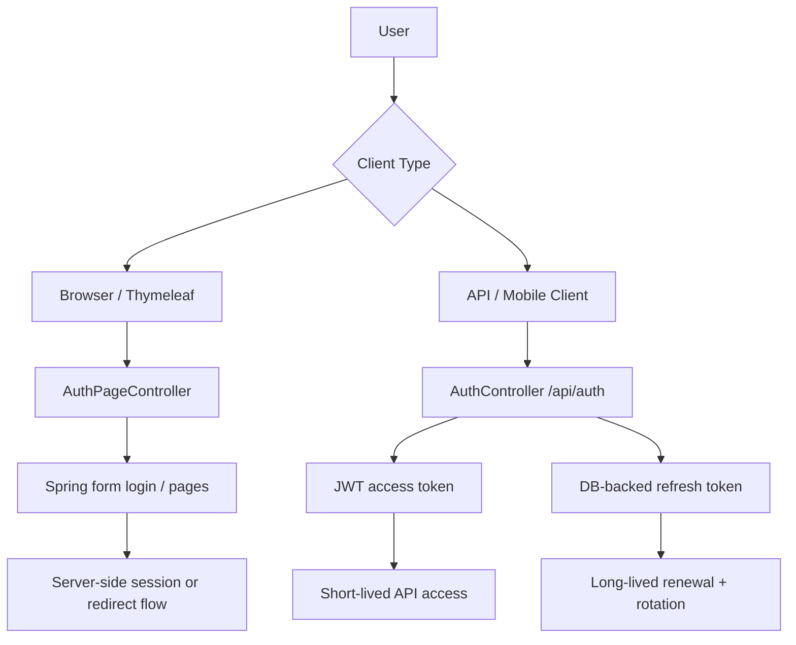
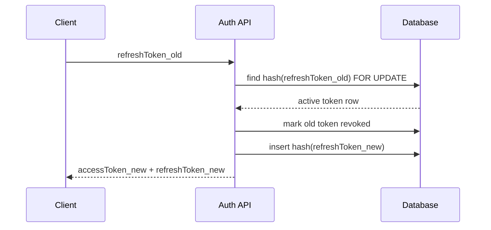
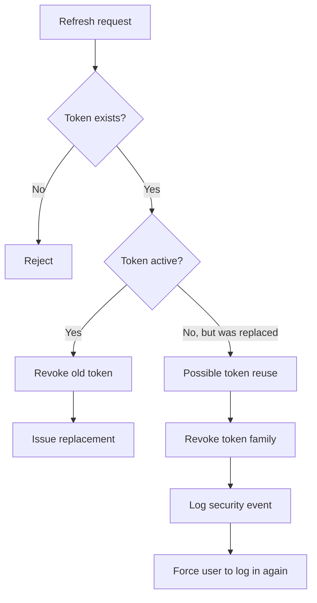

I inspected `auth.zip`. Your auth is around **70% production-ready**. The core is solid; the next goal is to **separate browser auth vs API/mobile auth cleanly, then harden abuse controls, token invalidation, and operational security**.

## First principles: what auth is doing

Authentication has four jobs:

1. **Identify** the user: username/email.
2. **Prove** the user owns the account: password, reset token, refresh token.
3. **Issue proof** for future requests: access token or server session.
4. **Limit damage** when proof leaks: expiry, rotation, revocation, rate limits, logging.

Your code currently has **two auth styles mixed together**:



That split is important. For **browser pages**, server-side sessions plus CSRF protection are usually simpler. For **mobile/API**, short-lived JWT access tokens plus refresh-token rotation make sense. OWASP treats bearer tokens as credentials where whoever possesses the token can use it, so they must be short-lived and carefully scoped; refresh tokens should be sender-constrained or rotated. ([OWASP Cheat Sheet Series][1])

---

## Your current flow

### 1. Register

Current code path:

```text
POST /api/auth/register
    -> AuthController.register()
    -> AuthService.register()
    -> normalize email + username
    -> check email availability
    -> check username availability
    -> fetch default USER role
    -> hash password
    -> create User
    -> create Profile
    -> issue access token + refresh token
```

Good: you hash passwords through `PasswordEncoder`, normalize input, handle DB race conditions with `DataIntegrityViolationException`, and create a default profile.

Production issue: you immediately mark the account as `active = true`. For production, you probably want:

```text
registered -> email_unverified -> active
```

Otherwise fake emails can create valid accounts.

---

### 2. Login

Current code path:

```text
POST /api/auth/login
    -> AuthenticationManager.authenticate(username, password)
    -> AuthService.recordSuccessfulLogin()
    -> JwtTokenService.issueTokens()
    -> return accessToken + refreshToken
```

The access token is a JWT. It contains:

```text
issuer
issuedAt
expiresAt
subject = username
uid = user id
roles = role
```

The refresh token is not stored raw. You generate a random token, hash it with SHA-256, store only the hash, then return the raw token once. That is good design.

Spring Security’s JWT resource-server support is built around validating bearer tokens through JWT decoding and issuer/key validation. Your zip did not include the `SecurityFilterChain`, `JwtDecoder`, or converter config, so I cannot verify the actual request-authentication layer from this upload alone. ([Home][2])

---

### 3. Normal API request

Expected production flow:

```text
GET /api/me
Authorization: Bearer <access-token>
    -> Spring Security filter validates JWT
    -> extracts subject/user id/roles
    -> controller runs as authenticated user
```

Access tokens should be short-lived because logout usually does **not** revoke already-issued JWTs unless you add server-side invalidation. Your default access-token TTL appears to be 15 minutes, which is reasonable.

---

### 4. Refresh token rotation

Current code path:

```text
POST /api/auth/refresh
    -> hash incoming refresh token
    -> DB lookup with pessimistic lock
    -> verify not expired/revoked
    -> revoke old refresh token
    -> create new refresh token
    -> issue new access token
```

This is one of the strongest parts of your design.



Production gap: you rotate refresh tokens, but you do **not fully detect token reuse families** yet. If an old rotated token is reused, that may mean theft. Production behavior should be:

```text
old refresh token reused
    -> revoke entire token family
    -> revoke all active refresh tokens for that user/device
    -> log security event
    -> optionally notify user
```

OWASP recommends refresh-token rotation as a mitigation for refresh-token theft/replay. ([OWASP Cheat Sheet Series][1])

---

### 5. Logout

Current code path:

```text
POST /api/auth/logout
    -> hash refresh token
    -> mark refresh token revoked
```

Good. But note this:

```text
logout revokes refresh token
logout does not immediately revoke existing access token
```

That is normal for stateless JWTs. The access token remains valid until it expires unless you add a denylist, token version, or `passwordChangedAt`/`sessionVersion` check.

---

### 6. Forgot/reset password

Current flow:

```text
POST /api/auth/forgot-password
    -> always return generic message
    -> lookup active user by email or username
    -> invalidate previous unused reset tokens
    -> generate random token
    -> store hash only
    -> email raw token link

POST /api/auth/reset-password
    -> hash submitted token
    -> DB lookup with pessimistic lock
    -> verify unused and unexpired
    -> hash new password
    -> mark reset token used
```

This is also mostly good. OWASP recommends consistent forgot-password messages, random long tokens, secure storage, single-use tokens, expiry, and rate-limiting for excessive reset attempts; your implementation covers most of that except rate limiting and timing uniformity. ([OWASP Cheat Sheet Series][3])

Production gap: after password reset, you should revoke all refresh tokens for that user and notify the user by email that the password was changed. OWASP also recommends notifying users after password reset. ([OWASP Cheat Sheet Series][3])

---

## What is already good

Your current auth has several production-grade instincts:

| Area                | Current state                                      |
| ------------------- | -------------------------------------------------- |
| Password storage    | Uses `PasswordEncoder`, not raw passwords          |
| Refresh tokens      | Random, high entropy, stored as hashes             |
| Refresh rotation    | Old refresh token revoked when new one is issued   |
| DB race safety      | Uses pessimistic locks for refresh/reset token use |
| Password reset      | Single-use, expiring, hashed token                 |
| Account enumeration | Forgot-password response is generic                |
| Layering            | Controllers mostly delegate to services            |

Session identifiers and token-like secrets should be generated with strong randomness and enough entropy; your 48-byte refresh tokens and 32-byte reset tokens are strong from an entropy perspective. ([OWASP Cheat Sheet Series][4])

---

## What I would improve first

### Priority 1: Split browser auth from API auth

Right now `AuthController` and `AuthPageController` live in the same `auth` package and represent two different products:

```text
Browser pages:
    /login
    /register
    /forgot-password
    /reset-password

API/mobile:
    /api/auth/register
    /api/auth/login
    /api/auth/refresh
    /api/auth/logout
```

Production structure I’d use:

```text
com.scubapal.identity.auth
├── api
│   ├── AuthApiController.java
│   ├── LoginRequest.java
│   ├── RegisterRequest.java
│   ├── RefreshTokenRequest.java
│   └── AuthResponse.java
├── web
│   ├── AuthPageController.java
│   ├── RegisterForm.java
│   ├── ForgotPasswordForm.java
│   └── ResetPasswordForm.java
├── token
│   ├── JwtTokenService.java
│   ├── RefreshToken.java
│   ├── RefreshTokenRepository.java
│   └── TokenHashing.java
├── passwordreset
│   ├── PasswordResetService.java
│   ├── PasswordResetToken.java
│   └── PasswordResetTokenRepository.java
└── AuthService.java
```

This makes the mental model cleaner: **web forms are not API contracts**.

---

### Priority 2: Add rate limiting

Add rate limits to:

```text
POST /api/auth/login
POST /api/auth/register
GET  /api/auth/username-available
POST /api/auth/forgot-password
POST /api/auth/reset-password
POST /api/auth/refresh
```

Use per-IP and per-username/email limits.

Example policy:

| Endpoint           | Limit                                  |
| ------------------ | -------------------------------------- |
| Login              | 5 attempts / minute / username + IP    |
| Forgot password    | 3 attempts / 15 minutes / account + IP |
| Reset password     | 5 attempts / 15 minutes / token/IP     |
| Register           | 5 attempts / hour / IP                 |
| Username available | Throttle heavily                       |

OWASP explicitly recommends protections such as rate limiting for forgot-password abuse. ([OWASP Cheat Sheet Series][3])

---

### Priority 3: Revoke sessions after password reset

In `PasswordResetService.resetPassword()`, after setting the new password, call something like:

```java
refreshTokenRepository.revokeActiveTokensForUser(
        user.getId(),
        now,
        "password-reset"
);
```

Better long-term: add this to `User`:

```java
private Instant passwordChangedAt;
private long tokenVersion;
```

Then include `tokenVersion` or `passwordChangedAt` in JWT claims. On sensitive requests, reject tokens older than the password change.

---

### Priority 4: Improve refresh-token reuse detection

Your `RefreshToken` has `replacedByTokenHash`, but not enough structure to revoke a whole token family.

Add fields:

```text
token_family_id
parent_token_hash
last_used_at
user_agent
device_name
created_by_ip
revoked_reason
```

Then the flow becomes:



That is the main difference between “rotation exists” and “rotation is production-grade.”

---

### Priority 5: Harden token storage per client

For **mobile**:

```text
access token: memory
refresh token: iOS Keychain / Android Keystore
```

For **browser SPA**:

```text
access token: memory only
refresh token: HttpOnly + Secure + SameSite cookie
```

Avoid storing refresh tokens in `localStorage`. If XSS happens, `localStorage` is easy to steal. If you use cookies for refresh tokens, then configure CSRF protection carefully.

For **Thymeleaf server-rendered pages**, I would not use JWTs at all. Use Spring Security sessions, secure cookies, and CSRF.

OWASP says authenticated pages and login flows must be protected by TLS, and sensitive changes should require re-authentication/current credentials. ([OWASP Cheat Sheet Series][5])

---

### Priority 6: Validate JWT secret and consider asymmetric keys

Your `JwtProperties` gives defaults for issuer and TTL, but does not validate `secret`.

At minimum:

```text
secret must exist in prod
secret must be at least 256 bits for HS256
secret must come from env/secret manager
secret must not have a dev default in prod
```

For a monolith, HS256 can be okay. For a system that may grow into multiple services, prefer:

```text
RS256 / EdDSA
private key signs tokens
public key verifies tokens
key id / kid for rotation
JWKS endpoint eventually
```

Spring Security’s resource-server JWT support is designed around issuer and key-based validation for bearer tokens. ([Home][2])

---

## Blunt production-readiness verdict

Your current auth is **better than most beginner Spring Boot auth implementations**.

But it is not fully production-ready until you add:

```text
[ ] SecurityFilterChain verification for API vs web routes
[ ] CSRF enabled for web forms
[ ] Rate limiting on auth endpoints
[ ] Email verification
[ ] Refresh-token family reuse detection
[ ] Revoke refresh tokens after password reset
[ ] Security event logging
[ ] Proper JWT secret/key validation
[ ] HttpOnly cookie strategy for browser refresh tokens
[ ] Consistent exception mapping: 400 vs 401 vs 403
[ ] Expired token cleanup job
[ ] Tests for concurrent refresh and reset-token reuse
```

## Next goal

Move from **70% → 80%** by doing these three changes first:

1. Split packages into `api`, `web`, `token`, and `passwordreset`.
2. Add rate limiting to login/register/forgot/reset/refresh.
3. Revoke all refresh tokens after password reset.

That gives you the biggest production-readiness jump without redesigning the whole module.

[1]: https://cheatsheetseries.owasp.org/cheatsheets/OAuth2_Cheat_Sheet.html "OAuth2 - OWASP Cheat Sheet Series"
[2]: https://docs.spring.io/spring-security/reference/servlet/oauth2/resource-server/jwt.html "OAuth 2.0 Resource Server JWT :: Spring Security"
[3]: https://cheatsheetseries.owasp.org/cheatsheets/Forgot_Password_Cheat_Sheet.html "Forgot Password - OWASP Cheat Sheet Series"
[4]: https://cheatsheetseries.owasp.org/cheatsheets/Session_Management_Cheat_Sheet.html "Session Management - OWASP Cheat Sheet Series"
[5]: https://cheatsheetseries.owasp.org/cheatsheets/Authentication_Cheat_Sheet.html "Authentication - OWASP Cheat Sheet Series"
