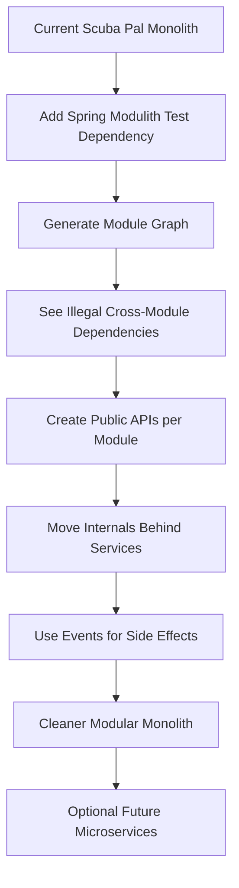

Yes — **Spring Modulith fits your app**, but I would **not** drop it in as a magic architecture fix yet.

Your current backend is already shaped like a modular monolith: main app package is `com.scubapal` , and the code naturally splits into top-level business areas like `identity`, `social`, `dive`, `messaging`, `notification`, `media`, `learn`, `admin`, `shared`, and `catalog` based on the repository search results      . Spring Modulith’s default model maps well to this because it treats each **direct subpackage below the main application package** as an application module. ([Home][1])

But your current package boundaries are **not yet strict Modulith boundaries**.

The biggest issue is that many modules depend directly on `identity` internals and repositories. For example, `PostService` imports `ProfileRepository`, `User`, and `UserRepository` from `identity`, plus `MediaStorageService` from `media` . `FollowService` depends on identity repositories, identity views, media, and notification service . `MessagingService` depends on identity repositories, profile entities, messaging repositories, and `NotificationService` . `NotificationService` also depends directly on `User` and `UserRepository` .

That means if you enable strict Spring Modulith verification today, it will likely expose boundary violations because subpackages like `identity.user`, `identity.profile`, `social.post`, and `notification` are being used as if everything is public. In Modulith, a module’s root package is its API surface, while subpackages are considered internal unless you explicitly expose them through named interfaces or open modules. ([Home][1])

My recommendation: **yes, use Spring Modulith, but start with verification + documentation first. Do not restructure everything immediately.**

Progress: **65% architecture maturity**
Next goal: **make module boundaries explicit before adding more features.**



The most valuable first step is this:

```java
class ModularityTests {

    @Test
    void verifiesModularStructure() {
        ApplicationModules.of(ScubaPalApplication.class).verify();
    }
}
```

Spring Modulith verification checks for module cycles, illegal access to internal packages, and optional allowed dependency rules. ([Home][2])

For your app, I would define these as real modules:

```text
com.scubapal.identity
com.scubapal.social
com.scubapal.messaging
com.scubapal.notification
com.scubapal.dive
com.scubapal.media
com.scubapal.learn
com.scubapal.admin
com.scubapal.catalog
com.scubapal.shared
```

But then each module needs a **public surface**. For example, other modules should not keep reaching into `identity.user.UserRepository`. Instead, expose something like:

```java
package com.scubapal.identity;

public interface IdentityUsers {
    UserSummary requireUserByUsername(String username);
    UserSummary requireUserById(Long id);
}
```

Then `social`, `messaging`, and `notification` depend on `IdentityUsers`, not `UserRepository`.

The same applies to notifications. Right now, `FollowService` calls `notificationService.createForUser(...)` directly after saving a follow , and `MessagingService` calls `notificationService.createForUser(...)` after saving a message . That works, but it creates direct module coupling. The more Modulith-style version is:

```java
public record UserFollowedEvent(Long followerUserId, Long followedUserId) {}
public record MessageSentEvent(Long senderUserId, Long receiverUserId, Long conversationId) {}
```

Then `social` publishes `UserFollowedEvent`, `messaging` publishes `MessageSentEvent`, and `notification` listens. Spring Modulith explicitly encourages application events as the primary way to decouple modules. ([Home][3])

For your project, the order should be:

1. **Add Spring Modulith only to tests first.**
2. **Run module verification and generate the module diagram.**
3. **Do not make modules open unless temporarily necessary.**
4. **Create public module facades:** `IdentityUsers`, `NotificationCommands`, `MediaUrls`, etc.
5. **Move repository/entity access behind the owning module.**
6. **Use events for side effects like notifications.**

Spring Modulith can also generate C4/UML module diagrams and module canvases, which fits your documentation style well. ([Home][4])

Final judgment: **use it.** Your app is exactly the kind of Spring Boot monolith that benefits from it. But use it as an **architecture guardrail**, not as a new framework layer. The win is not “more code.” The win is that your app stops silently becoming a ball of services where every module imports every other module’s repositories and entities.

[1]: https://docs.spring.io/spring-modulith/reference/fundamentals.html "Fundamentals :: Spring Modulith"
[2]: https://docs.spring.io/spring-modulith/reference/verification.html "Verifying Application Module Structure :: Spring Modulith"
[3]: https://docs.spring.io/spring-modulith/reference/events.html "Working with Application Events :: Spring Modulith"
[4]: https://docs.spring.io/spring-modulith/reference/documentation.html "Documenting Application Modules :: Spring Modulith"
