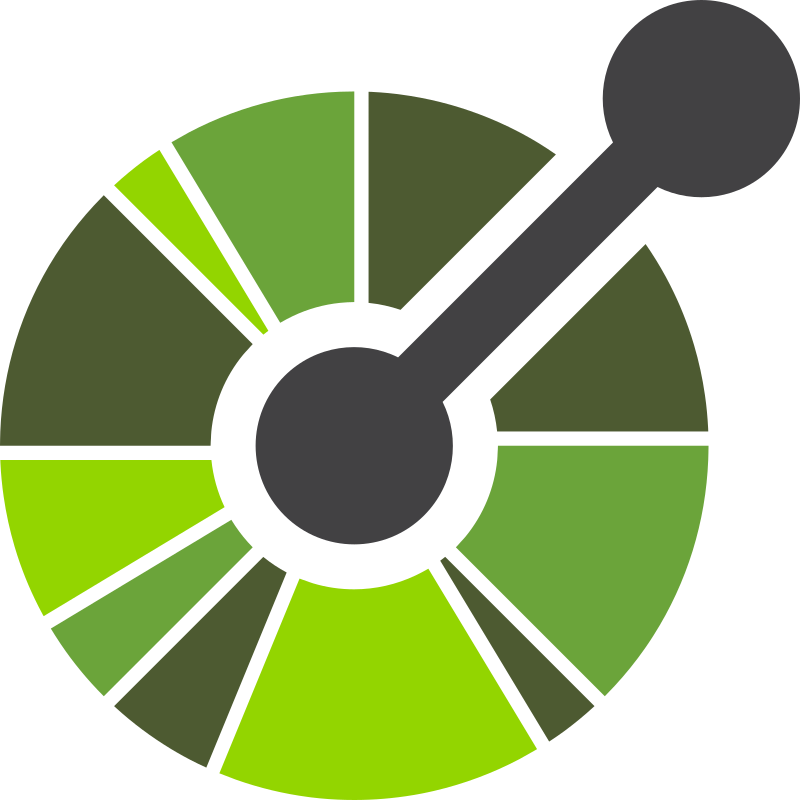

## Tools

  
  

Need RDS and Flyway

  
  
  
  

[Visual VM]](https://visualvm.github.io)

|   Domain    |                                                              Name                                                               |
| :---------: | :-----------------------------------------------------------------------------------------------------------------------------: |
|     IDE     |                                                        vscode, DataGrip                                                         |
|     API     |                         Postman, [OpenAPI Generator](https://github.com/openapitools/openapi-generator)                         |
| Generators  |                             [OpenAPI Generator](https://github.com/openapitools/openapi-generator)                              |
|    UI/UX    |                                                 [Figma](https://www.figma.com)                                                  |
|  Database   |                                                  dbdiagram, pgAdmin, DataGrip                                                   |
|   Backend   |              Profiling - [VisualVM](https://visualvm.github.io), Generator - [JHipster](https://www.jhipster.tech)              |
| Diagramming | MermaidJS, UML Generator, [Graphviz](https://graphviz.org), [PlantUML](https://plantuml.com), [DBDiagram](https://dbdiagram.io) |

## Backend

| Domain     | Framework                                                                                                              |
| ---------- | ---------------------------------------------------------------------------------------------------------------------- |
| Auth       | Spring Security, Validation                                                                                            |
| Database   | Spring Data JPA (ORM), PostgreSQL, [AWS RDS](https://aws.amazon.com/rds), Flyway migrations                            |
| Storage    | [AWS S3](https://aws.amazon.com/s3)                                                                                    |
| API        | [Spring Doc](https://springdoc.org/#google_vignette), Postman                                                          |
| Mailing    | Spring Mail, Mailpit, [AWS SES](https://aws.amazon.com/s/idc-server-side-test/awswt-938-new-template-ses/control-ses/) |
| Automation | GitHub Workflows, Fastlane                                                                                             |
| Deployment | [AWS EKS](https://aws.amazon.com/eks)                                                                                  |
| Profiling  | [VisualVM](https://visualvm.github.io)                                                                                 |
| Generator  | [JHipster](https://www.jhipster.tech)                                                                                  |

