For Scuba Pal, “all this” becomes your **Architecture Contract**: the human-readable and machine-readable truth that code must follow. Your current repo truth is: root repo `scuba-pal`, backend in `app` with Java Spring Boot + Thymeleaf using Java 25, mobile in `mobile` with React Native Expo, and generated mobile API client in `mobile/src/api/generated` after OpenAPI updates. 

Progress: **45% — Scuba Pal source-of-truth map drafted**
Next goal: create `docs/architecture/00-product-brief.md` through `06-api-tree.md` first.

---

# Scuba Pal source-of-truth stack

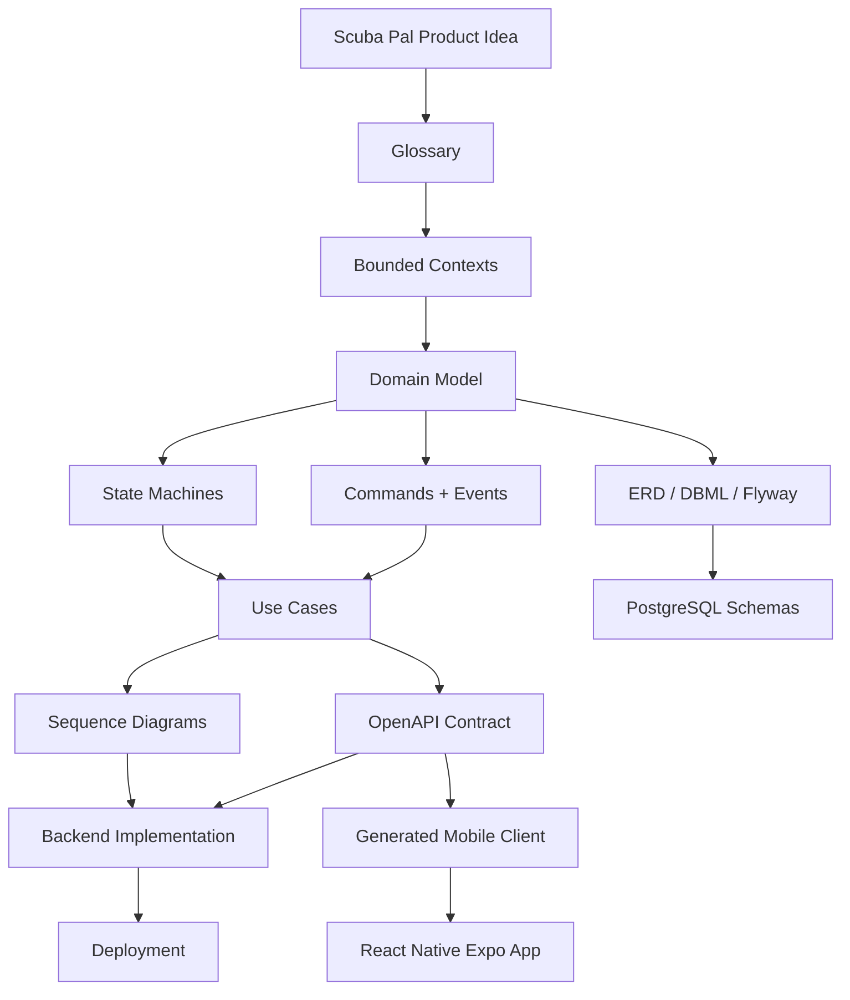

The important rule from your architecture template is: diagrams are not random drawings; they are views over deeper truth like domain model, state model, contracts, data model, and decisions. 

---

# 1. Product brief

```md
# Scuba Pal Product Brief

System:
Scuba Pal

Goal:
A social platform for scuba divers to create profiles, share posts, discover dive locations,
follow other divers, message each other, receive notifications, and learn through dive content.

Primary actors:
- Guest
- Diver/User
- Admin
- System Worker
- Email Provider
- Object Storage Provider

Core domains:
- Identity
- Profiles
- Social Posts
- Follows
- Messaging
- Notifications
- Dive Locations
- Dive Shops
- Learn Content
- Media Uploads
- Admin
```

---

# 2. Glossary

| Term          | Meaning                                                  |
| ------------- | -------------------------------------------------------- |
| User          | Authenticated account holder.                            |
| Profile       | Public diver-facing identity: bio, image, diver details. |
| Post          | Social content created by a user.                        |
| Comment       | Reply attached to a post.                                |
| Follow        | Relationship where one user follows another.             |
| Feed          | Ordered collection of posts relevant to a user.          |
| Conversation  | Messaging thread between users.                          |
| Message       | Individual text payload inside a conversation.           |
| Notification  | User-visible system alert.                               |
| Dive Location | Place where divers can dive.                             |
| Dive Shop     | Business/resource related to diving.                     |
| Learn Article | Educational scuba content.                               |
| Media Object  | Uploaded image/file stored in object storage.            |
| Admin         | User with elevated system-management permissions.        |

Golden rule:

> If Scuba Pal has a noun, it should appear in the glossary, domain model, ERD, API tree, screen map, permissions, and tests.

---

# 3. Actors

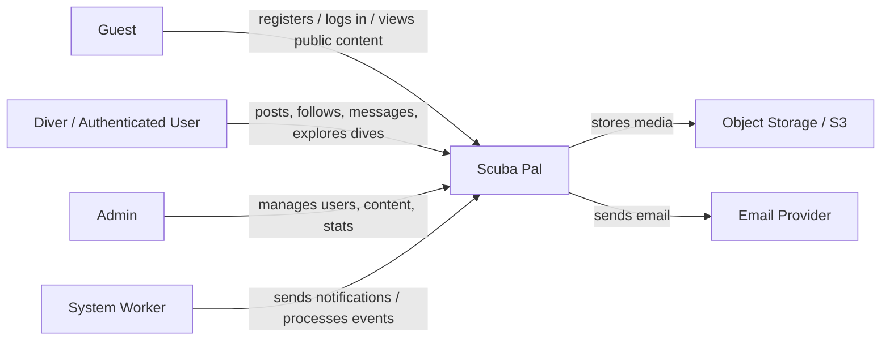

---

# 4. Bounded contexts

For Scuba Pal, these are your clean module boundaries.

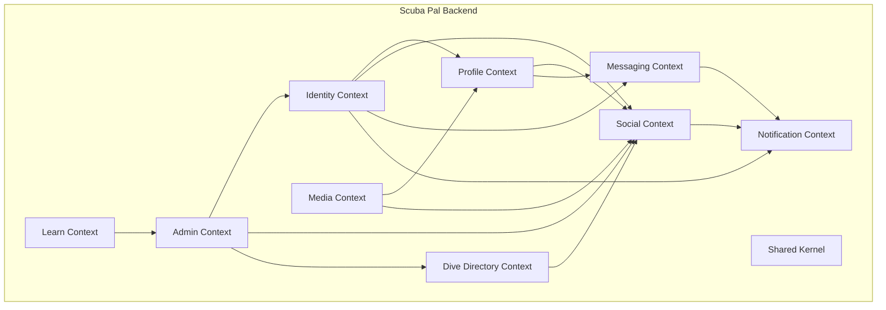

**Interpretation:**

| Context      | Owns                                                           |
| ------------ | -------------------------------------------------------------- |
| Identity     | users, credentials, roles, login, registration, password reset |
| Profile      | diver profile, bio, avatar, public user identity               |
| Social       | posts, comments, follows, feed                                 |
| Messaging    | conversations, messages, unread counts                         |
| Notification | notifications and read/unread lifecycle                        |
| Dive         | dive locations, dive shops, map/search/filter                  |
| Learn        | educational articles                                           |
| Media        | presigned uploads, object keys, image metadata                 |
| Admin        | stats, moderation, management                                  |
| Shared       | exceptions, security helpers, config, base types               |

---

# 5. Domain model

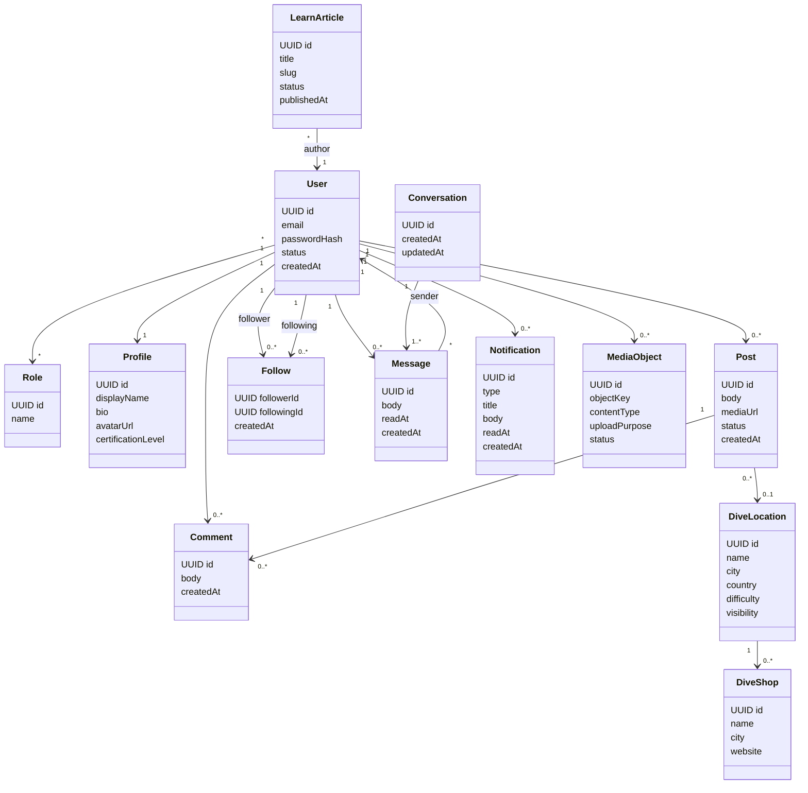

---

# 6. ERD / database model

This is the rough Scuba Pal ERD. Your actual source should eventually become `database/schema.dbml` plus Flyway migrations.

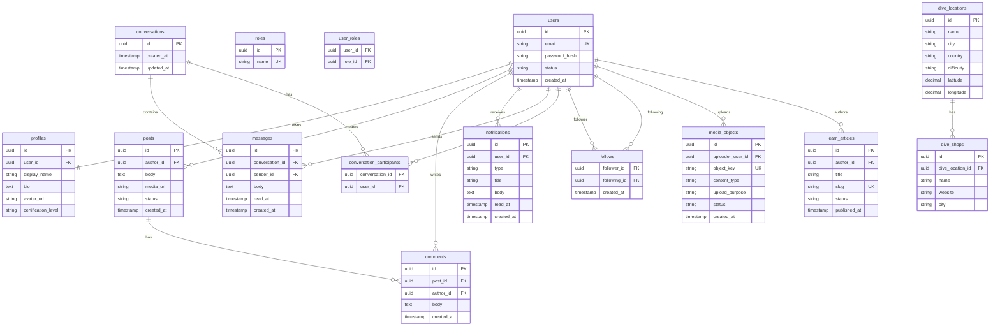

---

# 7. State machines

## User lifecycle

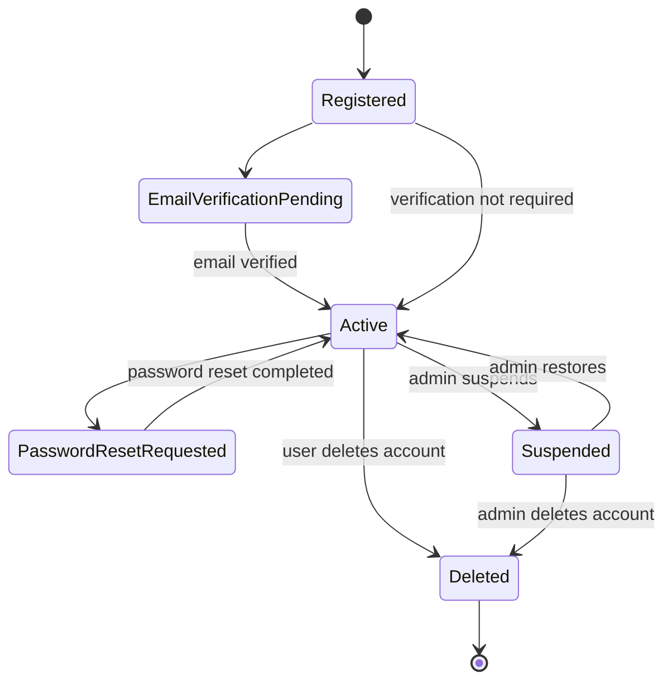

## Post lifecycle

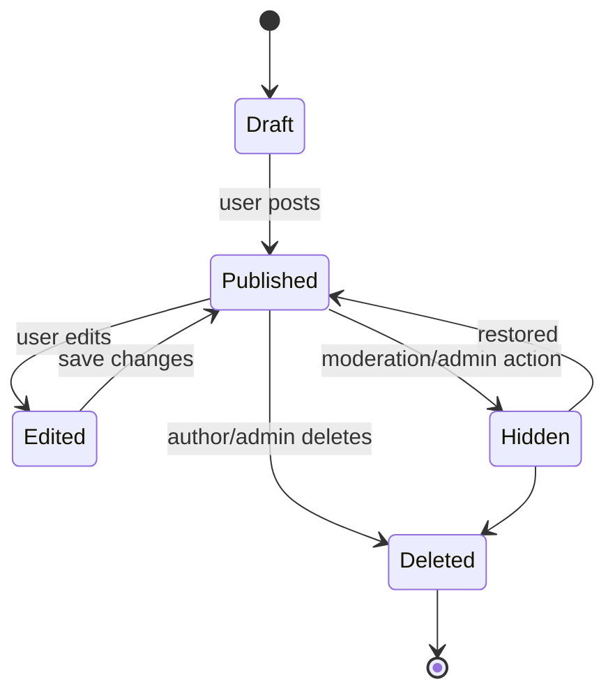

## Media upload lifecycle

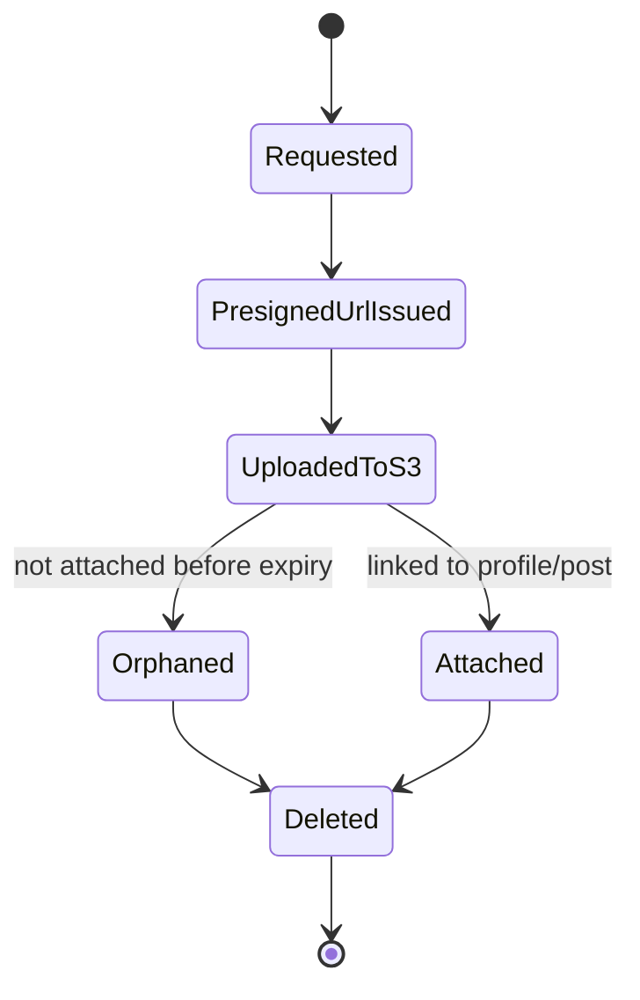

## Message lifecycle

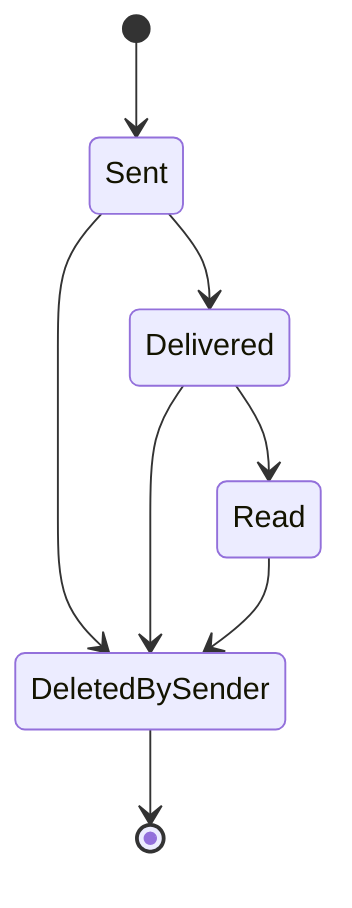

## Notification lifecycle

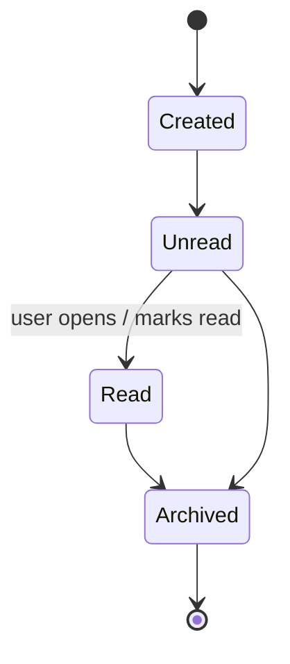

---

# 8. Use cases

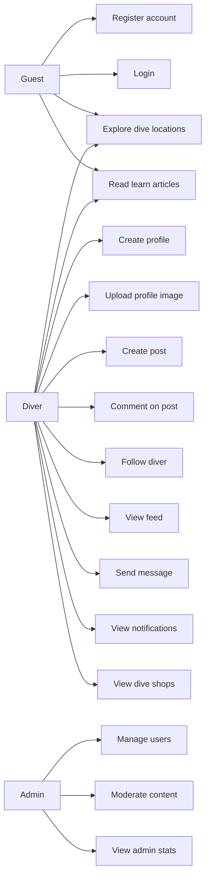

---

# 9. API tree

OpenAPI should be the machine-readable truth. That matters extra for you because your mobile client is generated from backend OpenAPI into `mobile/src/api/generated`. 

```mermaid
flowchart TD
    API[/api/v1/]

    API --> Auth[/auth/]
    Auth --> Register[POST /auth/register]
    Auth --> Login[POST /auth/login]
    Auth --> Logout[POST /auth/logout]
    Auth --> Forgot[POST /auth/forgot-password]
    Auth --> Reset[POST /auth/reset-password]

    API --> Me[/me/]
    Me --> GetMe[GET /me]
    Me --> UpdateMe[PATCH /me]

    API --> Profiles[/profiles/]
    Profiles --> GetProfile[GET /profiles/{userId}]
    Profiles --> UpdateProfile[PATCH /profiles/me]

    API --> Posts[/posts/]
    Posts --> ListPosts[GET /posts]
    Posts --> CreatePost[POST /posts]
    Posts --> GetPost[GET /posts/{postId}]
    Posts --> UpdatePost[PATCH /posts/{postId}]
    Posts --> DeletePost[DELETE /posts/{postId}]

    API --> Feed[/feed/]
    Feed --> GetFeed[GET /feed]

    API --> Comments[/posts/{postId}/comments/]
    Comments --> CreateComment[POST /posts/{postId}/comments]
    Comments --> DeleteComment[DELETE /posts/{postId}/comments/{commentId}]

    API --> Follows[/follows/]
    Follows --> Follow[POST /follows/{userId}]
    Follows --> Unfollow[DELETE /follows/{userId}]
    Follows --> Followers[GET /users/{userId}/followers]
    Follows --> Following[GET /users/{userId}/following]

    API --> Messaging[/messaging/]
    Messaging --> Conversations[GET /messaging/conversations]
    Messaging --> CreateConversation[POST /messaging/conversations]
    Messaging --> GetMessages[GET /messaging/conversations/{conversationId}/messages]
    Messaging --> SendMessage[POST /messaging/conversations/{conversationId}/messages]

    API --> Notifications[/notifications/]
    Notifications --> ListNotifications[GET /notifications]
    Notifications --> MarkRead[POST /notifications/{notificationId}/read]

    API --> DiveLocations[/dive-locations/]
    DiveLocations --> ListLocations[GET /dive-locations]
    DiveLocations --> GetLocation[GET /dive-locations/{locationId}]

    API --> DiveShops[/dive-shops/]
    DiveShops --> ListShops[GET /dive-shops]
    DiveShops --> GetShop[GET /dive-shops/{shopId}]

    API --> Media[/media/]
    Media --> Presign[POST /media/presigned-upload]
    Media --> Attach[POST /media/{mediaId}/attach]

    API --> Learn[/learn/]
    Learn --> ListArticles[GET /learn/articles]
    Learn --> GetArticle[GET /learn/articles/{slug}]

    API --> Admin[/admin/]
    Admin --> Stats[GET /admin/stats]
    Admin --> Users[GET /admin/users]
```

---

# 10. Event catalog

| Event                    | Meaning                      | Producer     | Consumers                    |
| ------------------------ | ---------------------------- | ------------ | ---------------------------- |
| `UserRegistered`         | New user account created     | Identity     | Notification, Analytics      |
| `PasswordResetRequested` | User requested reset         | Identity     | Email                        |
| `ProfileUpdated`         | User changed profile         | Profile      | Feed/Search cache            |
| `MediaUploadRequested`   | Presigned upload started     | Media        | Audit/cleanup worker         |
| `MediaAttached`          | Media linked to post/profile | Media        | Social/Profile               |
| `PostCreated`            | User created post            | Social       | Feed, Notification           |
| `PostCommented`          | User commented on post       | Social       | Notification                 |
| `UserFollowed`           | User followed another user   | Social       | Notification                 |
| `ConversationCreated`    | New message thread opened    | Messaging    | Notification                 |
| `MessageSent`            | Message created              | Messaging    | Notification, unread counter |
| `NotificationRead`       | User read notification       | Notification | Analytics                    |
| `DiveLocationCreated`    | New location added           | Dive         | Search/Map index             |
| `LearnArticlePublished`  | Article became public        | Learn        | Feed/Notification optional   |

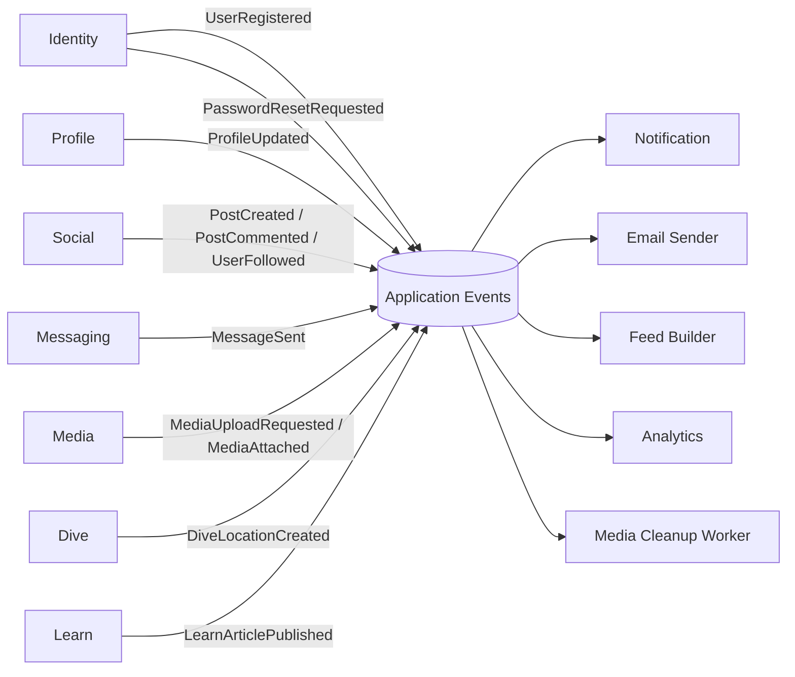

For now this can be Spring application events. Later it can become RabbitMQ/Kafka if Scuba Pal grows.

---

# 11. Permission matrix

| Action                   | Guest | User | Admin |
| ------------------------ | ----: | ---: | ----: |
| View public landing page |   Yes |  Yes |   Yes |
| Register                 |   Yes |   No |    No |
| Login                    |   Yes |   No |    No |
| View public profiles     |   Yes |  Yes |   Yes |
| Edit own profile         |    No |  Yes |   Yes |
| Create post              |    No |  Yes |   Yes |
| Edit own post            |    No |  Yes |   Yes |
| Delete own post          |    No |  Yes |   Yes |
| Delete any post          |    No |   No |   Yes |
| Comment                  |    No |  Yes |   Yes |
| Follow user              |    No |  Yes |   Yes |
| Message user             |    No |  Yes |   Yes |
| View own conversations   |    No |  Yes |   Yes |
| View notifications       |    No |  Yes |   Yes |
| Explore dive locations   |   Yes |  Yes |   Yes |
| Manage dive locations    |    No |   No |   Yes |
| Manage learn articles    |    No |   No |   Yes |
| View admin stats         |    No |   No |   Yes |

---

# 12. Screen map

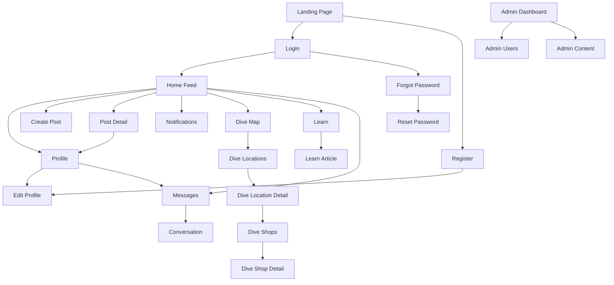

---

# 13. System architecture

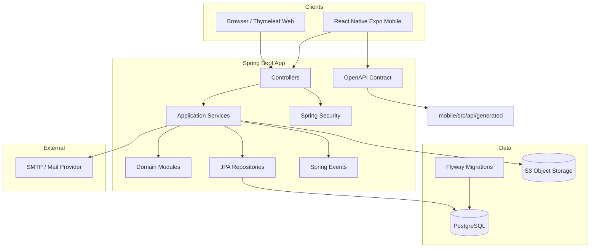

This should stay a **modular monolith** first. You do not need microservices yet. Your modules should be clean enough that future extraction is possible, but the deployable should remain simple.

---

# 14. Deployment diagram

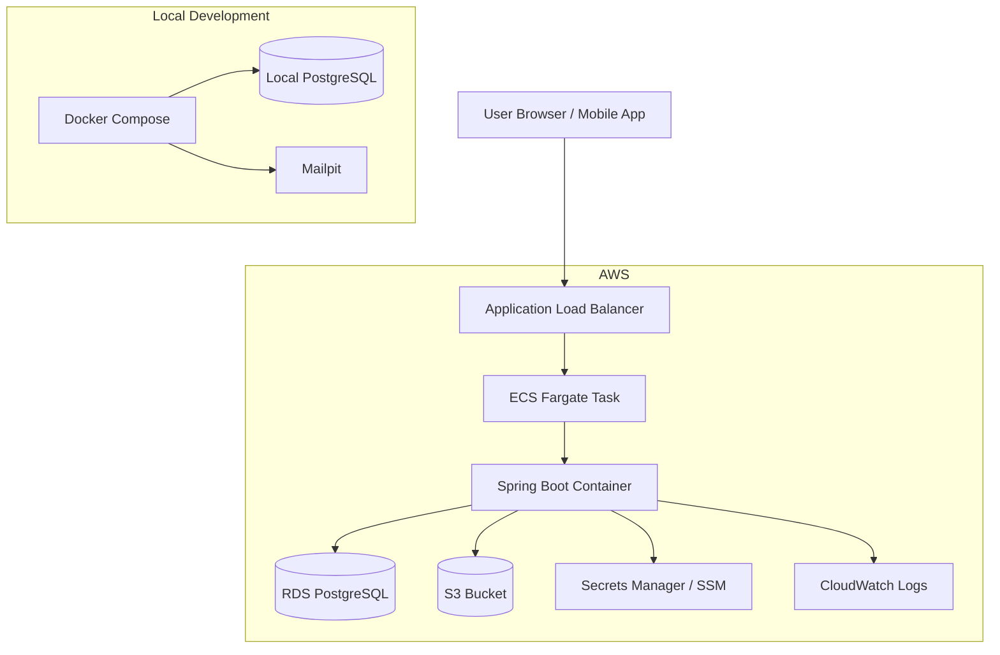

---

# 15. Recommended Scuba Pal docs structure

```text
scuba-pal/
  app/
    src/
    pom.xml

  mobile/
    src/
      api/
        generated/

  docs/
    architecture/
      00-product-brief.md
      01-glossary.md
      02-actors.md
      03-context-map.md
      04-domain-model.md
      05-erd.md
      06-state-machines.md
      07-use-cases.md
      08-sequence-diagrams.md
      09-api-tree.md
      10-event-catalog.md
      11-permissions.md
      12-screen-map.md
      13-system-architecture.md
      14-deployment.md
      15-observability.md
      16-risks.md
      adr/
        ADR-001-use-modular-monolith.md
        ADR-002-use-postgresql.md
        ADR-003-use-openapi-for-mobile-client.md
        ADR-004-use-s3-presigned-uploads.md
        ADR-005-use-react-native-expo-for-mobile.md

  contracts/
    openapi.yaml
    asyncapi.yaml

  database/
    schema.dbml
    migrations/

  diagrams/
    context-map.mmd
    domain-model.mmd
    erd.mmd
    user-state-machine.mmd
    post-state-machine.mmd
    message-sequence.mmd
    media-upload-sequence.mmd
```

Your uploaded architecture template recommends this exact kind of separation: architecture docs, machine-readable contracts, database schema, migrations, and diagrams. 

---

# The minimum Scuba Pal source of truth

Do these first:

```text
00-product-brief.md
01-glossary.md
02-context-map.md
03-domain-model.md
04-erd.md
05-state-machines.md
06-api-tree.md
```

After that, add:

```text
07-sequence-diagrams.md
08-event-catalog.md
09-permissions.md
10-screen-map.md
```

Then implementation becomes much easier because every file answers one question:

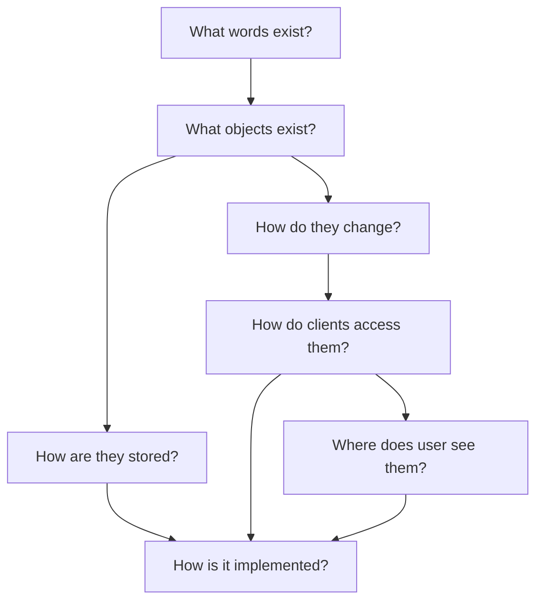

# Best next move

Create `docs/architecture/01-glossary.md` and lock the nouns first:

```text
User
Profile
Post
Comment
Follow
Feed
Conversation
Message
Notification
DiveLocation
DiveShop
LearnArticle
MediaObject
Admin
```

Once those are stable, Scuba Pal stops feeling like “many folders and features” and starts feeling like one coherent system.
