Below is the **Scuba Pal architecture map** as a clean “current + production-ready direction” set of Mermaid diagrams.

I’m grounding this in your project note: root repo is `scuba-pal`, backend is `app` using Java Spring Boot + Thymeleaf, mobile is `mobile` using React Native Expo, and backend OpenAPI updates generate the mobile client into `mobile/src/api/generated`. fileciteturn2file0 Your local deployment checkpoint already proved Docker, container startup, PostgreSQL, Flyway/JPA, S3 config, Mailpit config, Spring Security health access, liveness, readiness, and overall health. fileciteturn2file1

Progress: **85% architecture mapped**.  
Next goal: turn these into `/docs/architecture/*.mdx` pages and keep each diagram close to the code module it explains.

---

# 1. Whole Scuba Pal system architecture

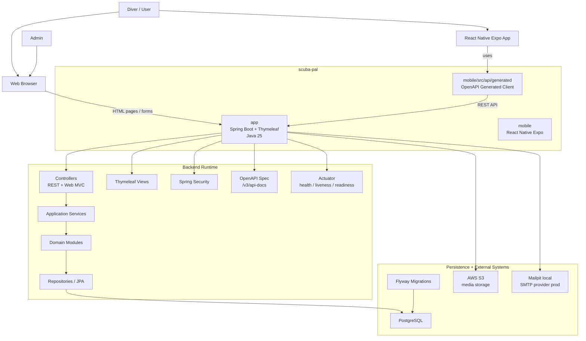

---

# 2. Repository / codebase architecture

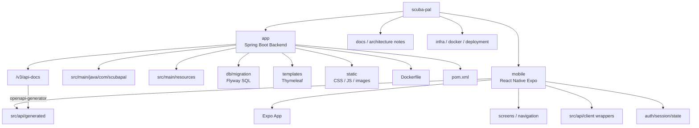

Core idea: **backend owns the contract**, mobile consumes the generated client. Do not hand-write duplicated API types in mobile unless you are wrapping generated calls into cleaner app-specific hooks/services.

---

# 3. Backend modular monolith architecture

This is the best fit right now. You get clean boundaries without paying microservice complexity too early.

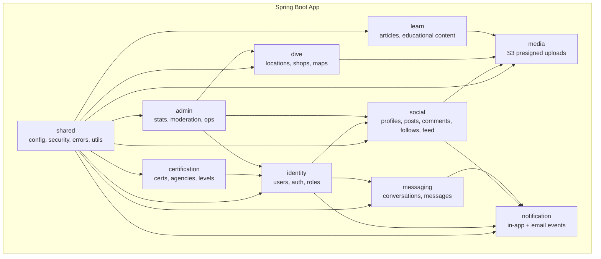

Rule of thumb: each module should have its own:

```text
controller
service
repository
entity
dto
mapper
event
```

But do not force every folder if the module is tiny. Grow structure from actual complexity.

---

# 4. Backend request lifecycle

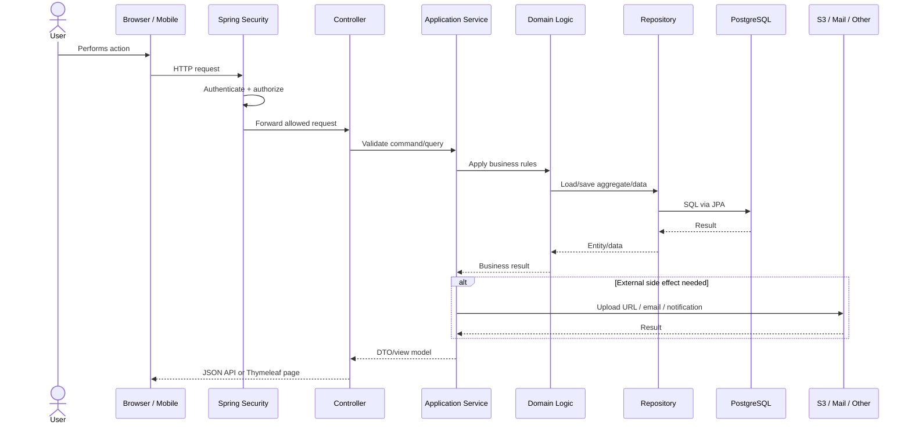

The big production principle: controllers should stay thin. The **service layer owns workflows**, and the **domain/module layer owns business rules**.

---

# 5. Web + mobile API boundary

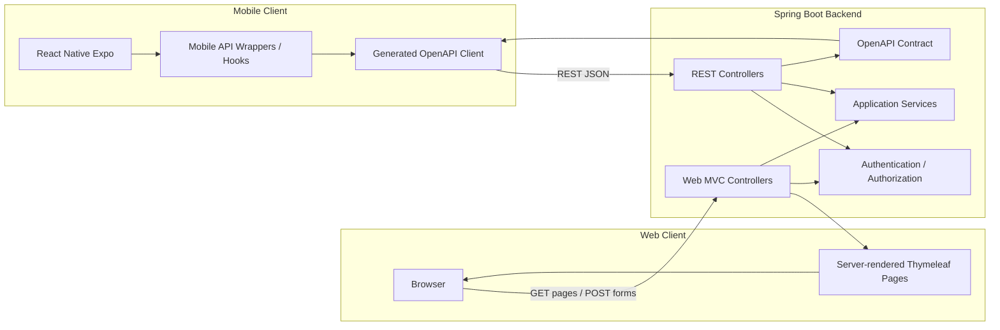

Long-term clean rule:

```text
Web controllers = page rendering
REST controllers = API contract
Services = shared business workflows
```

That keeps your Thymeleaf web app and mobile app from drifting into two different products.

---

# 6. Authentication architecture

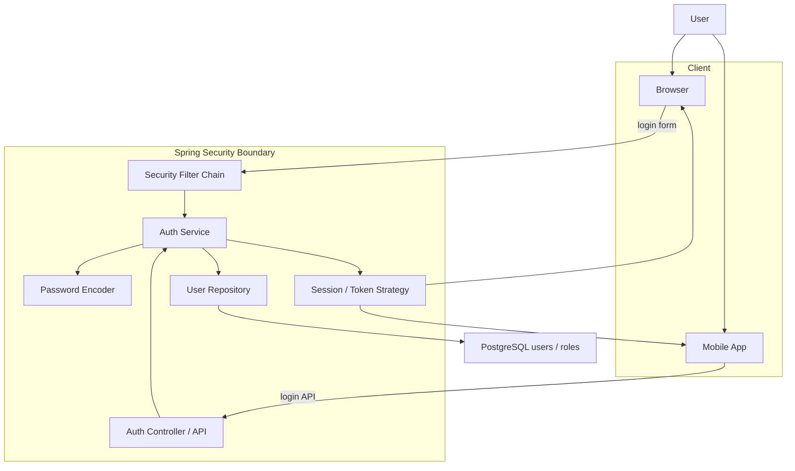

Important: do **not** casually add JWT unless you need stateless auth across multiple backend instances or external clients. For now:

```text
Web: session cookie is natural.
Mobile: use the backend's explicit auth contract.
Production later: choose either session-backed API auth or token auth intentionally.
```

---

# 7. OpenAPI generation lifecycle

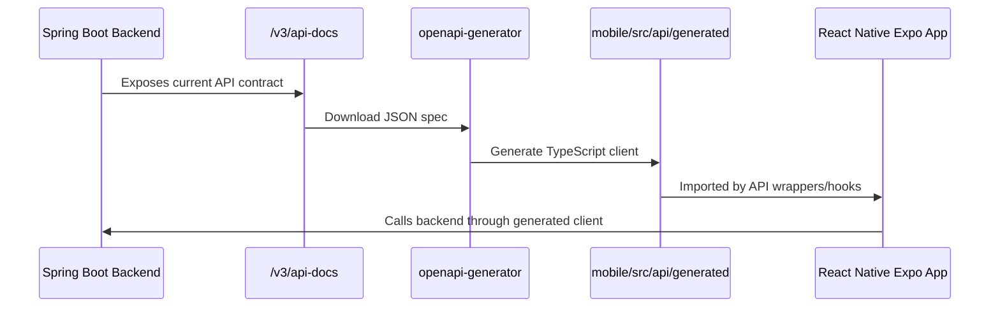

This is one of your strongest architectural decisions. It prevents this common failure:

```text
Backend changes endpoint
Mobile silently keeps old request shape
Runtime breaks later
```

Generated clients make API drift visible earlier.

---

# 8. Media upload architecture with S3

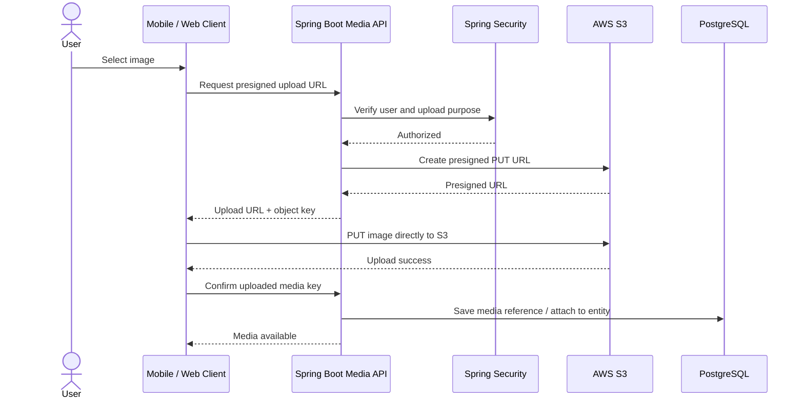

Why this is good:

```text
Client uploads large file directly to S3.
Backend controls authorization and object keys.
Database stores references, not image bytes.
```

---

# 9. Social/feed architecture

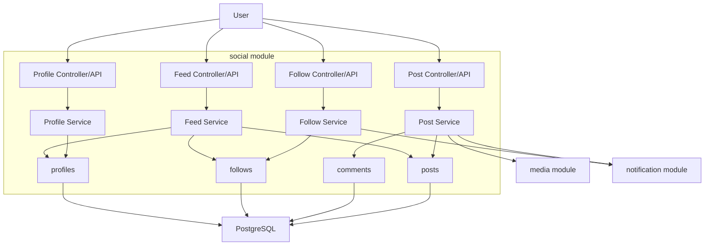

Feed can start simple:

```text
Query posts from followed users + own posts + recent public posts.
```

Later, once traffic grows:

```text
Precomputed feed table
Event-driven fanout
Ranking service
Caching layer
```

Do not start with a complex feed system until the simple one is painful.

---

# 10. Messaging + notification architecture

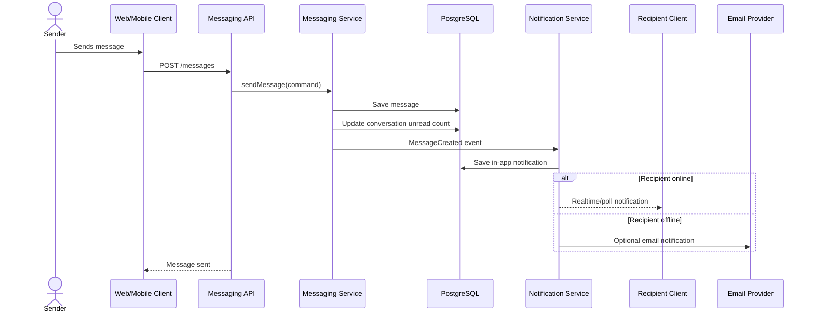

Current simple version:

```text
Persist messages.
Expose unread counts.
Mobile/web polls or refreshes.
```

Production evolution:

```text
Domain event -> queue -> notification worker -> push/email/websocket.
```

---

# 11. Event-driven production direction

This is the **future shape**, not something you need to split into microservices yet.

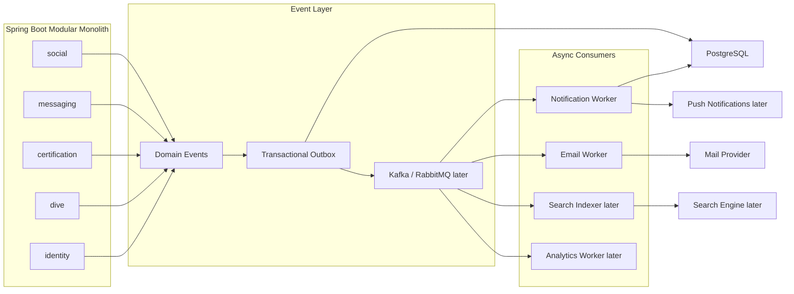

Best long-term sequence:

```text
1. Start with in-process Spring events.
2. Add transactional outbox table.
3. Add background publisher.
4. Add RabbitMQ/Kafka only when async pressure is real.
5. Split services only after module boundaries are stable.
```

---

# 12. Database bounded-context architecture

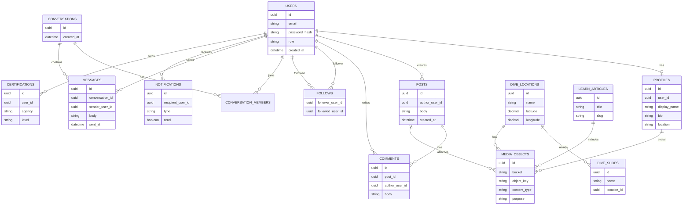

This is not meant to be a perfect database dump. It is the **mental model** for how the system hangs together.

---

# 13. Local development architecture

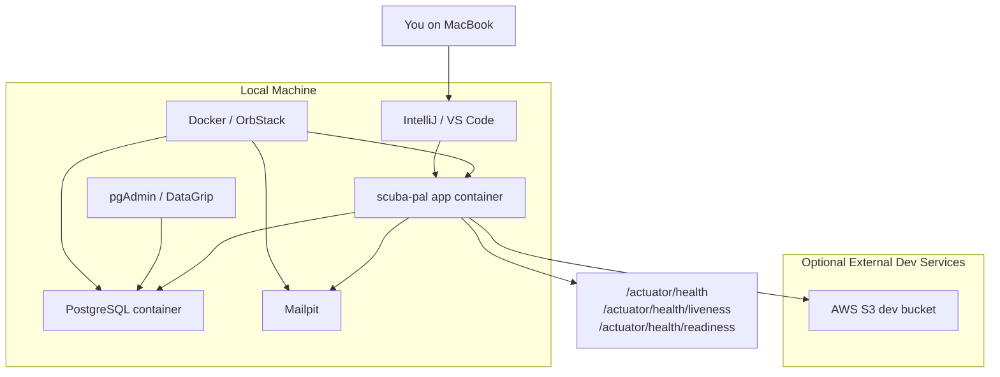

Your local checkpoint is strong because it proves the app does not just compile; it boots with infrastructure dependencies.

---

# 14. AWS deployment architecture target

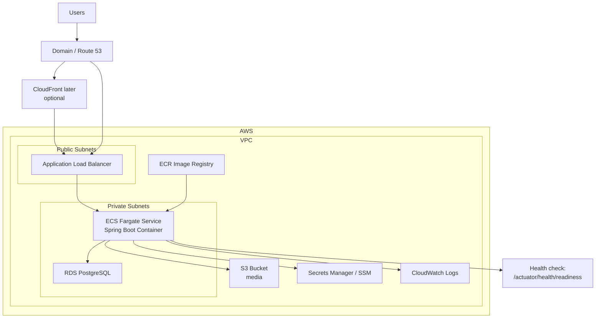

Production deployment order:

```text
1. Build Docker image.
2. Push image to ECR.
3. ECS task pulls image.
4. ECS injects secrets/env vars.
5. App connects to RDS + S3.
6. ALB routes traffic only to healthy readiness endpoint.
```

---

# 15. Final clean architecture mental model

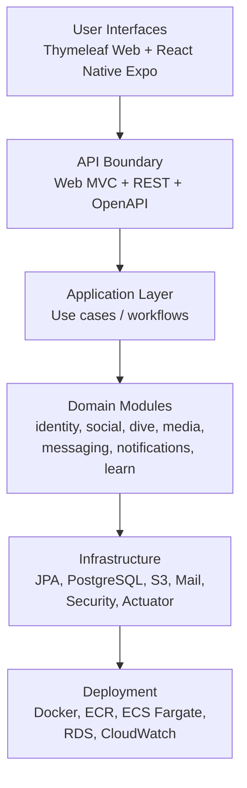

The key idea:

```text
Scuba Pal should stay a modular monolith until its modules are stable.
The backend owns the product rules.
OpenAPI keeps mobile aligned.
PostgreSQL is the system of record.
S3 owns media bytes.
Events should begin inside the monolith before becoming queues.
```

Next best goal: **create `docs/architecture/index.mdx` and paste diagrams 1, 2, 3, 5, 8, 11, and 14 first.** Those give you the strongest architecture documentation without overwhelming the reader.
