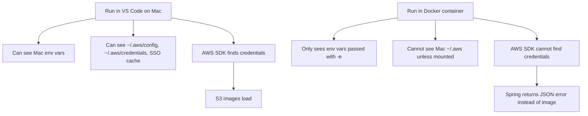

In the search tab,
I would like to filter by profiles, shop, locations.

When a new user account is created, it does not display when i go to search.

Messaging should be in the messaging tab, it should never go under notification.


the use profile pic should be displayed in posts. currently it does not display that.


implement payment support

this is my post. feel free to find any bugs or anything I can do better. anything I missed, or if I didn't follow proper conventions? prioritize robustness and production ready code.


---

Because **VS Code runs your app on your Mac**, but Docker runs your app inside an isolated Linux container.

Same Java code. Different runtime environment.



Your Docker command passes:

```text
MEDIA_S3_REGION
MEDIA_S3_BUCKET
```

But those only tell the app **where S3 is**. They do not prove **who the app is**.

Your log shows the container tried the AWS SDK credential chain and found nothing: no system properties, no `AWS_ACCESS_KEY_ID`, no profile credentials, no ECS credentials, and no EC2 instance metadata credentials. 

## Why VS Code works

When you run locally, the AWS SDK can probably read one of these from your Mac:

```text
~/.aws/config
~/.aws/credentials
~/.aws/sso/cache
AWS_ACCESS_KEY_ID
AWS_SECRET_ACCESS_KEY
AWS_SESSION_TOKEN
AWS_PROFILE
```

So this works:

```text
Spring Boot on Mac
  -> AWS SDK
  -> finds local AWS profile/env
  -> S3 getObject works
```

But inside Docker:

```text
Spring Boot in container
  -> AWS SDK
  -> cannot see your Mac's ~/.aws folder
  -> cannot see host env vars unless passed
  -> S3 getObject fails
```

## Verify the difference

Run this on your Mac:

```bash
aws sts get-caller-identity
```

Breakdown:

```text
aws
```

Runs the AWS CLI.

```text
sts get-caller-identity
```

Asks AWS which identity your current shell is using.

Then check what Docker sees:

```bash
docker run --rm \
  -e AWS_ACCESS_KEY_ID \
  -e AWS_SECRET_ACCESS_KEY \
  -e AWS_SESSION_TOKEN \
  amazon/aws-cli sts get-caller-identity
```

Breakdown:

```text
docker run
```

Starts a temporary container.

```text
--rm
```

Deletes the container after it exits.

```text
-e AWS_ACCESS_KEY_ID
-e AWS_SECRET_ACCESS_KEY
-e AWS_SESSION_TOKEN
```

Passes those host environment variables into the container.

```text
amazon/aws-cli
```

Uses an AWS CLI Docker image.

```text
sts get-caller-identity
```

Checks whether the container can authenticate to AWS.

## If you use AWS profile or SSO

Passing `AWS_ACCESS_KEY_ID` might not be enough if your Mac is using an AWS profile or SSO. In that case, mount your AWS config into the container:

```bash
docker run --rm -p 8080:8080 \
  -v "$HOME/.aws:/home/app/.aws:ro" \
  -e AWS_PROFILE=default \
  -e AWS_REGION=us-west-2 \
  -e SPRING_PROFILES_ACTIVE=dev \
  -e DB_URL="jdbc:postgresql://host.docker.internal:5432/scuba_pal" \
  -e DB_USER="scuba_pal_runtime" \
  -e DB_PASSWORD="scuba_pal" \
  -e SPRING_MAIL_HOST="host.docker.internal" \
  -e SPRING_MAIL_PORT="1025" \
  -e MEDIA_S3_REGION="us-west-2" \
  -e MEDIA_S3_BUCKET="scuba-pal-user-media-test-817455142561-us-west-2-an" \
  scuba-pal-app:local
```

Breakdown:

```text
-v "$HOME/.aws:/home/app/.aws:ro"
```

Mounts your Mac’s AWS config into the container as read-only.

```text
-e AWS_PROFILE=default
```

Tells the AWS SDK which profile to use.

```text
-e AWS_REGION=us-west-2
```

Gives AWS SDK a default region.

One caveat: this assumes your Docker image runs as a user whose home directory is `/home/app`. If your container user is different, the mounted path may need to change.

## Clean convention for Scuba Pal

Use this rule:

| Runtime           | Credential method                         |
| ----------------- | ----------------------------------------- |
| VS Code local run | Local AWS profile or env vars             |
| Docker local run  | Pass env vars or mount `~/.aws` read-only |
| ECS Fargate       | ECS task role                             |
| Production        | Never hardcode AWS keys                   |

So the answer is: **VS Code works because your app can see your Mac’s AWS identity. Docker fails because the container has only the config you explicitly pass into it.**

Progress: **92%**. Next goal: decide whether your local Docker flow should use env var pass-through or mounted AWS profile. For long-term dev, I’d use mounted `~/.aws` read-only; for ECS, use task roles.
