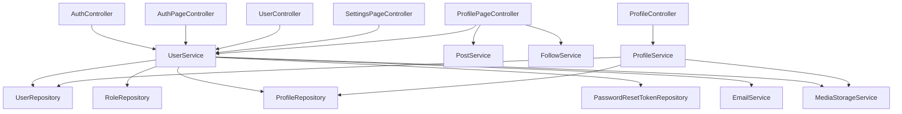
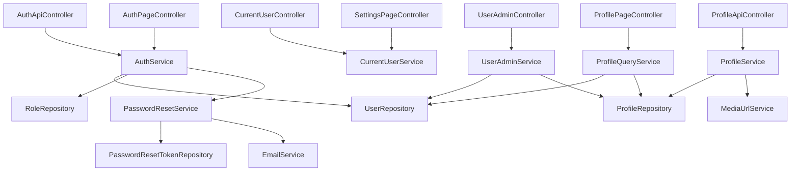
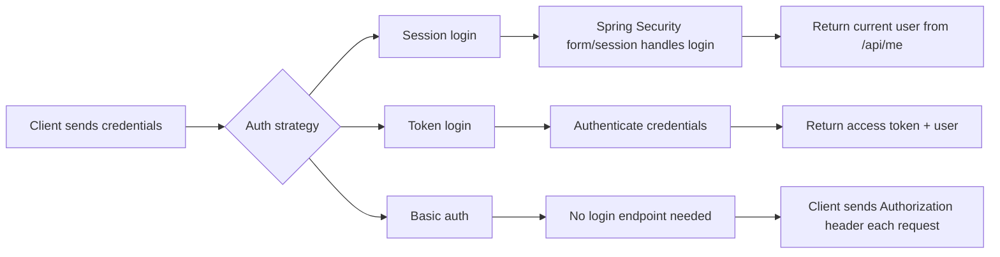

## Verdict

Your identity module is **good enough for a learning/local app**, but **not yet production-ready**. The main problem is not that the code is “wrong”; it is that responsibilities have started blending together.

The biggest issue: **`UserService` has become the identity god-service**. It handles registration, login, profile creation, settings updates, password reset, user admin, profile mapping, media URL normalization, and password encoding. That works short term, but long term it becomes hard to secure, test, and evolve.

Progress: **100% inspection complete**.
Next goal: **split identity into clean use-case services and fix P0 security/API contract issues first**.

---

# 1. Current architecture problem



This shows the core issue: **too many controllers depend on `UserService`, and `UserService` depends on too many domains.**

A cleaner target:



The key principle: **services should represent use cases, not database tables.**

---

# 2. Highest-priority issues

## P0 — Security / production blockers

### 1. `UserController` exposes dangerous admin-style endpoints

`UserController` has:

```java
POST   /api/users
GET    /api/users
GET    /api/users/{id}
PUT    /api/users/{id}
DELETE /api/users/{id}
```

These are admin-level operations, but there is no visible `@PreAuthorize`, ownership check, or role guard in the controller.

Maybe your `SecurityConfig` protects these elsewhere, but from this module alone, these endpoints are dangerous.

Recommended split:

```text
/api/auth/register              public
/api/me                         current authenticated user
/api/me/settings                current authenticated user
/api/me/profile                 current authenticated user's profile
/api/admin/users                admin only
/api/admin/users/{id}           admin only
/api/admin/users/{id}/profile   admin only
```

Do not let normal users send arbitrary `userId` values to update or delete accounts.

---

### 2. API login is redundant and probably misleading

In `AuthController.login()`:

```java
authenticationManager.authenticate(...);
return ResponseEntity.ok(userService.login(request));
```

Then `UserService.login()` fetches the user again and checks the password again:

```java
if (!passwordEncoder.matches(request.password(), user.getPasswordHash())) {
    throw new IllegalArgumentException("Invalid credentials");
}
```

That is redundant.

More importantly, the API login does not clearly create a session or return a JWT/token. It verifies credentials and returns a `UserView`, but unless you explicitly store the `Authentication` in the `SecurityContext` or issue a token, this is not really an API login.

Choose one model:



For your app, since you have web + mobile planned, the long-term path is probably:

```text
Browser/Thymeleaf: session auth
Mobile/API: token auth later, or session cookie if same-origin web app
```

But do not keep a fake `/api/auth/login` that only checks credentials.

---

### 3. Password reset uses raw maps instead of validated DTOs

Current:

```java
public MessageResponse forgotPassword(@RequestBody Map<String, String> body)
```

and:

```java
public MessageResponse resetPassword(@RequestBody Map<String, String> body)
```

This is bad for OpenAPI, generated clients, validation, and maintainability.

Use records:

```java
public record ForgotPasswordRequest(
        @NotBlank String emailOrUsername
) {
}
```

```java
public record ResetPasswordRequest(
        @NotBlank String token,
        @NotBlank @Size(min = 12, max = 120) String newPassword,
        @NotBlank String confirmPassword
) {
}
```

Then:

```java
@PostMapping("/forgot-password")
public MessageResponse forgotPassword(@Valid @RequestBody ForgotPasswordRequest request) {
    userService.sendPasswordResetLink(request.emailOrUsername());
    return new MessageResponse("If that account exists, a password reset link has been sent.");
}
```

This will make your OpenAPI generated client much cleaner.

---

### 4. Password reset token is stored and logged too openly

Current token generation:

```java
UUID.randomUUID().toString().replace("-", "")
```

Current logging:

```java
log.warn("Could not send password reset email to {}: {}. Reset link: {}", user.getEmail(),
        ex.getMessage(), link);
```

For local dev, logging the link is convenient. For production, it is dangerous. Anyone with log access can reset accounts.

Production-grade approach:

```text
Generate random raw token
Hash token
Store only hash in DB
Email raw token
When reset request comes in, hash provided token and compare
Never log raw token
Expire old tokens when issuing a new one
Mark token used atomically
```

Also consider deleting or invalidating all existing reset tokens for a user when issuing a new one.

---

### 5. Changing password from settings does not require current password

In `updateSettings()`:

```java
if (form.getNewPassword() != null && !form.getNewPassword().isBlank()) {
    if (!form.getNewPassword().equals(form.getConfirmPassword()))
        throw new IllegalArgumentException("Passwords do not match");
    user.setPasswordHash(passwordEncoder.encode(form.getNewPassword()));
}
```

For an authenticated settings page, require the current password before changing to a new password. Otherwise, if someone gets access to an open browser session, they can permanently take over the account.

Recommended fields:

```text
currentPassword
newPassword
confirmPassword
```

---

# 3. Major redundancy

## Redundancy 1: `AuthController.register()` and `UserController.create()`

Both create users using `RegisterRequest`.

```java
AuthController.register() -> userService.register(request)
UserController.create()   -> userService.register(request)
```

These are not the same use case.

Registration is public self-service. Admin user creation is an admin use case.

Use separate requests:

```text
RegisterRequest
AdminCreateUserRequest
```

---

## Redundancy 2: `RegisterRequest` is reused for update

`UserController.update()` currently does:

```java
public UserView update(@PathVariable Long id, @Valid @RequestBody RegisterRequest request)
```

This is wrong semantically.

A registration request contains password. Updating a user should not always require or rewrite the password.

Use:

```java
public record UpdateUserRequest(
        @Email String email,
        @Size(min = 3, max = 60) String username,
        String firstName,
        String lastName,
        String city,
        String country,
        Boolean active,
        String role
) {
}
```

Then have a separate endpoint for password changes.

---

## Redundancy 3: profile creation exists in multiple places

`UserService.register()` creates a profile.

`ProfileService.create()` also creates a profile.

`UserService.updateSettings()` creates a profile if missing.

`UserService.updateUser()` creates a profile if missing.

That logic should be centralized.

Better:

```text
ProfileService.createDefaultProfileForUser(user)
ProfileService.upsertCurrentUserProfile(username, request)
ProfileService.updateAdminProfile(userId, request)
```

---

## Redundancy 4: mapping is duplicated

`UserService.toUserView()` maps user/profile into `UserView`.

`ProfileService.toResponse()` maps profile/user into `ProfileResponse`.

This is okay when tiny, but you already have overlap.

Create:

```java
@Component
public class IdentityMapper {
    public UserResponse toUserResponse(User user, Profile profile) { ... }

    public ProfileResponse toProfileResponse(Profile profile) { ... }
}
```

Manual mapper is fine. You do not need MapStruct yet unless mapping grows a lot.

---

## Redundancy 5: unused / half-refactored classes

These look unused inside the uploaded module:

```text
Credentials.java
UserInfo.java
UserRepository.findByEmail(...)
UserRepository.findByUsernameWithRole(...)
UserRepository.findAllWithRoleOrderByUsernameAsc(...)
```

`User.java` also has commented-out code:

```java
// @Embedded
// private Credentials credentials;
```

Either finish the embeddable refactor or delete it. Right now it is dead code.

---

# 4. DTO / request / view naming issues

You currently have:

```text
RegisterRequest
RegisterForm
LoginRequest
ForgotPasswordForm
ResetPasswordForm
UserView
ProfileResponse
UpsertProfileRequest
UpdateSettingsForm
```

This is mostly okay, but inconsistent.

Recommended convention:

```text
API input:      SomethingRequest
API output:     SomethingResponse
MVC form:       SomethingForm
Page model:     SomethingViewModel
Internal view:  SomethingView
```

So I would rename:

```text
UserView -> UserResponse           if returned from REST APIs
UserView -> UserCardView           if used mostly by Thymeleaf/social pages
ProfileResponse                    keep
RegisterForm                       keep
RegisterRequest                    keep
UpdateSettingsForm                 keep for Thymeleaf only
```

Right now `UserView` has UI helper methods:

```java
displayName()
initials()
locationDisplay()
```

That is useful for Thymeleaf, but less ideal for an API DTO. Generated mobile clients do not need Java UI helper methods.

Long term, split:

```text
UserResponse      API DTO
UserProfileView   Thymeleaf/page view model
```

---

# 5. Controller review

## `AuthController`

Good:

* Thin controller.
* Uses validation on register/login.
* Uses `AuthenticationManager`.

Issues:

* `login()` authenticates twice.
* `forgotPassword()` and `resetPassword()` use raw maps.
* `logout()` does not actually log anyone out.
* `MessageResponse` comes from `com.scubapal.messaging.message`, which creates weird cross-domain coupling.

This is a smell:

```java
import com.scubapal.messaging.message.MessageResponse;
```

Identity should not depend on messaging just to return a generic message. Move this to shared:

```text
com.scubapal.shared.api.ApiMessageResponse
```

or define an identity-local response.

---

## `AuthPageController`

Good:

* Separate MVC page controller from REST controller.
* `RegisterForm` is reasonable for Thymeleaf.
* Handles validation errors.

Issues:

* Uses `IllegalArgumentException` for expected domain errors.
* Long one-line methods reduce readability.
* Password reset errors expose service exception messages directly to the page.
* Registration form has no confirm password field.
* `registerRequest` model attribute actually contains `RegisterForm`, not `RegisterRequest`.

This line is semantically confusing:

```java
model.addAttribute("registerRequest", new RegisterForm());
```

Prefer:

```java
model.addAttribute("registerForm", new RegisterForm());
```

---

## `UserController`

This should probably become `UserAdminController`.

Current name suggests regular user operations, but endpoints are admin-level.

Problems:

* No visible authorization.
* `GET /api/users` returns a simple list, capped indirectly by service default of 20.
* No pagination metadata.
* `PUT /api/users/{id}` uses `RegisterRequest`.
* Delete performs soft disable but endpoint message says “deactivated”; okay, but make it explicit.

Better:

```text
GET    /api/admin/users?page=0&size=20
GET    /api/admin/users/{id}
PATCH  /api/admin/users/{id}
DELETE /api/admin/users/{id}
```

And:

```text
GET    /api/me
PATCH  /api/me/settings
PATCH  /api/me/password
```

---

## `ProfileController`

Current:

```text
POST /api/profiles/{userId}
GET  /api/profiles/{userId}
PUT  /api/profiles/{userId}
```

This is understandable, but not ideal.

If `{userId}` means user ID, the REST shape should be:

```text
GET /api/users/{userId}/profile
PUT /api/users/{userId}/profile
```

For current authenticated user:

```text
GET /api/me/profile
PUT /api/me/profile
```

The biggest security issue: user ID is client-controlled. Make sure normal users cannot update other users’ profiles.

---

## `ProfilePageController`

Important bug:

```java
@GetMapping("/buddies")
public String buddies(@RequestParam(required = false) String city, ...)
```

You accept `city`, put it back into the model, but never filter by it.

Current behavior:

```text
/buddies?city=Phoenix
```

still returns all users.

Also:

```java
model.addAttribute("profile", user);
```

That is misleading because `user` is a `UserView`, not a `Profile`.

Also remove commented-out code:

```java
// var posts = postService.getPostsByUser(...)
```

One more design issue: `ProfilePageController` lives in `identity.profile`, but depends on:

```java
PostService
FollowService
```

That means identity depends on social. Better move this page controller to a social/web package, because the page is really a social profile page, not a pure identity profile API.

---

## `SettingsPageController`

Good:

* Thin controller.
* Uses a form object.
* Delegates to service.

Issues:

* Assumes `Authentication auth` is always present.
* Password change should require current password.
* Settings update belongs more naturally in `CurrentUserService` or `AccountSettingsService`, not broad `UserService`.

---

# 6. Service class review

## `UserService`

This class is doing too much.

Current responsibilities:

* username availability
* registration
* login
* password reset token creation
* password reset validation
* listing users
* loading users by ID/username
* current user lookup
* settings update
* admin user update
* soft delete
* mapping to `UserView`
* profile creation
* media URL normalization
* email sending orchestration

That is too many responsibilities.

Recommended split:

```text
AuthService
- register
- authenticate/login if needed

PasswordResetService
- request reset
- validate token
- reset password

CurrentUserService
- get current user
- update settings
- change password

UserAdminService
- list users
- get user
- update user
- deactivate user

IdentityQueryService
- read-only projections used by pages/social modules

IdentityMapper
- map User/Profile to DTOs
```

Service class rule of thumb:

```text
Controller = HTTP details
Service = use case + transaction boundary
Repository = persistence
Mapper = object conversion
Entity = domain state
DTO/Form = input/output contract
```

Your `UserService` currently mixes use cases, mapping, auth, profile, and media concerns.

---

## Transaction annotations

You use `@Transactional`, which is good, but several read-only methods are marked as regular transactions.

Examples:

```java
isUsernameAvailable()
getUser()
```

should be:

```java
@Transactional(readOnly = true)
```

Better pattern:

```java
@Service
@Transactional(readOnly = true)
public class UserAdminService {
    @Transactional
    public UserResponse update(...) { ... }
}
```

Class defaults to read-only. Write methods opt into write transactions.

---

## `ProfileService`

This is cleaner than `UserService`.

Good:

* Has class-level `@Transactional(readOnly = true)`.
* Write methods override with `@Transactional`.
* Keeps profile-specific logic mostly contained.

Issues:

* Mapping should move to mapper eventually.
* `create()` and `update()` duplicate field assignment.
* `normalizeMediaUrl()` is duplicated with `UserService`.
* Should probably trim blank strings to null consistently.
* Should validate `dateOfBirth` with `@Past`.
* Should align DTO length constraints with DB column lengths.

---

# 7. Repository review

## `UserRepository`

Current:

```java
Optional<User> findByEmail(String email);
Optional<User> findByEmailIgnoreCase(String email);
Optional<User> findByUsername(String username);
Optional<User> findByUsernameWithRole(String username);
Optional<User> findByIdWithRole(Long id);
List<User> findAllWithRoleOrderByUsernameAsc();
Page<User> findAllByOrderByUsernameAsc(Pageable pageable);
```

Cleanup:

```text
Remove findByEmail if unused.
Choose either @EntityGraph findByUsername OR findByUsernameWithRole, not both.
Remove findAllWithRoleOrderByUsernameAsc if unused.
Consider findByUsernameIgnoreCase or normalize username.
```

Good:

* `@EntityGraph(attributePaths = "role")` is a good way to avoid lazy loading issues.

Potential issue:

* `findByUsername()` has `@EntityGraph(role)`, so the method name does not reveal it fetches role. That is okay, but be consistent.

---

## `ProfileRepository`

Good:

```java
@EntityGraph(attributePaths = "user")
Optional<Profile> findByUserId(Long userId);
```

Potential issue:

```java
findAllByUserIdsWithUser(Collection<Long> userIds)
```

If the page is empty, passing an empty collection into `IN :userIds` can be awkward. Guard in service:

```java
if (users.isEmpty()) {
    return Page.empty(pageable);
}
```

or skip profile query when no user IDs.

---

# 8. Entity review

## `User`

Good:

* Uses `identity.users`, avoids reserved `user`.
* Has unique email/username.
* Role relationship is lazy.
* Password hash field is separate.

Issues:

* `active` may duplicate `SoftDeletableAuditableEntity`. If the base class already has soft delete fields, decide on one model.
* `emailVerifiedAt` is set during registration even though no email verification happens.
* `lastLoginAt` is set during registration even though no login happens.
* No column lengths for email/username/password hash.
* No case-insensitive DB uniqueness.
* Commented-out `Credentials` refactor should be removed.
* No `@Version` optimistic locking.

Better:

```java
@Column(nullable = false, unique = true, length = 320)
private String email;

@Column(nullable = false, unique = true, length = 60)
private String username;

@Column(name = "password_hash", nullable = false, length = 255)
private String passwordHash;
```

For production, enforce normalized uniqueness in the DB, not only Java service checks.

---

## `Profile`

Good:

* One-to-one with user.
* Profile fields separated from account/security fields.
* Visibility status is explicit.
* Profile image URL length is constrained.

Issues:

* `bio`, `firstName`, `lastName`, `city`, `state`, `country`, `phoneNumber` lack DB length constraints.
* `diveCount` might be user-entered claim or derived data. If it is derived from dive logs later, do not store it here as authoritative.
* `Gender` enum is simplistic. Consider whether you need to collect gender at all.
* `dateOfBirth` should be validated as past in request DTO.
* `phoneNumber` needs normalization/validation if you use it seriously.

---

## `PasswordResetToken`

Good:

* Separate table.
* Has expiration and used timestamp.
* Token is unique.

Issues:

* Uses `LocalDateTime`; prefer `Instant` or `OffsetDateTime` for security/audit events.
* Stores raw token.
* `isUsable()` calls `LocalDateTime.now()` directly, making testing harder.
* No lock/atomic protection against double-use race.
* No cleanup mechanism for expired tokens.

---

## `Role`

Fine for now.

But decide whether you want:

```text
role table: dynamic roles, admin UI, seeded DB
enum: simple fixed roles
```

For Scuba Pal, a role table is okay if you will have:

```text
USER
MODERATOR
ADMIN
DIVE_SHOP_OWNER
INSTRUCTOR
```

But use constants:

```java
public final class RoleNames {
    public static final String USER = "USER";
    public static final String ADMIN = "ADMIN";
}
```

Avoid magic string:

```java
roleRepository.findByName("user")
```

---

# 9. OpenAPI / generated-client impact

These choices will make generated mobile/web clients worse:

| Current code                             | Generated client problem                  | Fix                              |
| ---------------------------------------- | ----------------------------------------- | -------------------------------- |
| `@RequestBody Map<String,String>`        | Client sees generic map, no typed payload | Use request records              |
| `UserView`                               | Generated model name sounds UI-specific   | Rename to `UserResponse`         |
| `RegisterRequest` reused for update      | Update API forces password                | Use `UpdateUserRequest`          |
| `MessageResponse` from messaging package | Weird cross-domain generated model        | Move to shared/common            |
| `List<UserView>` for users               | No pagination metadata                    | Use `PageResponse<UserResponse>` |
| Profile endpoints by raw `userId`        | Easy to misuse from client                | Add `/api/me/profile`            |

For your SwiftUI/OpenAPI Generator plan, typed request/response records matter a lot.

---

# 10. Things I would delete or move

Delete from this identity module unless used elsewhere:

```text
Credentials.java
UserInfo.java
UserRepository.findByEmail(...)
UserRepository.findAllWithRoleOrderByUsernameAsc()
commented code in User.java
commented code in ProfilePageController.java
```

Move:

```text
MessageResponse -> shared/api
ProfilePageController -> social/web or profile/web depending on ownership
Media URL normalization -> shared media URL helper or ProfileService only
```

Rename:

```text
UserController -> UserAdminController
UserView -> UserResponse or UserProfileView
registerRequest model attribute -> registerForm
```

---

# 11. Recommended target package structure

Keep it simple but modular:

```text
com.scubapal.identity
  auth
    api
      AuthController
      request
        LoginRequest
        RegisterRequest
        ForgotPasswordRequest
        ResetPasswordRequest
      response
        AuthResponse
    web
      AuthPageController
      form
        RegisterForm
        ForgotPasswordForm
        ResetPasswordForm
    application
      AuthService
      PasswordResetService
    domain
      PasswordResetToken
    persistence
      PasswordResetTokenRepository

  account
    api
      CurrentUserController
      UserAdminController
    web
      SettingsPageController
      form
        UpdateSettingsForm
    application
      CurrentUserService
      UserAdminService
      IdentityQueryService
    domain
      User
      Role
      Gender
    persistence
      UserRepository
      RoleRepository
    dto
      UserResponse

  profile
    api
      ProfileController
      request
        UpsertProfileRequest
      response
        ProfileResponse
    application
      ProfileService
      ProfileMapper
    domain
      Profile
    persistence
      ProfileRepository
```

You do not need to do this all at once, but this is the shape I would move toward.

---

# 12. Production-readiness refactor order

## Phase 1 — Safety first

Progress target: **0% → 25%**

Do these before cosmetic cleanup:

1. Add authorization to user/profile admin endpoints.
2. Replace raw `Map<String,String>` request bodies.
3. Remove duplicate password verification in login.
4. Fix password reset token logging/storage behavior.
5. Require current password for password changes.
6. Split `/api/me` from `/api/admin/users`.

---

## Phase 2 — API contract cleanup

Progress target: **25% → 50%**

1. Rename `UserView` if it is API-facing.
2. Replace `RegisterRequest` in update endpoint.
3. Add `ForgotPasswordRequest` and `ResetPasswordRequest`.
4. Create shared `ApiMessageResponse`.
5. Add pagination response for users.
6. Add `/api/me/profile`.

---

## Phase 3 — Service decomposition

Progress target: **50% → 75%**

Split `UserService` into:

```text
AuthService
PasswordResetService
CurrentUserService
UserAdminService
IdentityQueryService
```

Then move mapping into:

```text
IdentityMapper
ProfileMapper
```

---

## Phase 4 — Persistence hardening

Progress target: **75% → 90%**

1. Add DB-level normalized uniqueness.
2. Add column lengths.
3. Add optimistic locking if needed.
4. Use `Instant`/`OffsetDateTime` for token/audit fields.
5. Add expired reset token cleanup.
6. Ensure Flyway migrations match entity constraints.

---

## Phase 5 — Polish and maintainability

Progress target: **90% → 100%**

1. Delete dead classes.
2. Remove comments/dead code.
3. Move page/social dependencies out of identity where appropriate.
4. Add service tests.
5. Add controller tests.
6. Add password reset integration tests.

---

# 13. Final assessment

Your current module is **directionally good**:

* entities are mostly separated correctly,
* repositories are simple,
* DTO records are being used,
* MVC forms are separate from API requests,
* profile is separated from user security fields,
* services are transactional,
* page controllers and REST controllers are separate.

But for long-term maintainability, the module needs these big changes:

```text
1. Stop using UserService as the everything-service.
2. Separate public auth, current-user, profile, and admin-user use cases.
3. Replace raw Map request bodies with real request DTOs.
4. Fix password reset production security.
5. Stop reusing RegisterRequest for update.
6. Remove dead refactor leftovers.
7. Make generated OpenAPI models clean and intentional.
```

The next best move is: **refactor `AuthController` + password reset DTOs + login flow first**, because that gives you the highest security and OpenAPI quality improvement with the least architectural disruption.
