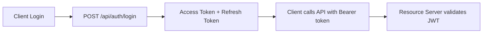
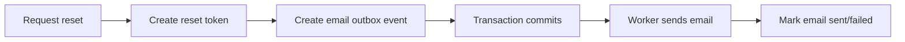
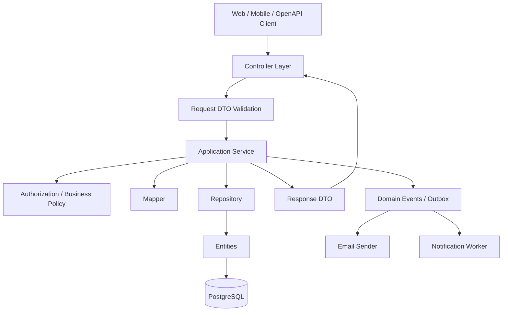

Progress: **review pass 1 = 70% complete**. I inspected the archive structure and the Java code. I did **not** run the app because the archive appears to contain source packages only, not the full Maven project/resources/migrations/tests.

Direct answer: **it is not production-ready yet**. It is much better organized than a random CRUD app, but it still has several architecture, security, API-contract, validation, and maintainability problems that will hurt you long term.

## Overall score

| Area                      | Rating | Verdict                                                             |
| ------------------------- | -----: | ------------------------------------------------------------------- |
| Package organization      |   7/10 | Mostly good feature packages, but inconsistent boundaries           |
| Controllers               |   6/10 | Usable, but API/web contracts are inconsistent                      |
| Services                  | 6.5/10 | Good transaction usage, but too much mapping/business/query mixing  |
| DTOs/records              | 5.5/10 | Too much reuse between public/admin/current-user views              |
| Security                  | 3.5/10 | Biggest production blocker                                          |
| OpenAPI/client generation |   4/10 | Security docs and response shapes will mislead generated clients    |
| Data privacy              |   3/10 | Public DTO leakage risk                                             |
| Persistence design        |   6/10 | Good start, but missing important constraints/indexes/race handling |
| Maintainability           |   6/10 | Solid direction, needs cleanup and consistency                      |
| Production readiness      |   4/10 | Not ready until security/API/privacy are fixed                      |

---

# Biggest production blockers

## 1. Your OpenAPI security says JWT/Bearer, but your backend uses Basic/Form login

In `OpenApiConfig.java`, the API declares:

```java
.scheme("bearer")
.bearerFormat("JWT")
```

But `SecurityConfig.java` uses:

```java
.httpBasic(Customizer.withDefaults())
```

And `/api/auth/login` only authenticates credentials and returns `UserView`. It does **not** return a JWT, session token, refresh token, or API credential.

This will break your generated TypeScript/Swift clients because they will expect Bearer auth while the server expects Basic auth.

**Fix: pick one contract.**

For production mobile/API clients, prefer:



Recommended long-term:

```text
POST /api/auth/login
-> AuthResponse {
     accessToken,
     refreshToken,
     expiresAt,
     user
   }
```

Then configure Spring Security as a resource server:

```text
Authorization: Bearer <access_token>
```

Until you implement JWT, remove the Bearer security scheme from OpenAPI and document Basic auth honestly.

---

## 2. CSRF is disabled for browser forms

In `SecurityConfig.java`, both API and web chains disable CSRF:

```java
.csrf(csrf -> csrf.disable())
```

For stateless APIs, disabling CSRF can be acceptable. For browser form login + Thymeleaf POST forms, disabling CSRF is **not production-safe**.

You have browser endpoints like:

```text
POST /login
POST /register
POST /settings
POST /posts
POST /posts/{id}/like
POST /messages/{conversationId}
```

Those are session/browser flows and should use CSRF protection.

**Fix:**

```java
// API chain
.securityMatcher("/api/**")
.csrf(csrf -> csrf.disable())

// Web chain
// do NOT disable CSRF
```

Then add Thymeleaf CSRF tokens in forms.

---

## 3. `UserView` leaks too much data

`UserView` includes:

```java
email
role
city
country
diveCount
bio
profileImageUrl
```

This same DTO is used in public-ish contexts like follows, divers, buddies, profile lists, and admin/current-user flows.

That is dangerous because public responses can accidentally expose emails and roles.

You need separate DTOs:

```text
PublicUserView
- id
- username
- displayName
- city
- country
- diveCount
- bio
- profileImageUrl

CurrentUserView
- id
- username
- email
- role
- profile fields
- settings fields

AdminUserView
- id
- username
- email
- role
- active
- createdAt
- lastLoginAt
```

Do **not** use one DTO for all audiences.

---

## 4. Public profile privacy is not enforced

`Profile` has:

```java
visibilityStatus
dateOfBirth
phoneNumber
```

But `ProfileService.getByUserId()` returns `ProfileResponse` without checking visibility or whether the caller is allowed to see sensitive fields.

`ProfileResponse` includes:

```java
phoneNumber
dateOfBirth
visibilityStatus
```

Even if the API route is protected today, the design is fragile. A future permitAll route would leak private profile data.

**Fix:** split profile DTOs.

```text
PublicProfileResponse
- username
- firstName
- lastName
- city
- country
- diveCount
- bio
- profileImageUrl

PrivateProfileResponse
- phoneNumber
- dateOfBirth
- email/private settings
```

And enforce:

```text
PUBLIC -> visible to all
PRIVATE -> owner/admin only
FOLLOWERS_ONLY -> followers/admin/owner only
```

---

## 5. Username case handling is inconsistent

Some code uses:

```java
findByUsernameIgnoreCase()
```

Other code uses:

```java
findByUsername()
```

Examples:

```java
MediaController.java
PostService.java
NotificationService.java
FollowService.java
MessagingService.java
```

Also, `normalizeUsername()` trims but does not lowercase. That means the application logic checks case-insensitively, but the database unique constraint may still be case-sensitive.

Possible bug:

```text
User A registers "Diver"
User B registers "diver"
```

Depending on race/direct DB insert, both can exist unless the DB has `citext` or a unique lower index.

**Fix:**

Use one canonical approach:

```text
usernameNormalized = lower(username)
displayUsername = original/user-facing
```

Database:

```sql
unique index users_username_normalized_uq on identity.users (lower(username));
unique index users_email_normalized_uq on identity.users (lower(email));
```

Or use PostgreSQL `citext`.

---

## 6. Role resolution has a likely bug

`RoleNames` defines uppercase names:

```java
USER
ADMIN
MODERATOR
```

But `UserAdminService.resolveRole()` does this:

```java
requestedRole.trim().toLowerCase()
```

So `"ADMIN"` becomes `"admin"` and may not match a DB role named `"ADMIN"`.

**Fix:**

```java
String roleName = requestedRole == null || requestedRole.isBlank()
        ? RoleNames.USER
        : requestedRole.trim().toUpperCase(Locale.ROOT);
```

Also make role names an enum or strongly validated type.

---

# API design problems

## 7. Response shapes are inconsistent

Some endpoints return raw Spring `Page<T>`:

```java
Page<FeedPostView>
```

Some return custom wrappers:

```java
ConversationListResponse
NotificationListResponse
PageResponse<UserView>
```

For OpenAPI Generator, this creates messy clients.

**Fix: standardize all paged APIs.**

Use one shape:

```java
public record PageResponse<T>(
        List<T> content,
        PageMetaResponse meta
) {}
```

Then:

```text
GET /api/posts -> PageResponse<FeedPostView>
GET /api/users -> PageResponse<AdminUserView>
GET /api/messages/conversations -> PageResponse<ConversationView>
GET /api/notifications -> PageResponse<NotificationView>
```

---

## 8. Some URLs are not clean REST conventions

Current examples:

```text
POST /api/posts/me
POST /api/messages/conversations/{otherUserId}
POST /api/notifications/{notificationId}/read
POST /api/messages/{conversationId}/read
```

Better:

```text
POST   /api/me/posts
POST   /api/conversations
PATCH  /api/notifications/{id}
PATCH  /api/conversations/{id}/read
```

For starting a conversation, avoid encoding the other user as the resource path:

```json
POST /api/conversations
{
  "participantUserId": 123
}
```

---

## 9. API and web behavior do not match

`PostService.getPostDetail()` supports anonymous access:

```java
String username = authentication == null ? null : authentication.getName();
```

But `SecurityConfig` requires authentication for:

```java
/api/posts
/api/posts/**
```

So public post viewing through API is blocked even though the service supports public visibility.

Same issue with profile routes. `ProfileController` exposes:

```java
GET /api/users/{userId}/profile
```

But `SecurityConfig` broadly locks:

```java
/api/users/**
```

except follow-related GET routes.

**Fix:** decide intentionally:

```text
Public API:
GET /api/posts
GET /api/posts/{id}
GET /api/users/{id}/public-profile

Authenticated API:
POST /api/me/posts
PATCH /api/me/profile
```

---

# Service-layer issues

## 10. Mapping is scattered everywhere

Mapping happens in:

```text
IdentityMapper
ProfileService
PostService
LocationController
DiveShopController
LearnService
NotificationService
MessagingService
FollowService
```

That makes the code harder to maintain.

**Fix convention:**

```text
Controller = HTTP only
Service = business transaction
Mapper = entity <-> DTO
Repository = persistence only
```

For example:

```text
DiveShopController -> DiveShopService -> DiveShopMapper -> DiveShopRepository
```

Right now `DiveShopController` does repository access, filtering, and mapping directly. That is not robust.

---

## 11. Services duplicate current-user lookup logic

Many services repeatedly do:

```java
userRepository.findByUsername(...)
```

Create one internal identity service method:

```java
CurrentActor actor = identityAccessService.requireCurrentActor(username);
```

Or:

```java
User requireActiveUserByUsername(String username)
User requireUserById(Long userId)
```

This centralizes active checks, case normalization, role loading, and error messages.

---

## 12. Service methods trust controller validation too much

Example: `CurrentUserService.changePassword()` checks current password and confirmation, but does not enforce password length itself. `UpdateSettingsForm` also has no password size validation.

So through the settings page, a user may be able to set a too-short password if the form does not validate it.

**Fix:** important invariants must exist in the service too.

```java
if (request.newPassword().length() < 12 || request.newPassword().length() > 120) {
    throw new IllegalArgumentException("Password must be 12 to 120 characters.");
}
```

Controller validation is useful, but business rules belong in the service.

---

# Persistence/data model problems

## 13. Missing uniqueness constraint for post likes

`PostLike` has no unique constraint on:

```text
post_id + user_id
```

So duplicate likes are possible under race conditions.

Add:

```java
@Table(
    schema = "social",
    name = "post_likes",
    uniqueConstraints = @UniqueConstraint(columnNames = {"post_id", "user_id"})
)
```

And add a Flyway migration.

---

## 14. Race conditions are not handled

Patterns like this are race-prone:

```java
if (!exists) {
    save(...)
}
```

Affected places:

```text
follow()
toggleLike()
startConversation()
register()
admin create user()
profile create()
```

You should still check in code for nice errors, but production correctness must come from DB constraints plus `DataIntegrityViolationException` handling.

Example:

```text
two requests follow same user at same time
both see no row
both try insert
one wins
one gets DB unique violation
```

Handle that gracefully.

---

## 15. Soft delete exists but is not actually implemented consistently

You have:

```java
deletedAt
```

on `SoftDeletableAuditableEntity`.

But `deletePost()` does:

```java
postRepository.delete(post);
```

And repositories do not filter `deletedAt IS NULL`.

So the model says “soft deletable,” but behavior is hard delete / inconsistent.

Pick one:

```text
Option A: remove soft delete from entities until needed
Option B: implement soft delete everywhere
```

If keeping it, add:

```java
@SQLDelete(...)
@Where(...)
```

or repository methods that explicitly filter deleted rows.

---

## 16. Timestamps use `LocalDateTime`

For APIs and distributed systems, prefer:

```java
Instant
```

or:

```java
OffsetDateTime
```

`JacksonConfig` serializes `LocalDateTime` as UTC by doing:

```java
value.atOffset(ZoneOffset.UTC)
```

That assumes the `LocalDateTime` is already UTC. `LocalDateTime` itself has no timezone, so this can lie.

Use `Instant` for created/updated/read/reset timestamps.

---

## 17. Audit fields depend on DB defaults but may not be populated in Java responses

Your base entities use:

```java
insertable = false
updatable = false
```

for `createdAt` and `updatedAt`.

That is okay if Flyway creates DB defaults/triggers, but after `save()`, Hibernate may not have those generated values in memory. Your API might return `createdAt = null` immediately after creation.

Better options:

```java
@CreationTimestamp
@UpdateTimestamp
```

or Spring Data auditing:

```java
@CreatedDate
@LastModifiedDate
```

or DB-generated values with refresh/read-after-write where needed.

---

# Security/privacy issues

## 18. Missing rate limiting

Production auth endpoints need rate limiting:

```text
POST /api/auth/login
POST /api/auth/forgot-password
POST /api/auth/reset-password
GET  /api/auth/username-available
```

Without this, you are exposed to brute force, username enumeration pressure, and password reset abuse.

Use IP + username/email based throttling.

---

## 19. Password reset email TTL mismatch

`PasswordResetService` uses:

```java
RESET_TTL_SECONDS = 3600
```

But email text says:

```text
expires in 30 minutes
```

Fix either the constant or the email copy.

---

## 20. SMTP service is probably not wired correctly

`SmtpEmailService` does **not** implement `EmailService`.

But `PasswordResetService` depends on:

```java
EmailService emailService
```

The class that implements `EmailService` is `ConsoleFallbackEmailService`.

So your SMTP implementation may never be used as the password reset email service.

Fix:

```java
@Service
@ConditionalOnBean(JavaMailSender.class)
public class SmtpEmailService implements EmailService {
    ...
}
```

Then make fallback conditional:

```java
@ConditionalOnMissingBean(EmailService.class)
```

---

## 21. Password reset tokens remain valid if email send fails

`issueTokenAndSendEmail()` saves the token, then tries to send email. If sending fails, the token remains valid.

That is not always terrible, but it is sloppy production behavior.

Better long-term pattern:



For now, at least make email failures observable and fix the service wiring.

---

# Media/S3 issues

## 22. Public media controller loads entire S3 object into memory

`PublicMediaController` returns:

```java
ResponseEntity<byte[]>
```

And `MediaStorageService.read()` uses:

```java
getObjectAsBytes(...)
```

This is not production-friendly for large images or many requests.

Better:

```text
CloudFront/S3 public or signed delivery
or
stream ResponseEntity<Resource>
```

Do not proxy every image through your Spring Boot server unless you need strict authorization.

---

## 23. Upload size is not actually enforced by S3

You check:

```java
request.contentLength() > maxBytes
```

But that is client-provided metadata. A malicious client can lie unless the S3 presigned policy enforces content length or you verify after upload.

Better:

```text
Presigned POST with content-length-range
or
post-upload verification job
or
store media_asset row as PENDING and verify S3 object metadata before use
```

---

## 24. Users can attach any managed media URL if they know it

`PostService.replaceMedia()` normalizes any Scuba Pal media URL. It does not verify:

```text
Does this media belong to this user?
Was this object actually uploaded?
Was it uploaded for POST_IMAGE?
Is it clean/verified?
```

You need a `media_assets` table:

```text
id
owner_user_id
object_key
purpose
content_type
size_bytes
status: PENDING | VERIFIED | ATTACHED | DELETED
created_at
```

Then posts should attach media by `mediaAssetId`, not arbitrary URL.

---

# Controller issues

## 25. `DiveShopController` should not query/filter/map directly

Current controller does:

```java
diveShopRepository.findAll(...)
    .stream()
    .filter(...)
    .map(this::toResponse)
    .limit(50)
```

Problems:

```text
loads all shops into memory
no service layer
no pagination
filtering belongs in DB
mapping belongs in mapper
```

Fix:

```text
DiveShopController
  -> DiveShopService.search(q, pageable)
  -> DiveShopRepository query/specification
  -> DiveShopMapper.toResponse()
```

---

## 26. `LocationController` returns only fixed-size list

`LocationController.getAll()` returns a `List`, while `LocationService.getLocations(city)` silently limits to 20.

That is surprising for API clients.

Better:

```text
GET /api/locations?page=0&size=20&city=...
-> PageResponse<DiveLocationResponse>
```

---

## 27. `AdminController.posts()` returns public feed only

This admin endpoint:

```java
GET /api/admin/posts
```

returns:

```java
postService.getPublicFeed()
```

That is not admin behavior. Admin probably needs all posts, including hidden/private/moderated/deleted depending on role.

Either remove it or implement:

```text
GET /api/admin/posts?status=&visibility=&userId=&page=&size=
```

---

# DTO/request validation issues

## 28. `CreateCurrentUserPostRequest` lacks size validation

Current:

```java
@NotBlank String caption
List<String> mediaUrls
```

Should be:

```java
@NotBlank
@Size(max = 500)
String caption

@Size(max = 10)
List<@NotBlank @Size(max = 500) String> mediaUrls
```

---

## 29. `SendMessageRequest` lacks max length

Entity column:

```java
length = 1000
```

Request:

```java
@NotBlank String messageText
```

Should be:

```java
@NotBlank
@Size(max = 1000)
String messageText
```

Also enforce in service.

---

## 30. `CreateLocationRequest` does not validate coordinate ranges

You validate `Coordinates`, but the request itself only has `@NotNull`.

Add:

```java
@DecimalMin("-90.0")
@DecimalMax("90.0")
BigDecimal latitude

@DecimalMin("-180.0")
@DecimalMax("180.0")
BigDecimal longitude
```

---

## 31. `UpdateSettingsForm` password fields lack validation

Current form has:

```java
private String currentPassword;
private String newPassword;
private String confirmPassword;
```

No `@Size`, no custom “all or none” validation.

Add a dedicated request/form validator.

---

# Maintainability cleanup

## 32. Remove commented-out code

Examples:

```text
OpenApiConfig.java old config block
PostController.java old create endpoint
LocationService.java old alternative implementation
Address.java old zip/country code fields
DiveShop.java old address fields
```

Production code should not keep old design experiments inline. Put rationale in docs or git history.

---

## 33. Remove `.DS_Store` and `__MACOSX`

The archive contains Mac metadata files. Add to `.gitignore`:

```gitignore
.DS_Store
__MACOSX/
```

And when zipping, use a clean packaging command.

---

## 34. Avoid wildcard imports

Several files use:

```java
import jakarta.persistence.*;
import org.springframework.web.bind.annotation.*;
```

For production style, use explicit imports. It improves readability and avoids accidental symbol confusion.

---

## 35. Formatting is inconsistent

`MessagingService`, `MessagingController`, and `OpenApiConfig` use deeper indentation than the rest of the code. Standardize with IntelliJ formatting or Spotless.

Recommended:

```text
spotless-maven-plugin
checkstyle or spring-javaformat
```

---

# Target architecture

This is the shape I would move toward:



Controller should be thin:

```text
validate HTTP input
get authenticated user
call service
return response
```

Service should own:

```text
transactions
business rules
authorization decisions
state changes
race handling
```

Mapper should own:

```text
entity -> DTO
DTO -> entity creation helpers
```

Repository should own:

```text
query methods only
no business meaning
```

---

# Priority refactor plan

## Phase 1 — security/API contract first

Completion target: **80% production safety**

1. Choose JWT/Bearer or Basic. I strongly recommend JWT for generated mobile/web clients.
2. Fix OpenAPI security to match actual backend.
3. Enable CSRF for web forms.
4. Split `UserView` into `PublicUserView`, `CurrentUserView`, `AdminUserView`.
5. Split `ProfileResponse` into public/private/admin profile DTOs.
6. Add structured error responses with `ProblemDetail`.
7. Add auth endpoint rate limiting.

---

## Phase 2 — data correctness

Completion target: **88% production safety**

1. Add DB unique constraints/indexes:

   ```text
   lower(email)
   lower(username)
   post_likes(post_id, user_id)
   user_follows(follower_user_id, followed_user_id)
   conversations(user_one_id, user_two_id)
   ```
2. Handle `DataIntegrityViolationException`.
3. Decide hard delete vs soft delete.
4. Add auditing strategy.
5. Use `Instant` or `OffsetDateTime`.

---

## Phase 3 — maintainability

Completion target: **93% maintainability**

1. Add mappers:

   ```text
   UserMapper
   ProfileMapper
   PostMapper
   DiveLocationMapper
   DiveShopMapper
   MessagingMapper
   NotificationMapper
   ```
2. Add service layer for `DiveShop`.
3. Centralize pagination creation.
4. Standardize all list endpoints to `PageResponse<T>`.
5. Remove commented code and unused files.
6. Add formatter/linter.

---

## Phase 4 — production features

Completion target: **97% production readiness**

1. Add tests:

   ```text
   AuthServiceTest
   PasswordResetServiceTest
   PostServiceTest
   MessagingServiceTest
   SecurityConfigTest
   Controller integration tests
   ```
2. Add media ownership tracking.
3. Add email outbox or at least robust email failure handling.
4. Add observability:

   ```text
   structured logs
   audit events
   actuator health groups
   metrics
   ```
5. Add admin moderation model.

---

# Highest-impact next goal

Your next goal should be: **fix the identity/API contract before touching smaller cleanup.**

Specifically:

```text
1. Decide JWT vs Basic.
2. Fix OpenAPI to match.
3. Split UserView into public/current/admin DTOs.
4. Stop exposing email/role in public user lists.
5. Re-enable CSRF for Thymeleaf web forms.
```

That moves the project from “works locally” toward “safe enough to build clients against.”
