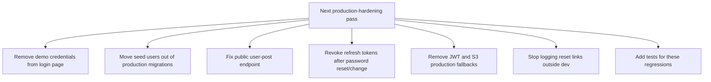

Checked the latest branch head. `ground-breaking-changes` is now **10 commits ahead of `main`**, so your newest commit is visible.

**Progress: ~76% production-readiness.** You improved several things, but a few high-risk production blockers are still present.

## What improved

### 1. Prod config is cleaner now

`application-prod.properties` now supports both `DB_*` and `AWS_DB_*` names, requires `APP_BASE_URL`, and sets CORS from `APP_CORS_ALLOWED_ORIGINS` or `APP_BASE_URL`. That is a good direction because prod behavior is no longer tied only to AWS-specific names. 

Your `.env.example` also now documents `APP_BASE_URL` and `APP_CORS_ALLOWED_ORIGINS`, which helps deployment clarity. 

### 2. REST exception handling is better scoped

`ApiExceptionHandler` is now scoped to `@RestControllerAdvice(annotations = RestController.class)`, which is cleaner because Thymeleaf web controllers will not accidentally receive API-style `ProblemDetail` responses. 

You also added structured validation errors under an `errors` property. That is much better for mobile/OpenAPI clients. 

### 3. Rate limit coverage improved

The rate limit filter now covers `/api/auth/register`, web `/login`, `/register`, `/forgot-password`, and `/reset-password`, not just API auth endpoints. 

Good move.

### 4. Request validation improved

You added max sizes to auth/media payloads, which prevents silly oversized payload abuse. Examples: login username/password now have max sizes, refresh token has max size, and media content type/file name have max sizes.   

## Still red before production

### 1. Demo credentials are still publicly shown

The login page still says:

`admin / admin123` and `maya_dives / password`.

That is a production blocker. 

Fix this now. Remove that paragraph from `login.html`.

---

### 2. Seed users are still inside the production migration path

`V001__init_users.sql` still inserts admin/demo/user accounts directly into the main migration. 

That means production Flyway still creates known seeded accounts unless you manually strip data later. Schema migrations should be production-safe and data-neutral.

Best fix:

```text
db/migration/          # schema only
db/dev-migration/      # demo users, demo profiles, demo posts
```

Then:

```properties
# application-dev.properties
spring.flyway.locations=classpath:db/migration,classpath:db/dev-migration
```

Prod should only use:

```properties
spring.flyway.locations=classpath:db/migration
```

---

### 3. Public user posts endpoint still leaks private posts

This is still the biggest app-level authorization bug.

`GET /api/posts/users/{userId}` still calls:

```java
postService.getPostsByUser(userId, pageable(page, size))
```


But earlier, `getPostsByUser` returns posts by user without public-only filtering. You already have a safer method available: `getPublicPostsByUser`.

Fix:

```java
@GetMapping("/users/{userId}")
public PageResponse<FeedPostView> getByUser(@PathVariable Long userId,
                                             @RequestParam(defaultValue = "0") int page,
                                             @RequestParam(defaultValue = "12") int size) {
    return PageResponse.from(postService.getPublicPostsByUser(userId, pageable(page, size)));
}
```

Then add a separate authenticated owner endpoint:

```java
@GetMapping("/me")
public PageResponse<FeedPostView> getMine(Authentication authentication,
                                          @RequestParam(defaultValue = "0") int page,
                                          @RequestParam(defaultValue = "12") int size) {
    return PageResponse.from(postService.getPostsForCurrentUser(authentication.getName(), pageable(page, size)));
}
```

---

### 4. Password reset/change still does not revoke refresh tokens

Password reset still only updates the password hash and marks the reset token used. It does not revoke existing refresh tokens. 

Current-user password change has the same issue: it validates the current password and updates the hash, but does not revoke active sessions. 

Production expectation: password change/reset invalidates existing refresh tokens.

Fix direction:

```java
refreshTokenRepository.revokeActiveTokensForUser(user.getId(), now, "password-change");
```

Or expose a service method like:

```java
jwtTokenService.revokeAllRefreshTokensForUser(user, "password-reset");
```

---

### 5. Base JWT config still has a known dev fallback

Base `application.properties` still contains:

```properties
app.security.jwt.secret=${JWT_SECRET:dev-only-scuba-pal-jwt-secret-change-me-please-32b}
```


Prod overrides it, yes. But fail-closed is better: base config should not contain a signing secret default.

Use:

```properties
app.security.jwt.secret=${JWT_SECRET}
```

Then put the dev secret only in `application-dev.properties` and test config.

---

### 6. S3 bucket fallback is still hardcoded in code

`MediaStorageProperties` still defaults to a real-looking bucket name.  It also repeats the fallback when bucket is blank. 

Production config should fail if media bucket/region are missing. Defaults should live in `.env.example`, not in application code.

---

### 7. Console fallback email is safer, but still risky

You improved it with:

```java
@ConditionalOnProperty(name = "app.mail.enabled", havingValue = "false", matchIfMissing = true)
```


But if `app.mail.enabled=false` or missing, it still logs the full password reset link. 

For dev that is convenient. For production it is dangerous.

Better:

```java
@Profile("dev")
@ConditionalOnProperty(name = "app.mail.enabled", havingValue = "false", matchIfMissing = true)
```

Also do not log the full reset URL; log only that one was generated.

---

## Updated priority order



## Next goal

**Get to 85% by fixing these exact four files first:**

1. `templates/auth/login.html` — remove demo credentials.
2. `V001__init_users.sql` — remove user/profile seed data from production migration.
3. `PostController.java` — use `getPublicPostsByUser` for the public user posts endpoint.
4. `PasswordResetService.java` + `CurrentUserService.java` — revoke active refresh tokens after credential changes.

After that, the remaining big architectural issue is still **media ownership + private media authorization**.
