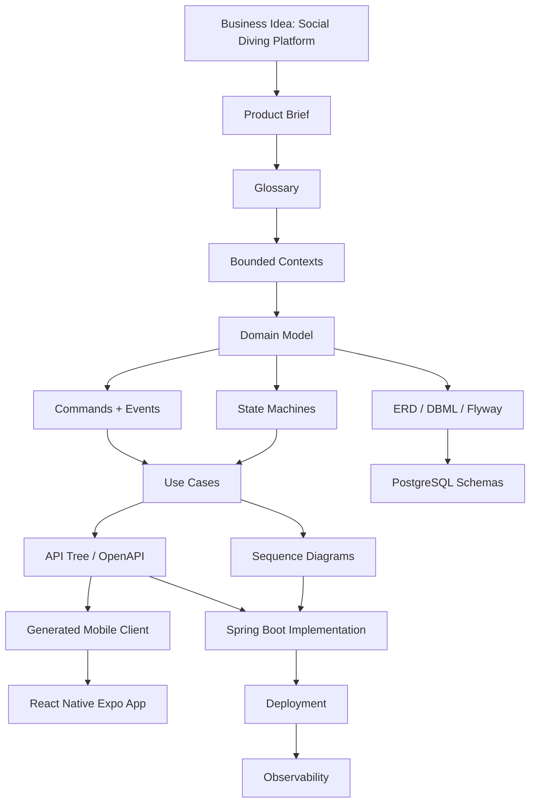

# Source of truth stack

Diagrams should not be random drawings. They should be views over deeper truth: product rules, domain language, lifecycle states, contracts, data, and decisions.

For Scuba Pal, the useful stack is:

## Minimum complete system, minus implementation

| Source of truth | Scuba Pal answer |
| --- | --- |
| Product brief | Why divers use Scuba Pal and what the app owns. |
| Glossary | Shared vocabulary: user, profile, post, dive location, follow, conversation. |
| Actor map | Guest, diver, admin, system worker, external providers. |
| Domain model | Business objects and relationships before database details. |
| ERD / data model | PostgreSQL schemas, tables, keys, and constraints. |
| State machines | Legal lifecycles for accounts, posts, uploads, messages, notifications. |
| Use cases | What each actor can do. |
| Sequence diagrams | Step-by-step behavior for core flows. |
| API tree | REST resources and generated OpenAPI contract. |
| Event catalog | Facts emitted by the system. |
| Permission matrix | Authorization truth by role. |
| Screen map | Web and mobile screens derived from use cases. |
| System architecture | Runtime modules and dependencies. |
| Deployment diagram | Where everything runs locally and in cloud. |
| ADRs | Why key choices were made. |

## Rule of consistency

If `DiveLocation` exists in the glossary, it should appear in the domain model, ERD, API tree, screen map, authorization rules, and tests. If it only exists in code, the source of truth is incomplete.
