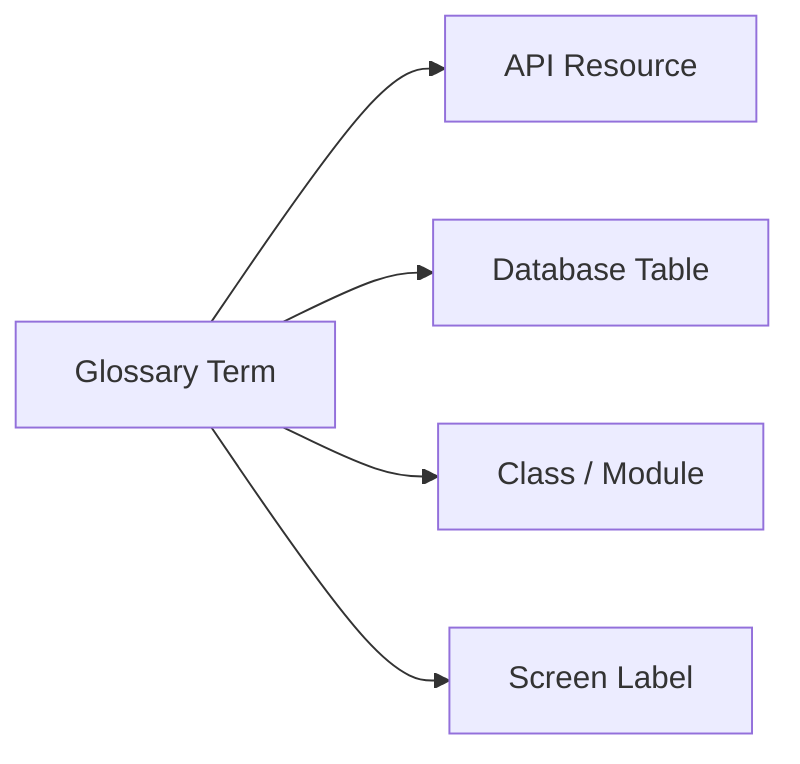

# Glossary / ubiquitous language

Every database table, API route, event, class, and screen should reuse this vocabulary unless there is a strong reason not to.

| Term | Meaning |
| --- | --- |
| User | Authenticated account holder. |
| Account | Identity and login container for a user. Use when discussing credentials/security. |
| Profile | Public diver-facing identity: display name, bio, avatar, dive details. |
| Role | Authorization classification such as user or admin. |
| Post | Social content created by a user. |
| Comment | Reply attached to a post. |
| Follow | Relationship where one user follows another. |
| Feed | Ordered stream of posts relevant to a user. |
| Conversation | Messaging thread between users. |
| Message | Individual item inside a conversation. |
| Notification | User-visible alert generated from platform activity. |
| Dive Location | Place where divers may dive. |
| Dive Shop | Business or operator serving divers. |
| Learn Article | Educational content inside the learn domain. |
| Media Object | File uploaded to object storage and referenced by app data. |
| Presigned Upload | Temporary upload permission issued by the backend for direct object storage upload. |
| OpenAPI Contract | Backend API description used to generate the mobile client. |
| Generated Client | Type-safe mobile API code regenerated after OpenAPI changes. |

## Naming rule

Use business names at the boundary, not implementation shortcuts.

Example: `DiveLocation` should consistently map to `dive_locations`, `/api/dive-locations`, `DiveLocationService`, and a Dive Locations screen.
