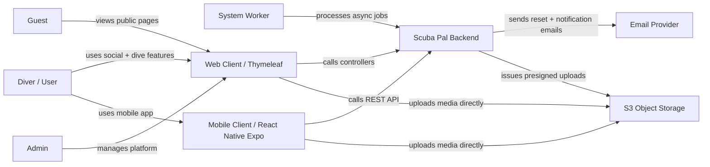

# Actor map

## Actor responsibilities

| Actor | Responsibilities |
| --- | --- |
| Guest | Read public-facing pages, register, log in. |
| Diver/User | Manage profile, create posts, comment, follow, message, browse dive data, read learn content. |
| Admin | Moderate content, manage users, inspect platform stats. |
| System Worker | Send notifications, process events, clean stale uploads, run scheduled tasks. |
| Web Client | Browser UI served by the backend. |
| Mobile Client | React Native Expo app using generated OpenAPI client. |
| Email Provider | Sends account and notification emails. |
| Object Storage | Stores user-uploaded media. |

## Boundary rule

External providers should remain replaceable. The domain should know **that** an email or upload happened, not depend on a specific vendor model everywhere.
