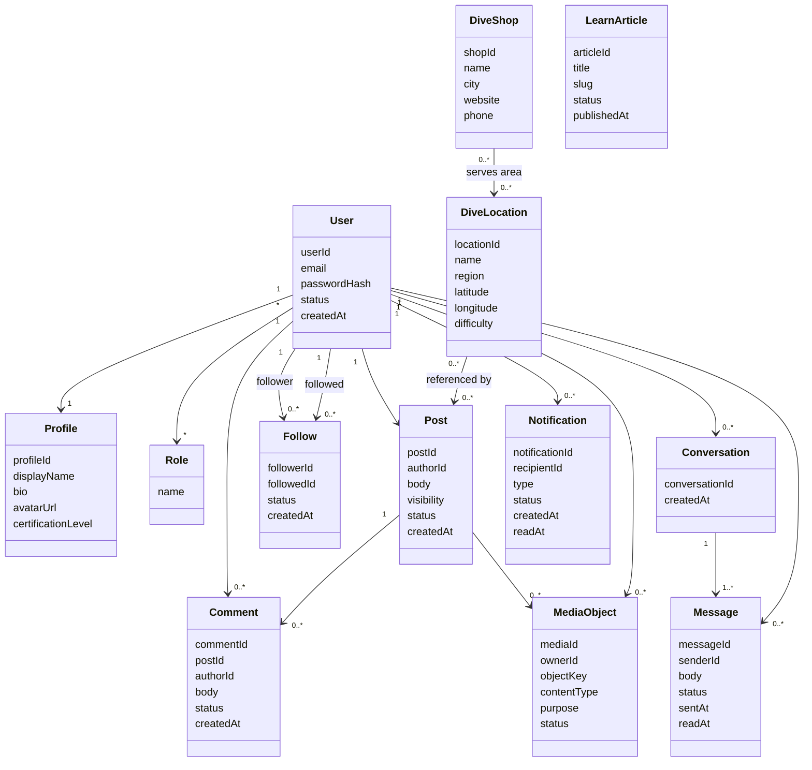

# Domain model

This is the conceptual model before table names, controllers, or DTOs.

## Bounded contexts

| Context | Owns |
| --- | --- |
| Identity | Users, credentials, roles, auth flows. |
| Profile | Public diver profile and avatar. |
| Social | Posts, comments, follows, feed. |
| Messaging | Conversations, participants, messages, unread counts. |
| Notification | Notification records and delivery state. |
| Dive | Dive locations and dive shops. |
| Learn | Educational articles and content. |
| Media | Presigned uploads, object keys, content-type rules, upload purpose. |
| Admin | Platform visibility and operational controls. |

## Design rule

For the first production version, keep this as an **internally modular monolith**. Split services later only when deployment, scaling, or team ownership creates real pressure.
