# ERD / database truth

The domain model becomes PostgreSQL schemas, Flyway migrations, keys, and constraints.

```mermaid
erDiagram
    users {
        uuid id PK
        string email UK
        string password_hash
        string status
        timestamp created_at
        timestamp updated_at
    }

    profiles {
        uuid id PK
        uuid user_id FK
        string display_name
        string bio
        string avatar_url
        string certification_level
        timestamp updated_at
    }

    roles {
        uuid id PK
        string name UK
    }

    user_roles {
        uuid user_id FK
        uuid role_id FK
    }

    posts {
        uuid id PK
        uuid author_id FK
        string body
        string visibility
        string status
        timestamp created_at
        timestamp updated_at
    }

    comments {
        uuid id PK
        uuid post_id FK
        uuid author_id FK
        string body
        string status
        timestamp created_at
    }

    follows {
        uuid follower_id FK
        uuid followed_id FK
        string status
        timestamp created_at
    }

    conversations {
        uuid id PK
        timestamp created_at
        timestamp updated_at
    }

    conversation_participants {
        uuid conversation_id FK
        uuid user_id FK
        timestamp joined_at
        timestamp last_read_at
    }

    messages {
        uuid id PK
        uuid conversation_id FK
        uuid sender_id FK
        string body
        string status
        timestamp sent_at
        timestamp read_at
    }

    notifications {
        uuid id PK
        uuid recipient_id FK
        string type
        string status
        string payload_json
        timestamp created_at
        timestamp read_at
    }

    dive_locations {
        uuid id PK
        string name
        string region
        decimal latitude
        decimal longitude
        string difficulty
        timestamp created_at
    }

    dive_shops {
        uuid id PK
        string name
        string city
        string website
        string phone
        timestamp created_at
    }

    learn_articles {
        uuid id PK
        string title
        string slug UK
        string status
        text body
        timestamp published_at
    }

    media_objects {
        uuid id PK
        uuid owner_id FK
        string object_key UK
        string content_type
        string upload_purpose
        string status
        timestamp created_at
    }

    users ||--|| profiles : owns
    users ||--o{ user_roles : has
    roles ||--o{ user_roles : grants
    users ||--o{ posts : authors
    posts ||--o{ comments : has
    users ||--o{ comments : writes
    users ||--o{ follows : follower
    users ||--o{ follows : followed
    conversations ||--o{ conversation_participants : includes
    users ||--o{ conversation_participants : joins
    conversations ||--o{ messages : contains
    users ||--o{ messages : sends
    users ||--o{ notifications : receives
    users ||--o{ media_objects : uploads
    posts ||--o{ media_objects : attaches
```

## Schema ownership

| Schema | Tables |
| --- | --- |
| `identity` | `users`, `roles`, `user_roles` |
| `social` | `profiles`, `posts`, `comments`, `follows` |
| `messaging` | `conversations`, `conversation_participants`, `messages` |
| `notification` | `notifications` |
| `dive` | `dive_locations`, `dive_shops` |
| `learn` | `learn_articles` |
| `media` | `media_objects` |

## Migration rule

Flyway migrations are the executable database truth. Diagrams explain the truth, but migrations enforce it.
