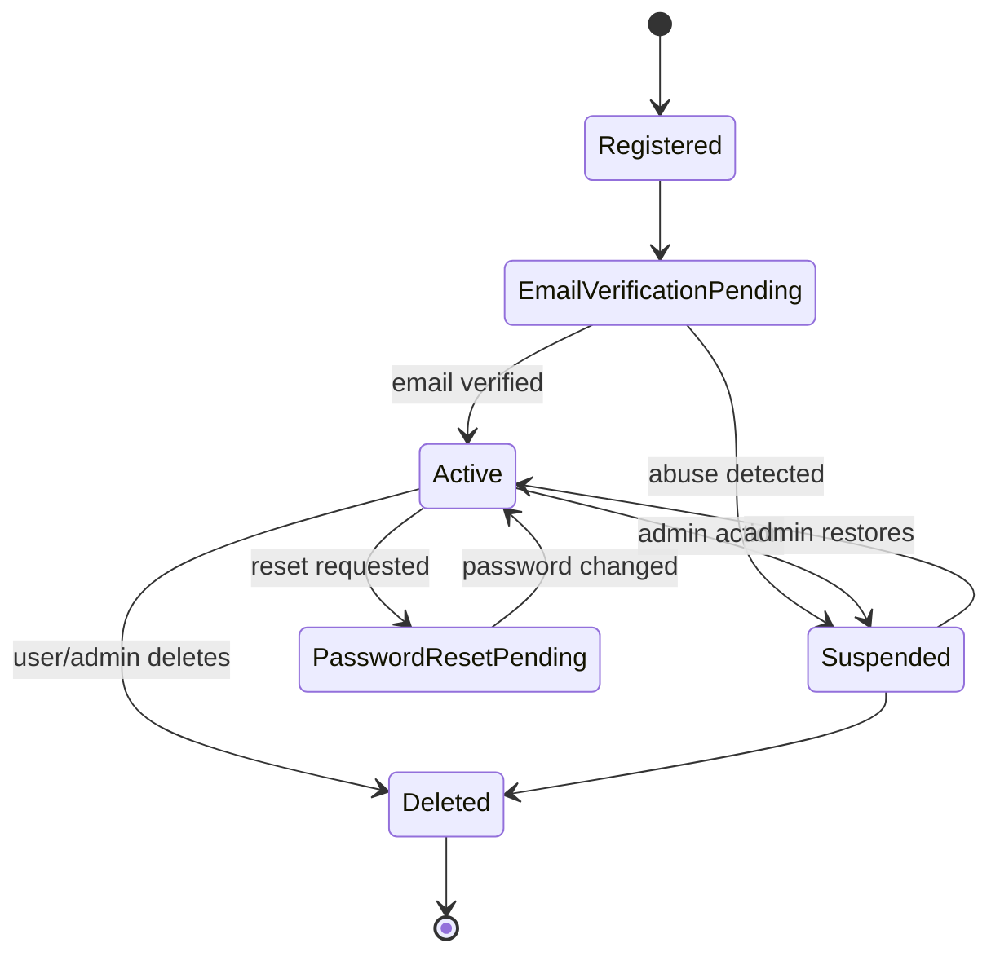
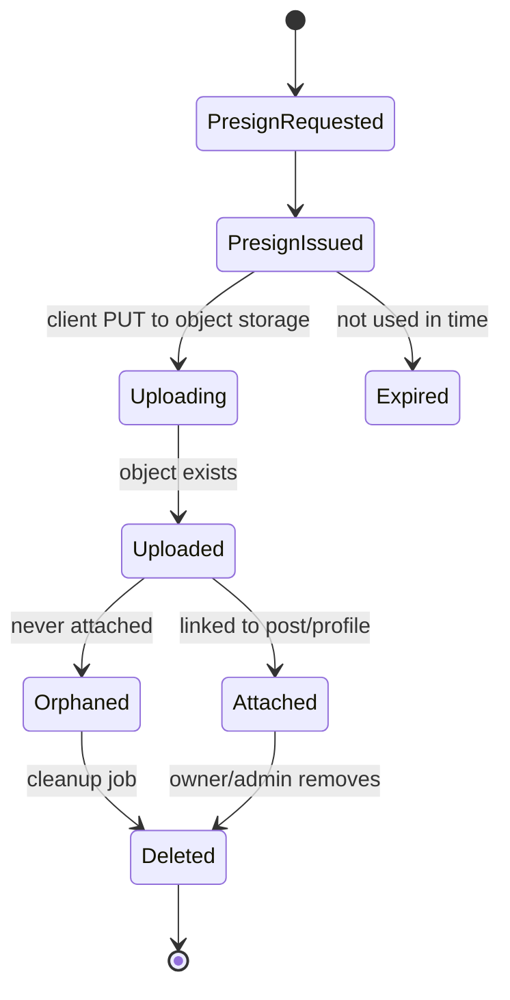
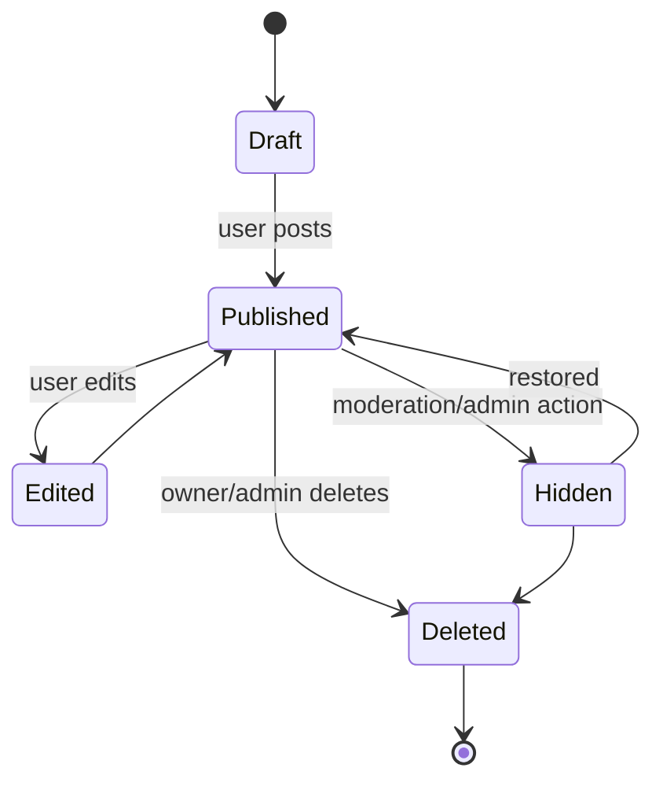
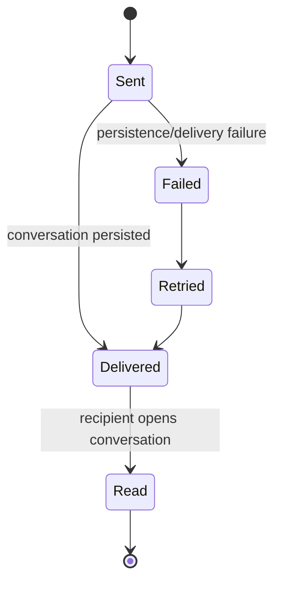
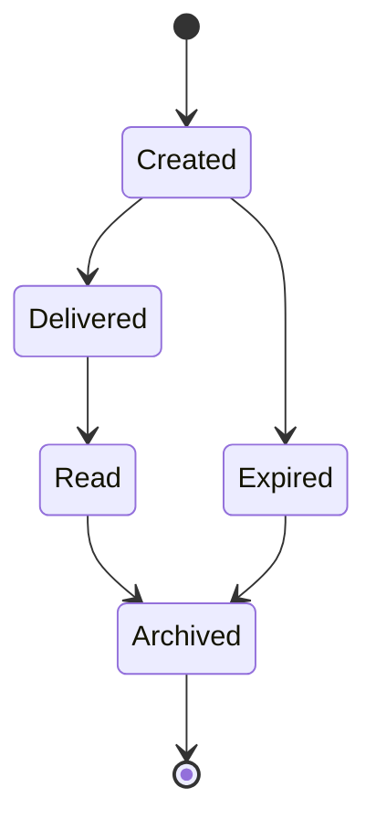

# State machines

State machines prevent scattered `if status == ...` logic and make illegal transitions obvious.

## User account lifecycle

## Media upload lifecycle

## Post lifecycle

## Message lifecycle

## Notification lifecycle

