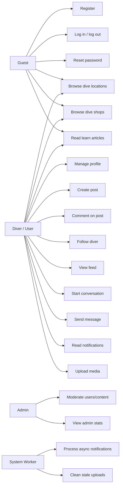

# Use cases

## Core capability table

| Capability | Guest | Diver/User | Admin | Worker |
| --- | ---: | ---: | ---: | ---: |
| Register | Yes | No | No | No |
| Log in | Yes | No | No | No |
| Manage own profile | No | Yes | No | No |
| Create post | No | Yes | Yes | No |
| Comment | No | Yes | Yes | No |
| Follow / unfollow | No | Yes | No | No |
| View feed | Limited | Yes | Yes | No |
| Browse dive locations | Yes | Yes | Yes | No |
| Browse dive shops | Yes | Yes | Yes | No |
| Read learn content | Yes | Yes | Yes | No |
| Start conversation | No | Yes | Yes | No |
| Send message | No | Yes | Yes | No |
| Read notifications | No | Yes | Yes | No |
| Upload media | No | Yes | Yes | No |
| Moderate content | No | No | Yes | No |
| Process events | No | No | No | Yes |

## Rule

Every use case should eventually map to a screen, endpoint, permission rule, test case, and at least one sequence diagram for critical flows.
