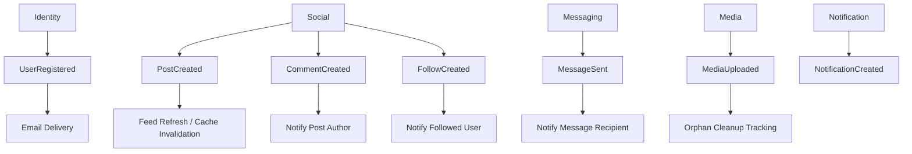

# Event catalog

Events are facts that already happened. They should be named in past tense.

## Events

| Event | Producer | Consumers | Minimal payload |
| --- | --- | --- | --- |
| `UserRegistered` | Identity | Email, analytics, admin stats | `userId`, `email`, `createdAt` |
| `ProfileUpdated` | Profile | Feed, search/indexing later | `userId`, `profileId`, `changedFields`, `updatedAt` |
| `PostCreated` | Social | Feed, notifications, moderation | `postId`, `authorId`, `visibility`, `createdAt` |
| `PostDeleted` | Social | Feed, notifications, media cleanup | `postId`, `authorId`, `deletedAt` |
| `CommentCreated` | Social | Notifications | `commentId`, `postId`, `authorId`, `createdAt` |
| `FollowCreated` | Social | Notifications, feed | `followerId`, `followedId`, `createdAt` |
| `FollowRemoved` | Social | Feed | `followerId`, `followedId`, `removedAt` |
| `MessageSent` | Messaging | Notifications, unread counts | `messageId`, `conversationId`, `senderId`, `recipientIds`, `sentAt` |
| `ConversationRead` | Messaging | Unread counts | `conversationId`, `userId`, `readAt` |
| `NotificationRead` | Notification | Analytics later | `notificationId`, `recipientId`, `readAt` |
| `MediaPresignIssued` | Media | Audit, cleanup | `mediaId`, `ownerId`, `objectKey`, `expiresAt` |
| `MediaUploaded` | Media | Validation, cleanup | `mediaId`, `ownerId`, `objectKey`, `uploadedAt` |
| `LearnArticlePublished` | Learn | Feed/search later | `articleId`, `slug`, `publishedAt` |

## Rule

Start with in-process events inside the Spring Boot app. Move to Kafka/RabbitMQ only when async volume or service boundaries require it.
