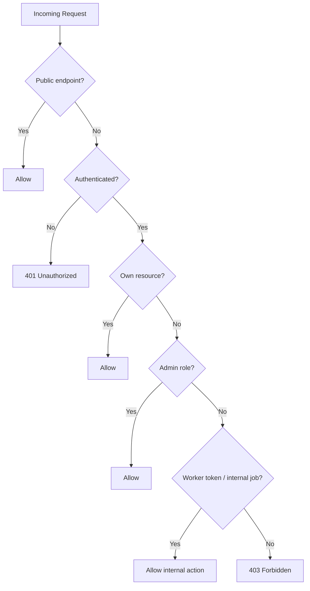

# Permission matrix

| Action | Guest | User | Admin | Worker |
| --- | ---: | ---: | ---: | ---: |
| View public home page | Yes | Yes | Yes | No |
| Register | Yes | No | No | No |
| Login | Yes | No | No | No |
| Reset password | Yes | Yes | No | No |
| View own profile | No | Yes | Yes | No |
| Update own profile | No | Yes | Yes | No |
| View public profile | Yes | Yes | Yes | No |
| Create post | No | Yes | Yes | No |
| Edit own post | No | Yes | Yes | No |
| Delete own post | No | Yes | Yes | No |
| Moderate any post | No | No | Yes | No |
| Comment on post | No | Yes | Yes | No |
| Follow user | No | Yes | Yes | No |
| View feed | Limited | Yes | Yes | No |
| Start conversation | No | Yes | Yes | No |
| Send message | No | Yes | Yes | No |
| Read own notifications | No | Yes | Yes | No |
| Mark notification read | No | Yes | Yes | No |
| Request presigned upload | No | Yes | Yes | No |
| Browse dive locations | Yes | Yes | Yes | No |
| Manage dive locations | No | No | Yes | No |
| Browse dive shops | Yes | Yes | Yes | No |
| Manage dive shops | No | No | Yes | No |
| Read learn articles | Yes | Yes | Yes | No |
| Manage learn articles | No | No | Yes | No |
| View admin stats | No | No | Yes | No |
| Process notification jobs | No | No | No | Yes |
| Clean orphan media | No | No | No | Yes |

## Security rules

## Rule

Authorization should be tested at controller/service boundaries. Never rely only on hiding buttons in the UI.
