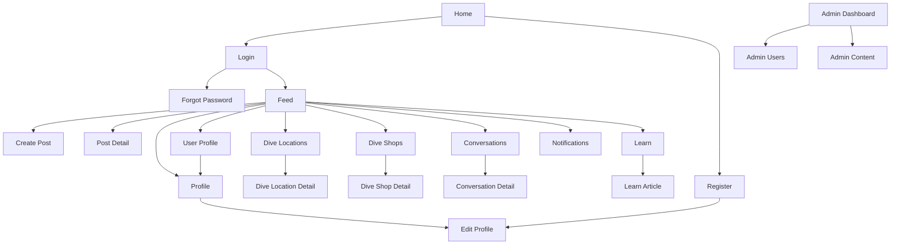

# Screen map

Frontend screens should be derived from use cases and the API tree.

## Web routes

| Screen | Example route | Primary APIs |
| --- | --- | --- |
| Home | `/` | Public content |
| Login | `/login` | `/api/auth/login` |
| Register | `/register` | `/api/auth/register` |
| Feed | `/feed` | `/api/feed`, `/api/posts` |
| Profile | `/profile` | `/api/profiles/me` |
| User Profile | `/users/{id}` | `/api/users/{id}`, `/api/profiles/{id}` |
| Dive Locations | `/dive-locations` | `/api/dive-locations` |
| Dive Shops | `/dive-shops` | `/api/dive-shops` |
| Conversations | `/messages` | `/api/conversations` |
| Notifications | `/notifications` | `/api/notifications` |
| Learn | `/learn` | `/api/learn/articles` |
| Admin | `/admin` | `/api/admin/stats` |

## Mobile navigation groups

| Group | Screens |
| --- | --- |
| Auth stack | Login, Register, Forgot Password |
| Main tabs | Feed, Dive, Learn, Messages, Profile |
| Modal flows | Create Post, Edit Profile, Media Upload |
| Detail flows | Post Detail, User Profile, Dive Location Detail, Conversation Detail |
| Admin stack | Admin Dashboard, Users, Content |
