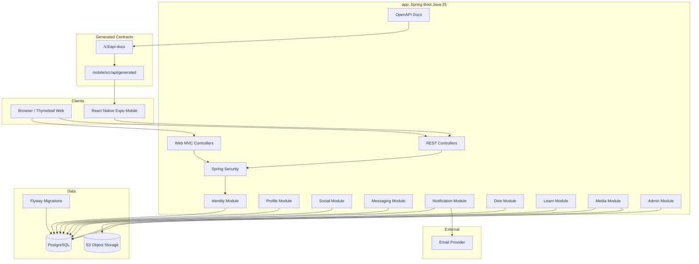
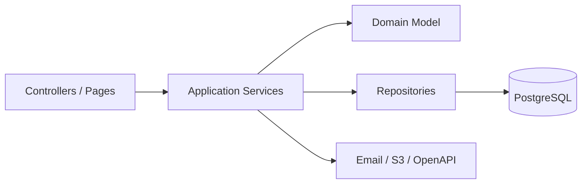

# System architecture diagram

Scuba Pal should start as an internally modular monolith with clean package/module boundaries.



## Module dependency rule



Keep dependency direction inward. Controllers should orchestrate request/response, not hold business rules.

## Suggested backend package shape

```text
app/src/main/java/com/scubapal
  identity/
  profile/
  social/
  messaging/
  notification/
  dive/
  learn/
  media/
  admin/
  shared/
```

## Split-service candidates later

| Candidate service | Split only when |
| --- | --- |
| Media service | Upload volume, malware scanning, or CDN invalidation grows. |
| Notification service | Delivery retry complexity becomes independent. |
| Messaging service | Real-time requirements require WebSocket scaling. |
| Dive catalog service | Dive data becomes separately owned/imported. |

For now, prefer one deployable backend with strong internal boundaries.
