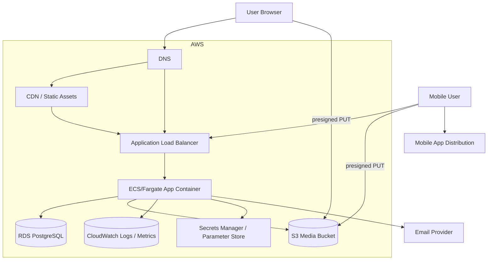
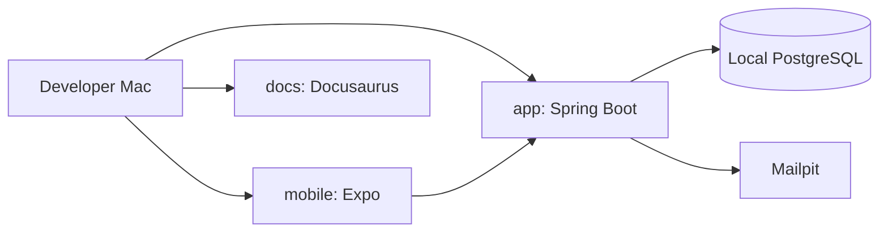
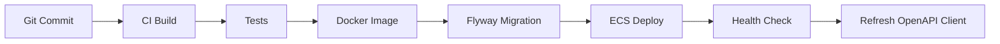

# Deployment diagram

## Production target

## Local development

## Runtime configuration

| Concern | Local | Production |
| --- | --- | --- |
| Database | Docker PostgreSQL | RDS PostgreSQL |
| Media | Local/S3 dev bucket | S3 bucket |
| Mail | Mailpit | Email provider |
| Secrets | `.env`, shell env | Secrets Manager / Parameter Store |
| Health | Actuator health endpoints | ALB/ECS health checks |
| Logs | Console | CloudWatch |
| API contract | `/v3/api-docs` | Versioned OpenAPI artifact + endpoint |

## Deployment rule

Deploy the backend only when migrations, health checks, OpenAPI generation, and smoke tests are part of the workflow.

