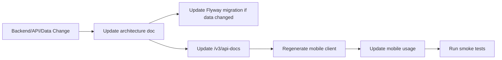

# Architecture docs guide

These files belong under the Docusaurus docs content path.

```text
scuba-pal/
  docs/
    docusaurus.config.*
    content/
      architecture/
        _category_.json
        index.md
        01-product-brief.md
        02-glossary.md
        03-actor-map.md
        04-domain-model.md
        05-erd-data-truth.md
        06-state-machines.md
        07-use-case.md
        08-sequence.md
        09-api-tree.md
        10-event-catalog.md
        11-permission-matrix.md
        12-screen-map.md
        13-system-architecture.md
        14-deployment.md
        15-architecture-decision-records.md
```

## Docusaurus convention

If your Docusaurus project root is `docs`, and your docs plugin path is renamed from `docs` to `content`, then the docs plugin should point at `content`.

```js
// docusaurus.config.js
presets: [
  [
    'classic',
    {
      docs: {
        path: 'content',
        routeBasePath: 'docs',
        sidebarPath: './sidebars.js',
      },
    },
  ],
]
```

## Maintenance workflow



## Checklist before committing docs

- Front matter exists on every Docusaurus page.
- `sidebar_position` creates a predictable reading order.
- `slug` is stable and does not depend on filename churn.
- Mermaid diagrams render locally.
- No template examples from unrelated domains remain.
- API docs and generated mobile client path are mentioned where relevant.
