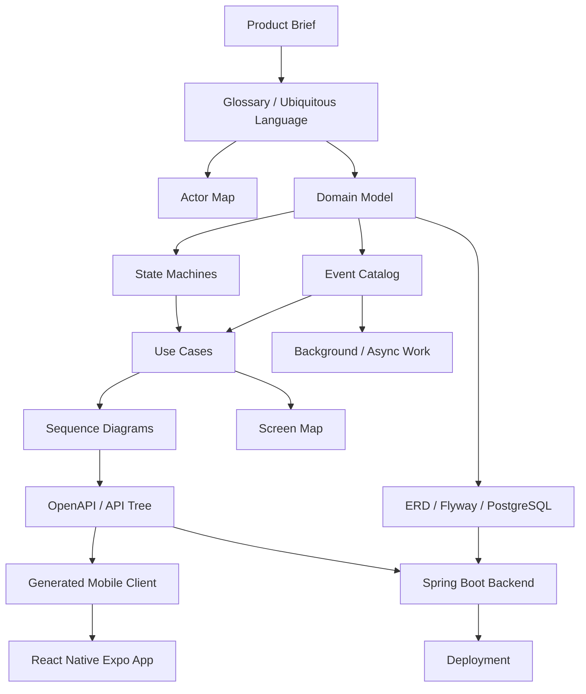

# Scuba Pal architecture

Scuba Pal is a social platform for scuba divers. The app lets divers create profiles, share posts, follow each other, discover dive locations and dive shops, message other divers, receive notifications, upload media, and learn through dive content.

This section is the **architecture contract** for the project. Code should implement this truth instead of inventing behavior ad hoc.

Progress: **55% — architecture source of truth organized**  
Next goal: keep the backend OpenAPI contract, mobile generated client, database migrations, and these docs in sync.

## Repository truth

| Area | Current convention |
| --- | --- |
| Product | Scuba Pal |
| Root repository | `scuba-pal` |
| Backend | `app` |
| Backend stack | Java 25, Spring Boot, Thymeleaf, PostgreSQL, Flyway, OpenAPI |
| Mobile | `mobile` |
| Mobile stack | React Native Expo |
| Generated mobile API client | `mobile/src/api/generated` |
| Documentation project root | `docs` |
| Docusaurus docs content path | `content` |

## Architecture source-of-truth map

## Recommended reading order

1. Product brief
2. Glossary
3. Actor map
4. Domain model
5. ERD / data truth
6. State machines
7. Use cases
8. Sequence diagrams
9. API tree
10. Event catalog
11. Permission matrix
12. Screen map
13. System architecture
14. Deployment
15. Architecture decision records

## Rule

When docs, code, API, mobile, and database disagree, fix the lower-level artifact unless the product truth intentionally changed.
