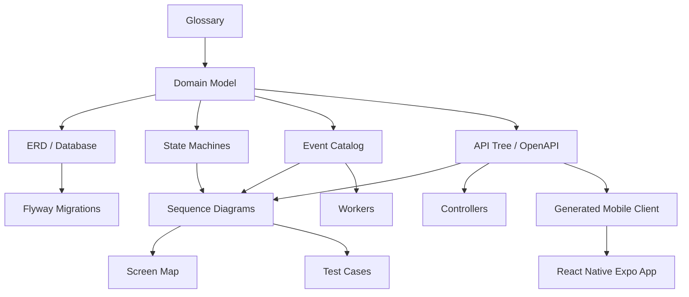

# The master relationship

This is the mental model:

For example:

> If `Message` exists in the glossary, it should appear in the domain model, ERD, API, events, state machine, sequence diagrams, screen map, permissions, and tests.

That is how you know Scuba Pal is coherent.

## Traceability table

| Artifact | Should trace to |
| --- | --- |
| Product brief | Glossary, actors, use cases |
| Glossary | Domain model, APIs, tables, UI labels |
| Domain model | ERD, state machines, event catalog |
| ERD | Flyway migrations, repositories |
| API tree | Controllers, OpenAPI, generated mobile client |
| Sequence diagrams | Services, events, tests |
| Screen map | Routes, components, mobile navigation |
| ADRs | Codebase structure and infrastructure choices |

## Coherence checklist

- A term is not added to code until it exists in the glossary or is intentionally internal.
- A table is not added without a domain object or clear infrastructure reason.
- A route is not added without a use case.
- A mobile generated client update follows backend OpenAPI changes.
- A deployment change gets an ADR if it affects architecture.
