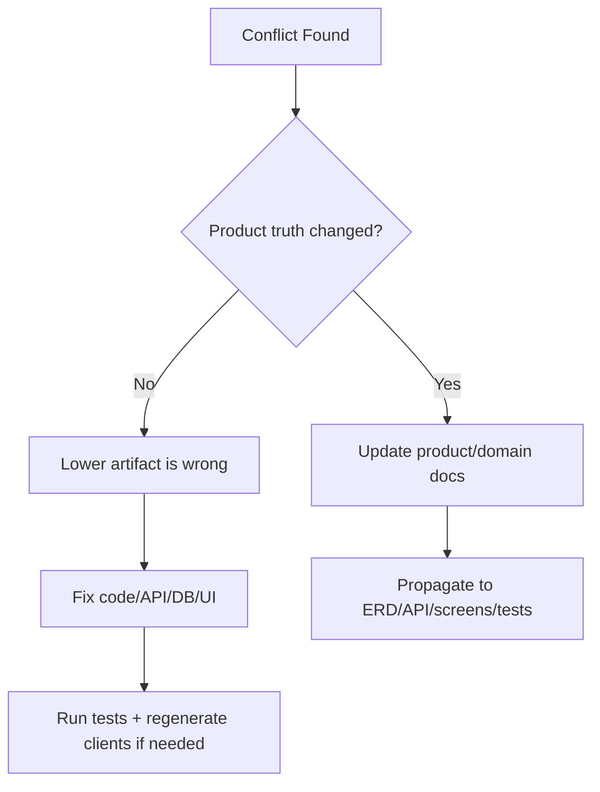

# Source-of-truth priority order

When artifacts conflict, use this order.

| Priority | Source | Why it wins |
| ---: | --- | --- |
| 1 | Product brief | Defines what Scuba Pal is and is not. |
| 2 | Glossary | Prevents naming drift across code, database, API, and UI. |
| 3 | Domain model | Defines business objects and relationships. |
| 4 | State machines | Defines legal lifecycle transitions. |
| 5 | ERD / database model | Defines persistence and constraints. |
| 6 | OpenAPI contract | Defines client-server boundary. |
| 7 | Event catalog | Defines async facts and consumers. |
| 8 | Sequence diagrams | Defines behavior over time. |
| 9 | Permission matrix | Defines authorization. |
| 10 | Screen map | Defines UI/navigation shape. |
| 11 | Code | Implements the above. |

## Practical rule

Code is allowed to reveal missing architecture, but code should not quietly become the architecture.

## Example

If mobile needs `GET /api/dive-locations?city=...` but OpenAPI does not expose it, do not hand-code a hidden mobile fetch. Update the backend endpoint and OpenAPI contract, regenerate `mobile/src/api/generated`, then update the mobile screen.
