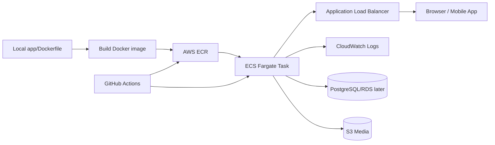
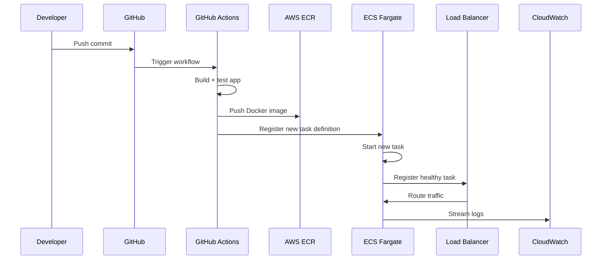
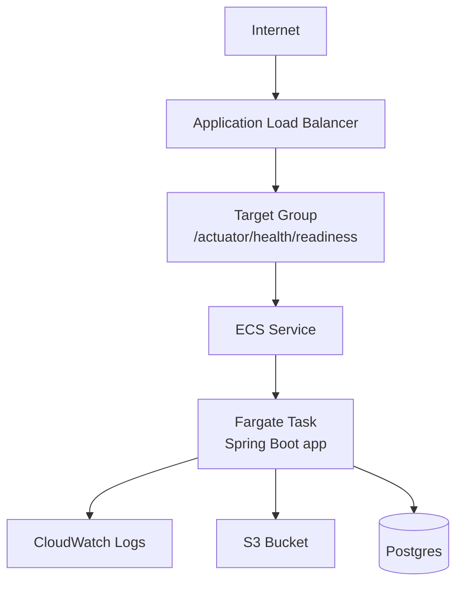
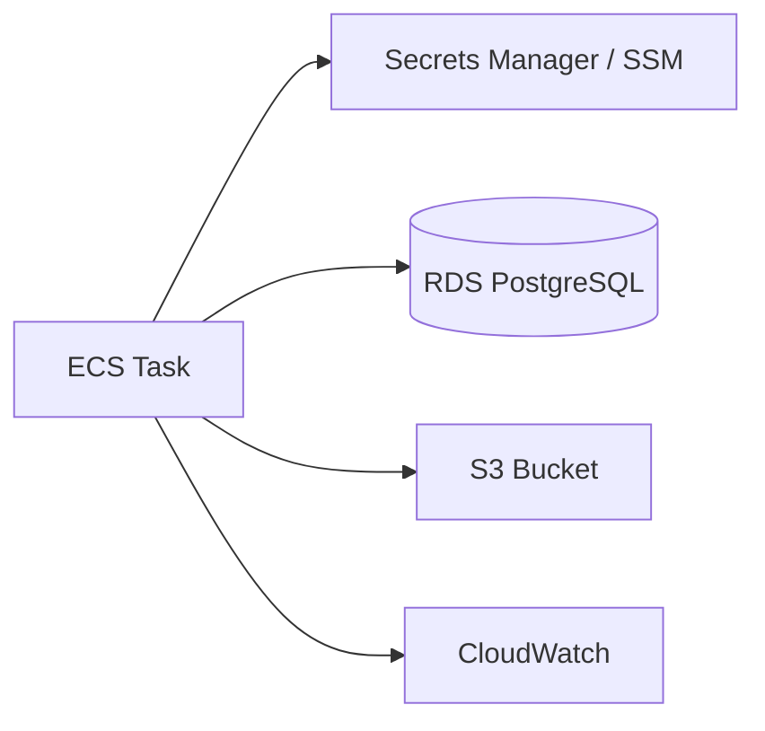
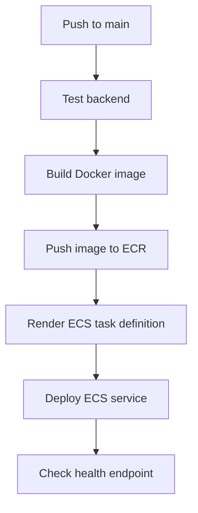

For **today**, choose **ECS Fargate**, not EKS.

EKS is valuable, but it adds Kubernetes, cluster networking, ingress controllers, IAM roles for service accounts, Helm, kubectl, and node/Fargate profile concepts before you even learn your app lifecycle. ECS Fargate gets you the real AWS deployment lifecycle faster: **image → registry → task definition → service → load balancer → logs → health checks → CI/CD**. Fargate services can sit behind an Elastic Load Balancer, and ALB gives you HTTP routing behavior you will need anyway. ([AWS Documentation][1])

Your project context: root repo is `scuba-pal`, Spring Boot backend is in `app` using Java 25, mobile is in `mobile` using React Native Expo, and generated mobile API client lives at `mobile/src/api/generated`.  You already reached a strong local container checkpoint: image builds, container starts, PostgreSQL/Flyway work, S3 config exists, and readiness/liveness are UP. 

## Today’s target

**Progress: 35% → 70% today**

End goal:



Today’s “win” is not perfect architecture. It is:

> I can push code, build an image, deploy it to AWS, hit a health endpoint, see logs, and understand what broke.

---

# My recommendation

Use this sequence:

1. **Manual ECS Fargate deployment first**
2. **Then GitHub Actions deploy**
3. **Then RDS/S3/secrets hardening**
4. **Then EKS later**

App Runner is simpler, but it hides too much. EKS is powerful, but too much ceremony for today. App Runner supports managed Java runtimes and container-style deployment, but for learning production lifecycle, ECS exposes the right amount of machinery. ([AWS Documentation][2])

---

# Deployment lifecycle you should learn today



---

# Phase 1 — Commit your local deployment checkpoint

Run:

```bash
git status
```

Breakdown:

```text
git status
```

Shows modified, staged, deleted, and untracked files before you deploy.

Then commit the stable local container state:

```bash
git add app/Dockerfile Makefile
git commit -m "Add backend container deployment baseline"
```

Breakdown:

```text
git add
```

Stages files for the next commit.

```text
app/Dockerfile
```

Your deployable backend image recipe.

```text
Makefile
```

Your repeatable local workflow commands.

```text
git commit -m
```

Creates a checkpoint with a short message.

---

# Phase 2 — Create ECR repo

Use one AWS region and stick to it today. I would use:

```text
us-west-2
```

Run:

```bash
aws sts get-caller-identity
```

Breakdown:

```text
aws
```

AWS CLI.

```text
sts get-caller-identity
```

Confirms which AWS account and IAM identity you are using.

Set variables:

```bash
export AWS_REGION=us-west-2
export APP_NAME=scubapal-backend
export AWS_ACCOUNT_ID=$(aws sts get-caller-identity --query Account --output text)
```

Breakdown:

```text
export
```

Stores shell variables for this terminal session.

```text
--query Account
```

Extracts only the AWS account ID.

```text
--output text
```

Prints plain text instead of JSON.

Create ECR repository:

```bash
aws ecr create-repository \
  --repository-name "$APP_NAME" \
  --region "$AWS_REGION"
```

Breakdown:

```text
aws ecr create-repository
```

Creates a private Docker image repository in Amazon ECR.

```text
--repository-name
```

Names the repository.

```text
--region
```

Chooses the AWS region.

---

# Phase 3 — Build and push Docker image

From repo root:

```bash
docker build \
  -t "$APP_NAME:latest" \
  -f app/Dockerfile \
  app
```

Breakdown:

```text
docker build
```

Builds a container image.

```text
-t "$APP_NAME:latest"
```

Tags the local image.

```text
-f app/Dockerfile
```

Uses your backend Dockerfile.

```text
app
```

Sets the build context to the backend folder.

Authenticate Docker to ECR:

```bash
aws ecr get-login-password \
  --region "$AWS_REGION" \
| docker login \
  --username AWS \
  --password-stdin "$AWS_ACCOUNT_ID.dkr.ecr.$AWS_REGION.amazonaws.com"
```

Breakdown:

```text
aws ecr get-login-password
```

Gets a temporary ECR login token.

```text
| docker login
```

Pipes that token into Docker login.

```text
--password-stdin
```

Avoids putting credentials directly into the command history.

Tag and push:

```bash
docker tag \
  "$APP_NAME:latest" \
  "$AWS_ACCOUNT_ID.dkr.ecr.$AWS_REGION.amazonaws.com/$APP_NAME:latest"

docker push \
  "$AWS_ACCOUNT_ID.dkr.ecr.$AWS_REGION.amazonaws.com/$APP_NAME:latest"
```

Breakdown:

```text
docker tag
```

Creates the remote ECR tag for your local image.

```text
docker push
```

Uploads the image to ECR.

---

# Phase 4 — ECS Fargate deployment shape

Use this minimal production-ish shape:



Important: health check should be:

```text
/actuator/health/readiness
```

Not `/`, not `/login`, not a page that depends on auth. Your previous checkpoint already identified readiness/liveness as the correct health model. 

---

# Phase 5 — What you should create in AWS console first

For today, console is okay. You are learning lifecycle, not proving Terraform purity yet.

Create:

| AWS resource         | Name                       |
| -------------------- | -------------------------- |
| ECR repo             | `scubapal-backend`         |
| ECS cluster          | `scubapal-cluster`         |
| ECS task definition  | `scubapal-backend-task`    |
| ECS service          | `scubapal-backend-service` |
| ALB                  | `scubapal-alb`             |
| Target group         | `scubapal-backend-tg`      |
| CloudWatch log group | `/ecs/scubapal-backend`    |

Use:

| Setting        | Value                                              |
| -------------- | -------------------------------------------------- |
| Launch type    | Fargate                                            |
| Container port | `8080`                                             |
| Desired tasks  | `1`                                                |
| CPU            | `0.5 vCPU` or smallest available                   |
| Memory         | `1 GB` minimum                                     |
| Health path    | `/actuator/health/readiness`                       |
| Public IP      | enabled for first deploy                           |
| Environment    | `SPRING_PROFILES_ACTIVE=prod` or `dev` temporarily |

---

# Phase 6 — Secrets and env vars

Start with env vars only if this is a learning deploy. Then move secrets to AWS Secrets Manager or SSM Parameter Store.

Your backend likely needs:

```text
SPRING_PROFILES_ACTIVE
DB_URL
DB_USERNAME
DB_PASSWORD
MEDIA_S3_REGION
MEDIA_S3_BUCKET
SPRING_MAIL_HOST
SPRING_MAIL_PORT
```

For first cloud deploy, you can temporarily point to a reachable database, but the better AWS shape is:



---

# Phase 7 — Add CI/CD only after manual deploy works

GitHub Actions should come second because then you know what it is automating.

Use GitHub OIDC instead of long-lived AWS keys. GitHub’s AWS OIDC setup lets GitHub Actions assume an AWS IAM role without storing permanent AWS access keys as repo secrets. ([GitHub][3])

Your workflow should eventually do:



---

# What problems you are supposed to encounter

These are not failures. These are the actual curriculum:

| Problem                                 | What it teaches                                              |
| --------------------------------------- | ------------------------------------------------------------ |
| Container runs locally but fails in ECS | Missing env vars, architecture, port, or startup assumptions |
| Health check fails                      | Actuator/security/load balancer path design                  |
| App starts but DB fails                 | VPC, security groups, DNS, credentials                       |
| S3 upload fails                         | IAM permissions and bucket policy                            |
| ECS task keeps restarting               | logs, exit codes, memory, readiness timing                   |
| Mobile cannot hit backend               | public URL, CORS, HTTPS, API base URL                        |
| Deploy works manually but CI fails      | IAM/OIDC permissions and reproducibility                     |
| Image builds slowly                     | Docker layering and CI caching                               |
| Rollback unclear                        | image tags, task definition revisions                        |

---

# Today’s exact next goal

**Next goal: push your backend image to ECR and start one ECS Fargate task behind an ALB.**

Definition of done:

```text
✅ Image exists in ECR
✅ ECS task starts
✅ CloudWatch shows Spring Boot logs
✅ ALB health check passes
✅ /actuator/health/readiness returns UP
✅ You can open the backend from the ALB DNS name
```

After that, your progress jumps to **70%**.

Do **not** start with EKS today. Learn ECS lifecycle first; then EKS will make much more sense because you will already understand the deployment primitives Kubernetes is abstracting.

[1]: https://docs.aws.amazon.com/AmazonECS/latest/developerguide/AWS_Fargate.html?utm_source=chatgpt.com "Architect for AWS Fargate for Amazon ECS"
[2]: https://docs.aws.amazon.com/apprunner/latest/dg/service-source-code-java.html?utm_source=chatgpt.com "Using the Java platform - AWS App Runner"
[3]: https://github.com/aws-actions/configure-aws-credentials?utm_source=chatgpt.com "Configure AWS credential environment variables for use ..."
