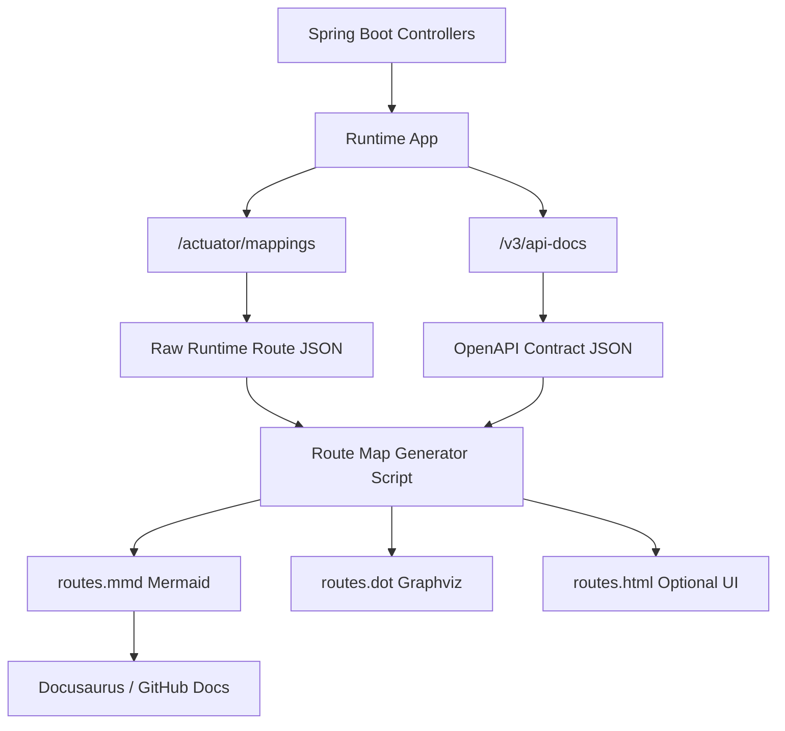
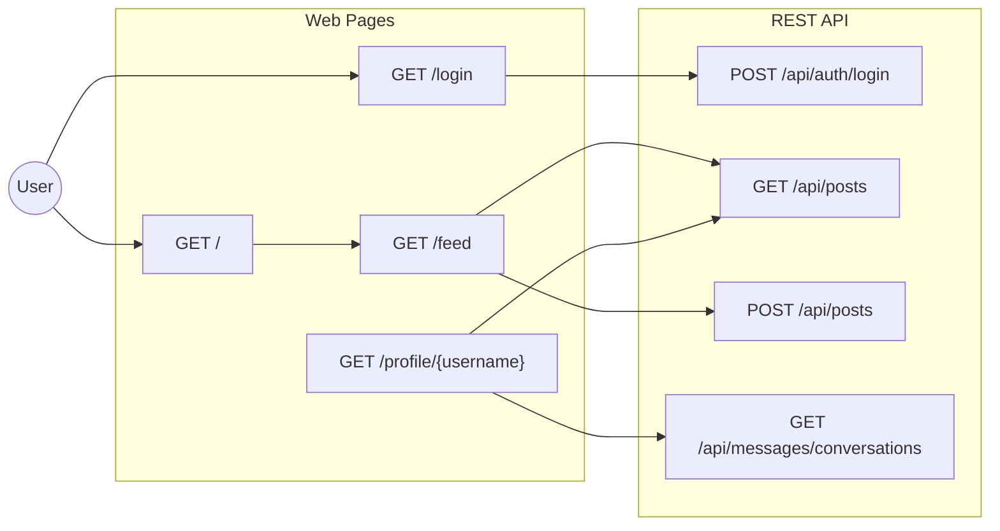
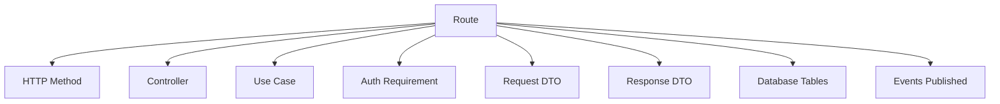
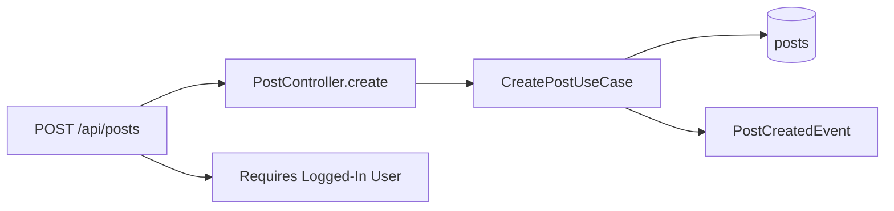
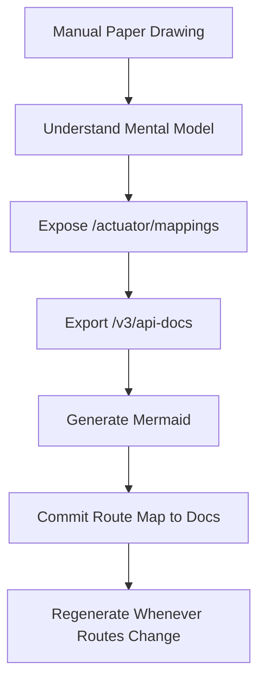

You should **not manually draw URL maps** once the app grows. Manual drawing is good for thinking, but the durable system is:

> **routes in code → exported JSON → generated Mermaid/D2/Graphviz diagram**

Progress: **25% — route-map source-of-truth chosen**
Next goal: generate your first route map from your running app.

## Best answer for your Spring Boot apps

Use **three layers**:

| Need                 | Tool                                          |
| -------------------- | --------------------------------------------- |
| Exact runtime routes | Spring Boot Actuator `/actuator/mappings`     |
| Clean API contract   | springdoc OpenAPI `/v3/api-docs` + Swagger UI |
| Visual route map     | Mermaid, D2, or Graphviz generated from JSON  |

Spring Boot’s Actuator has a mappings endpoint that exposes application request mappings, which is exactly what you want for runtime route discovery. ([Home][1])
`springdoc-openapi` can automatically generate OpenAPI documentation from Spring Boot runtime/config/annotations. ([OpenAPI 3 Library for spring-boot][2])
Swagger UI visualizes OpenAPI definitions interactively, but it is more of an API docs browser than a true architecture map. ([Swagger][3])
Mermaid supports flowcharts with nodes, arrows, and subgraphs, so it is good for version-controlled URL diagrams in Markdown/docs. ([Mermaid][4])

## The ideal route-map pipeline



## What I would do for your projects

For Scuba Pal / Quote Book / Ryd / any Spring Boot app:

```bash
curl -s http://localhost:8080/actuator/mappings -o docs/routes/spring-mappings.json
```

Flags:

| Part                                  | Meaning                            |
| ------------------------------------- | ---------------------------------- |
| `curl`                                | Makes an HTTP request              |
| `-s`                                  | Silent mode; hides progress noise  |
| URL                                   | Reads Spring Boot runtime mappings |
| `-o docs/routes/spring-mappings.json` | Writes output into a file          |

Then:

```bash
curl -s http://localhost:8080/v3/api-docs -o docs/routes/openapi.json
```

That gives you the API contract.

Then a tiny script converts paths into Mermaid:



## Tool choices

### 1. Swagger UI / OpenAPI

Use this for:

* API endpoint discovery
* request/response schemas
* controller grouping
* frontend/mobile client generation

But it does **not** show full app flow well.

### 2. Actuator mappings

Use this for:

* “What URLs does my app actually expose?”
* MVC routes
* REST routes
* actuator routes
* accidental routes you forgot existed

This is the most truthful source.

Important: expose `/actuator/mappings` only locally/dev, not publicly in production.

### 3. Mermaid

Use this for:

* route maps in docs
* deterministic diagrams
* Docusaurus/GitHub Markdown
* readable paper-like architecture

### 4. Graphviz or D2

Use these when the graph gets huge.

Graphviz DOT is designed around graphs, nodes, edges, subgraphs, and clusters. ([Graphviz][5])
D2 is a modern text-to-diagram language focused on declarative system diagrams. ([D2 Documentation][6])

## The convention I’d use

Do **not** only map URLs by path nesting. Map them by meaning:



Example:



That is way more useful than a normal sitemap.

## Minimum route metadata worth tracking

For each URL, capture:

```text
method
path
controller
handler
auth
role
request dto
response dto
tables touched
events emitted
called by page/component
redirects to
```

That becomes your route architecture database.

## My recommended folder structure

```text
docs/
  routes/
    openapi.json
    spring-mappings.json
    route-map.mmd
    route-map.md
scripts/
  generate-route-map.py
```

## Final recommendation

For now, do this:



So no, you do **not** need to do it manually forever.

The long-term optimal setup is:

> **Spring Boot Actuator + OpenAPI + tiny generator script + Mermaid/D2 docs**

That gives you deterministic, repeatable, version-controlled URL maps.

[1]: https://docs.spring.io/spring-boot/api/rest/actuator/mappings.html?utm_source=chatgpt.com "Mappings (mappings) :: Spring Boot"
[2]: https://springdoc.org/?utm_source=chatgpt.com "Springdoc-openapi"
[3]: https://swagger.io/tools/swagger-ui/?utm_source=chatgpt.com "REST API Documentation Tool | Swagger UI"
[4]: https://mermaid.ai/open-source/syntax/flowchart.html?utm_source=chatgpt.com "Flowcharts Syntax | Mermaid"
[5]: https://graphviz.org/doc/info/lang.html?utm_source=chatgpt.com "DOT Language"
[6]: https://d2lang.com/?utm_source=chatgpt.com "Home | D2 Documentation"
