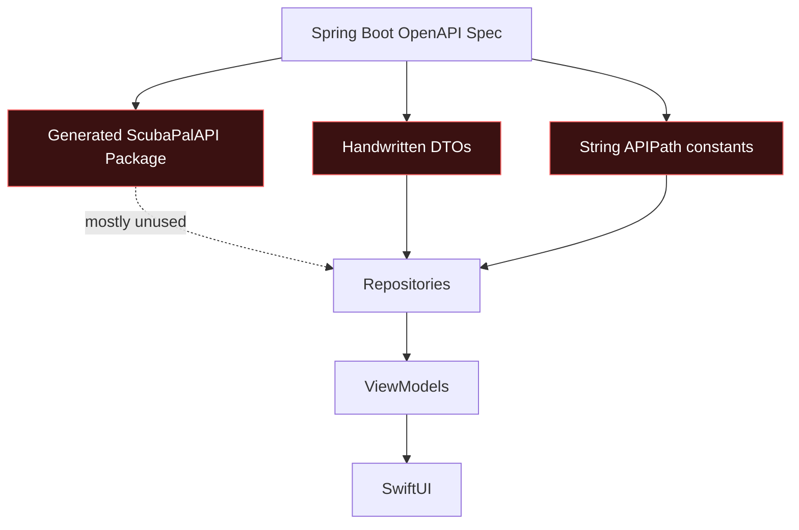
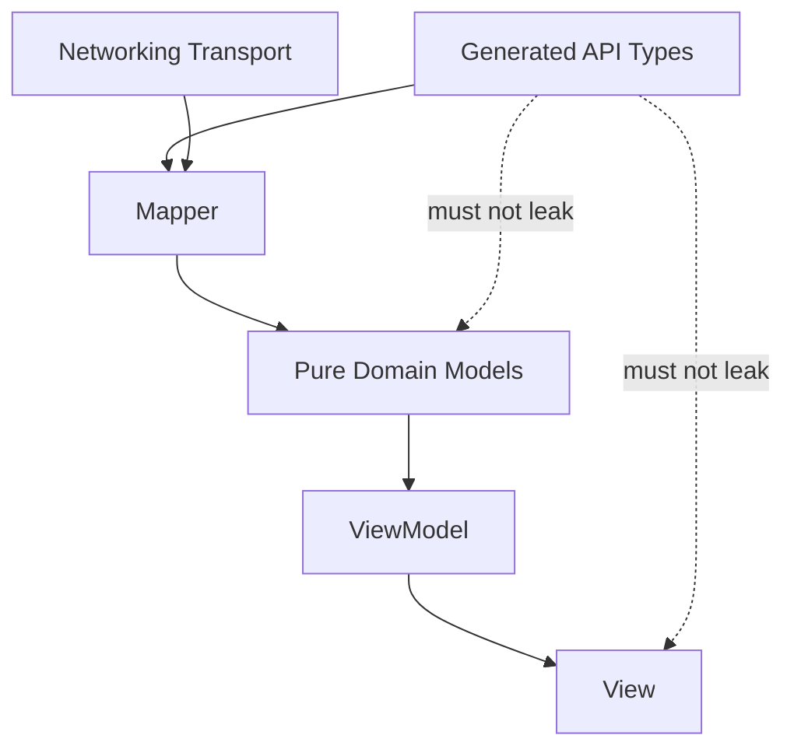
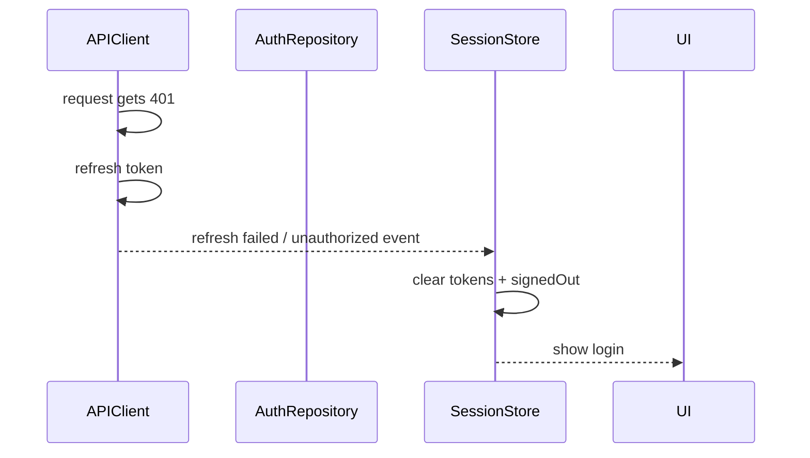
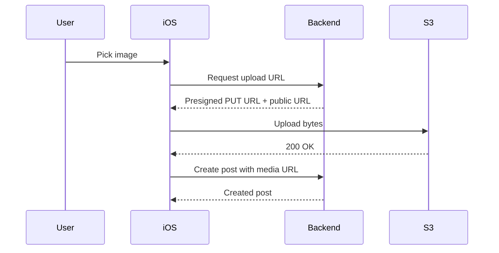
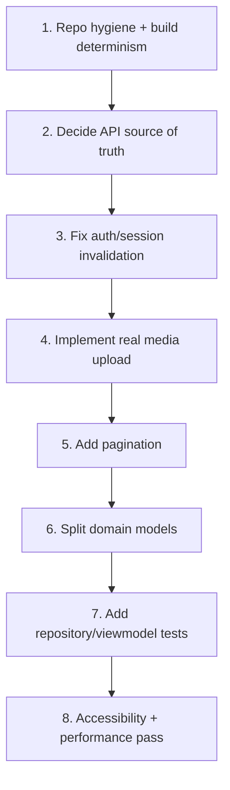

Progress: **35% toward production-ready iOS client** — static audit complete. Next goal: **make the project build deterministically and remove contract drift** before adding features.

## Blunt verdict

Your app has a decent **folder skeleton**, but it is not yet robust. Right now it is a polished SwiftUI prototype sitting on top of a fragile networking layer.

The biggest issue is not UI. The biggest issue is **source-of-truth confusion**:



You currently have **three competing API contracts**: OpenAPI JSON, generated client package, and handwritten DTO/path constants. That will become a maintenance trap.

---

# P0 — build / repo hygiene blockers

## 1. The project references a missing local package

`scubapal-ios.xcodeproj/project.pbxproj` references:

```text
Packages/ScubaPalAPI
```

But the uploaded project does **not** include `Packages/ScubaPalAPI`.

At the same time, this file imports it:

```swift
import ScubaPalAPI
```

in:

```text
scubapal-ios/API/Generated/ScubaPalGeneratedClient.swift
```

That means this zip likely does **not build cleanly as uploaded** unless that package exists outside the repo. That is a serious reproducibility failure.

You are not following: **“clone repo → build app” determinism.**

Fix: either commit the local Swift package or remove the project reference and unused generated wrapper until you actually migrate.

---

## 2. You committed machine-local junk

The zip contains:

```text
.DS_Store
__MACOSX
xcuserdata
Config/Debug.local.xcconfig
```

Your own `AGENTS.md` says not to commit these. You violated your own repo rule.

The worst one is:

```text
Config/Debug.local.xcconfig
```

because it contains your local Mac hostname. That file should never be tracked.

Cleanup commands:

```bash
find . -name ".DS_Store" -delete
```

`find .` searches from the current directory.
`-name ".DS_Store"` matches macOS metadata files.
`-delete` removes the matched files.

```bash
rm -rf __MACOSX
```

`rm` removes files/directories.
`-r` removes directories recursively.
`-f` forces removal without prompts.

```bash
rm -rf scubapal-ios.xcodeproj/xcuserdata scubapal-ios.xcodeproj/project.xcworkspace/xcuserdata
```

Removes Xcode user-specific workspace/project state.

```bash
git rm --cached Config/Debug.local.xcconfig
```

`git rm` removes a file from Git tracking.
`--cached` keeps the local file but removes it from the repository.

Then add a real `.gitignore`.

---

# P1 — architecture flaws

## 3. Folders are pretending to be architecture

You have:

```text
API/
Core/
Domain/
Features/
DesignSystem/
```

That looks clean, but it is all one app target. The compiler does not enforce boundaries.

Example problem: your domain model uses API-layer enum concepts like `VisibilityStatus`. Since everything is in one module, you do not feel the leak, but architecturally the domain layer now depends on transport contract naming.

Better:



Your target direction should be:

```text
SwiftUI View
  -> ViewModel
  -> Repository Protocol
  -> Repository Implementation
  -> API Client / Generated Client
  -> Backend
```

But the domain should not know backend enum names, backend optionality, or transport shape.

---

## 4. OpenAPI migration is half-done

You have docs saying generated OpenAPI exists, a wrapper called `ScubaPalGeneratedClient`, a package reference, and handwritten DTOs still doing the real work.

That is the worst middle state.

Pick one:

### Option A — for now, remove generated client

Use handwritten networking intentionally. Delete:

```text
API/Generated/ScubaPalGeneratedClient.swift
```

and remove the package reference until ready.

### Option B — actually migrate one endpoint

Start with `learnArticles()` or `locations()`, not auth.

Current state is redundant and confusing.

---

# P1 — API/client flaws

## 5. `APIPath` is stringly typed and fragile

`APIPath.swift` manually stores every route as strings:

```swift
static let posts = "/api/posts"
static func post(id: Int) -> String {
    "/api/posts/\(id)"
}
```

This is okay for a tiny prototype, but fragile long-term.

Problems:

1. No compiler verification against OpenAPI.
2. No HTTP method coupling.
3. No typed query params.
4. No request/response association.
5. Tests only verify that constants equal hardcoded strings — they do not prove backend compatibility.

Your `APIPathTests` are weak because they test your constants against your own expectations, not against the actual OpenAPI spec.

---

## 6. DTOs are too optional

Almost every DTO field is optional:

```swift
var postId: Int?
var username: String?
var createdAt: String?
```

Then mappers decide what is required.

This is defensive, but it hides contract problems. If the backend says a field is required, model it as required in the generated transport layer. Optional-everything makes API drift harder to catch early.

Good: you added `RequiredField`.

Bad: you pushed contract correctness from compile-time into runtime mapping failures.

---

## 7. You ignore pagination almost everywhere

Repositories call only page 0 with fixed sizes:

```swift
PageRequest(size: 30)
PageRequest(size: 50)
PageRequest(size: 80)
```

But your backend returns page metadata.

That means feed, profiles, conversations, notifications, shops, and locations silently truncate. It is not scalable.

You need a pagination model:

```swift
struct PageCursor: Equatable {
    var page: Int
    var size: Int
    var hasNext: Bool
}
```

Then feature view models need `loadInitial()` and `loadNextPageIfNeeded()`.

---

## 8. Auth refresh does not globally sign the user out

`APIClient` refreshes after a 401. Good.

But if refresh fails, the app throws `APIError.unauthorized` and the UI may show “session expired,” while `SessionStore` can remain `.signedIn`.

That is broken session ownership.

Auth expiration should be a global event:



Right now, request-level auth failure and app-level session state are not coordinated.

---

## 9. You are not using token expiration

`AuthResponse` has:

```swift
var expiresAt: String?
```

But `TokenPair` only stores:

```swift
var accessToken: String
var refreshToken: String
```

So the client only refreshes reactively after failure.

That causes avoidable failed requests. Store expiry and refresh proactively when close to expiration.

---

## 10. `EmptyResponse` uses a forced cast

In `APIClient.decodeResponse`:

```swift
return EmptyResponse() as! Response
```

This is probably safe because you check the type immediately before, but forced casts in core networking are still sloppy. It is a small smell, not a disaster.

More important: your `requestNoContent` path assumes empty body, but backend endpoints may return a message body. You need explicit handling for:

```text
204 No Content
200 with empty body
200 with JSON body
```

---

# P1 — feature correctness flaws

## 11. Post creation is fake for real mobile usage

The compose UI asks for:

```text
Image URL
```

That is not a production mobile app flow.

Your backend OpenAPI includes:

```text
/api/media/uploads
```

But the iOS app does not implement presigned upload, image picking, content-type validation, or upload progress.

This is a major missing feature because ScubaPal is media-heavy.

Correct flow:



Right now you are making the user paste a URL. That is prototype behavior.

---

## 12. “Saved for later” is fake

`FeedView.swift` shows:

```swift
appUI.showToast("Saved for later", systemImage: "bookmark.fill")
```

But there is no saved-post backend call. The card only toggles local `@State`.

This is dangerous UX. It tells the user something persisted when it did not.

Either implement saved posts or rename it to a local-only visual state. Better: remove it until real.

---

## 13. Learn button is fake navigation

The feed header says Learn is available from Discover and only shows a toast.

That is not robust. Navigate to Discover → Learn tab, or remove the button.

---

# P2 — state management flaws

## 14. View models swallow important failures

Example in `PostDetailViewModel`:

```swift
guard let detail = try? await repository.postDetail(id: post.id) else { return }
```

This silently fails. No error state. No toast. No retry.

That is not production-grade. `try?` is acceptable only when failure is genuinely irrelevant. Here it is relevant.

Also in `BadgeStore`:

```swift
async let messages = try? messagingRepository.unreadCount()
async let notifications = try? notificationsRepository.unreadCount()
```

This hides auth/network/backend problems.

You are overusing `try?` as a broom.

---

## 15. Tasks are mostly unmanaged

You use many:

```swift
Task { ... }
```

inside views.

That is common in SwiftUI, but unmanaged tasks can outlive view intent. For simple button taps it is okay; for repeated search/load flows you need cancellation and dedupe.

`DiscoverView` debounces search with:

```swift
.task(id: searchText) {
    try? await Task.sleep(for: .milliseconds(260))
    guard !Task.isCancelled else { return }
    await loadCurrent()
}
```

Good direction, but it also separately runs:

```swift
.task(id: activeFilter)
```

That can double-load when filter/search changes together.

---

## 16. MainActor view models do too much

Most view models are `@MainActor`. That is fine for UI state mutation, but you also do mapping, sorting, filtering, and optimistic update logic there.

For current scale it is okay. Long-term, keep:

```text
MainActor: state assignment
Repository/Service: work
Mapper: transformation
```

Do not let view models become feature services.

---

# P2 — domain modeling flaws

## 17. `User` is a god model

`User` contains:

```swift
id
username
firstName
lastName
email
role
city
state
country
profileImageUrl
profileImageURL
visibilityStatus
bio
diveCount
followersCount
followingCount
followedByMe
```

This is too much for one model. You are merging:

```text
Account
Profile
PublicUser
AuthUser
FollowState
```

That makes every feature carry irrelevant optional data.

Better:

```swift
struct UserIdentity {
    let id: UserID
    let username: String
}

struct PublicProfile {
    let user: UserIdentity
    let displayName: String
    let avatarURL: URL?
    let bio: String?
    let stats: DiveStats
    let followState: FollowState?
}

struct CurrentUser {
    let id: UserID
    let username: String
    let email: String
    let role: UserRole
    let profile: PublicProfile
}
```

---

## 18. Duplicate raw/resolved image URL fields

`User` has both:

```swift
var profileImageUrl: String?
var profileImageURL: URL?
```

This is confusing and easy to desync.

Prefer one app-facing field:

```swift
var avatarURL: URL?
```

If you need raw backend value, keep it in DTO, not domain.

---

## 19. Domain defaults hide backend bugs

Examples:

```swift
diveCount: diveCount ?? 0
followersCount: follow?.followerCount ?? 0
messageText ?? ""
caption ?? ""
```

Sometimes defaults are okay. But if the backend forgot a field, the app quietly displays false data.

Use defaults only for genuinely optional presentation fields. For required business state, fail mapping.

---

# P2 — UI / performance / accessibility flaws

## 20. Too many hardcoded strings

You have hundreds of string literals. That blocks localization and consistency.

Examples:

```text
"Welcome back"
"Account created"
"Saved for later"
"Post to the lounge"
"Syncing your dive circle"
```

For a production app, move user-facing copy into `Localizable.xcstrings` or at least a `Copy` namespace first.

---

## 21. Accessibility is thin

You have only a few accessibility labels. Many icon buttons and custom controls rely on SF Symbol names or visual context.

This is especially bad because you use custom tab bars, custom buttons, custom cards, and image-heavy layouts.

For every icon-only button, provide a human label:

```swift
.accessibilityLabel("Log out")
```

Not:

```swift
.accessibilityLabel(systemImage)
```

`"rectangle.portrait.and.arrow.right"` is not a user-facing accessibility label.

---

## 22. Visual polish may be expensive

You use many gradients, ultraThinMaterial backgrounds, shadows, overlays, and animated transitions.

That is fine for a premium look, but you need performance discipline on real devices. Watch especially:

```text
LazyVGrid image feed
AsyncImage
ultraThinMaterial
large shadows
animated matched geometry tab bar
```

You need Instruments testing before calling this fast.

---

## 23. `RelativeDateTimeFormatter` is recreated repeatedly

`Date.relativeShort()` creates a formatter every call:

```swift
let formatter = RelativeDateTimeFormatter()
```

Formatters are not free. Cache it statically.

---

# P2 — testing flaws

Your tests are a good start, but too shallow.

You have mapper tests, date parsing tests, some API client refresh testing. Missing:

```text
Repository tests
ViewModel tests
Session expiration tests
Logout tests
Pagination tests
Media upload tests
Error mapping tests per status code
Contract tests against OpenAPI paths
Accessibility/UI tests
```

The path tests are especially weak because this:

```swift
XCTAssertEqual(APIPath.posts, "/api/posts")
```

only proves that your constant equals your hardcoded expectation. It does not prove the backend still supports it.

---

# P3 — configuration flaws

## 24. You have a `Staging.xcconfig` but no staging build configuration

The project has Debug and Release build configurations. `Staging.xcconfig` exists, but the Xcode project does not appear to define a Staging configuration.

That is dead config unless manually wired.

---

## 25. Release can crash at launch if env vars are missing

`AppConfig.live()` does:

```swift
preconditionFailure("SCUBAPAL_API_BASE_URL must be configured...")
```

Fail-fast is okay in development. In Release, this means a bad build setting becomes a launch crash.

Better:

```swift
#if DEBUG
preconditionFailure(...)
#else
return safe production config or show fatal configuration screen
#endif
```

Also enforce HTTPS for staging/production.

---

## 26. Bundle/app naming is messy

Project name:

```text
scubapal-ios
```

Product:

```text
Scuba Pal
```

Bundle ID:

```text
com.scubapal.app
```

Asset catalog:

```text
AppIcon 1
AppIcon
```

Clean this. `AppIcon 1` is sloppy.

---

# What you are doing right

You do have some good foundations:

* Keychain storage instead of `UserDefaults`.
* Repository protocols for previews/tests.
* Domain mapping layer instead of dumping DTOs into SwiftUI.
* `@MainActor` for UI state.
* Basic error redaction.
* Basic token refresh dedupe with `refreshTask`.
* Preview dependencies.
* Some mapper tests.

So the code is not bad. But it is **not production robust yet**.

---

# Fix order

Do this in order. Do not jump to UI polish.



## Immediate next goal

Get to **45%** by doing only this:

1. Remove committed junk files.
2. Add `.gitignore`.
3. Restore or remove `Packages/ScubaPalAPI`.
4. Decide whether handwritten API or generated API is the source of truth.
5. Make a clean clone build without machine-local files.

Until that is true, anything else is building on sand.
