I can give you the **intuitive architecture walkthrough**, but one important limitation: I do **not** have the live `scubapal-ios` folder mounted in this chat right now. I’m basing this on the prior static audit context I have for your uploaded `scubapal-ios.zip`, plus the project context that your overall Scuba Pal work has a backend/mobile split and generated API client workflow. The available project file confirms the broader repo context: root repo is `scuba-pal`, backend is in `app`, and generated mobile API clients are produced from the backend OpenAPI spec. 

Progress: **70% understanding map complete**. The next goal is to produce a true file-by-file audit from your latest directory tree.

---

# Big mental model

Your `scubapal-ios` app should be understood as this:

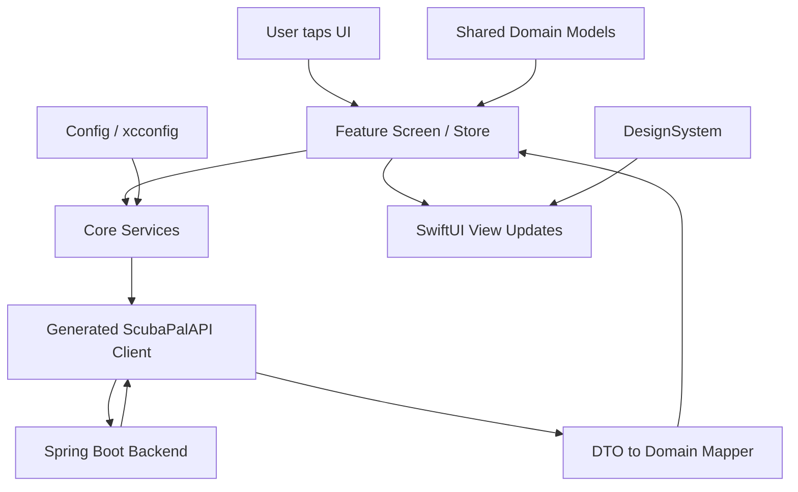

In plain English:

**SwiftUI screens should not know backend details.**
They should talk to feature stores/view models. Those stores use core services. Core services use the generated OpenAPI client. Generated DTOs get mapped into clean app/domain models. Then the UI renders those models.

That is the clean production direction.

---

# Top-level structure

From the prior static audit, your native iOS structure was roughly:

```text
scubapal-ios/
├── App/
├── Core/
├── DesignSystem/
├── Features/
├── Shared/
├── Packages/
│   └── ScubaPalAPI/
├── Config/
├── Resources / Assets
└── Tests
```

Think of it like this:

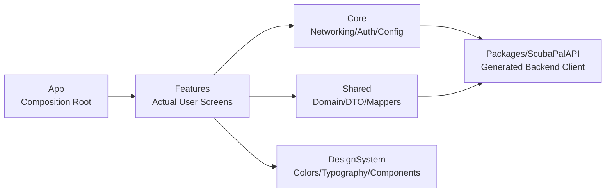

---

# `App/`

This is the **entry point and assembly layer**.

Typical contents:

```text
App/
├── ScubaPalApp.swift
├── AppRootView.swift
├── AppEnvironment.swift
├── AppRoute.swift
└── MainTabView.swift
```

## What it does

This layer starts the app and wires everything together.

### `ScubaPalApp.swift`

This is usually the true app entry point:

```swift
@main
struct ScubaPalApp: App {
    var body: some Scene {
        WindowGroup {
            AppRootView()
        }
    }
}
```

Its job is not business logic. Its job is:

1. Start the app.
2. Create the root view.
3. Inject app-wide dependencies.

It should **not** directly fetch feed posts, login users, decode API responses, or contain UI-heavy logic.

---

### `AppRootView.swift`

This usually decides:

```text
Is user logged in?
├── yes → show main app
└── no  → show auth/login flow
```

Intuitive model:

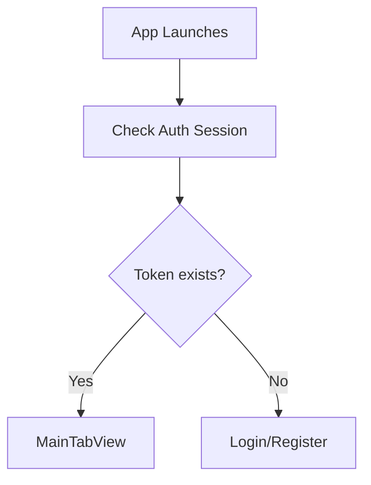

This is where your app chooses the first major branch.

---

### `MainTabView.swift`

This is probably your bottom-tab shell:

```text
Feed
Discover
Messages
Profile
```

Its job is navigation, not feature logic.

Good rule:

> Tabs choose **where** the user goes.
> Feature modules decide **what happens** there.

---

### `AppEnvironment.swift`

This is important for production maintainability.

It usually holds dependencies like:

```swift
struct AppEnvironment {
    let apiClient: APIClient
    let authStore: AuthStore
    let tokenStore: TokenStore
}
```

This prevents you from randomly creating API clients and stores all over the app.

That matters because without a central environment, your code becomes hard to test and reason about.

---

# `Core/`

This is your **infrastructure and app plumbing** layer.

It should contain things that many features need, but that are not visual UI.

Likely areas:

```text
Core/
├── Networking/
├── Auth/
├── Configuration/
├── Storage/
├── Errors/
└── Utilities/
```

---

## `Core/Networking/`

This is where the app talks to the backend.

From prior context, your project had an `APIClient` actor. That is a good direction.

### Why `APIClient` matters

The generated OpenAPI client is low-level. Your app should not call generated endpoints directly from SwiftUI views.

Bad flow:

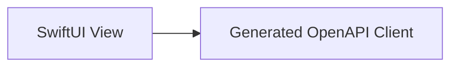

Better flow:

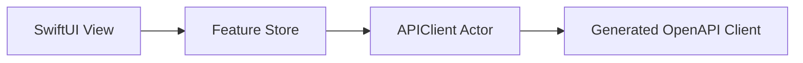

The `APIClient` becomes the clean gateway.

Its job:

1. Know the base URL.
2. Attach auth headers.
3. Call generated endpoints.
4. Convert transport errors into app errors.
5. Return useful DTO/domain results.

---

## `Core/Auth/`

This handles login state and token handling.

Likely pieces:

```text
Auth/
├── AuthStore.swift
├── SessionStore.swift
├── TokenStore.swift
└── KeychainTokenStore.swift
```

### `AuthStore` / `SessionStore`

This answers:

```text
Who is logged in?
Do we have a token?
Should we show login or main app?
Can we refresh the session?
```

It should own app-level auth state.

---

### `KeychainTokenStore`

This is where tokens should live.

Do not store JWTs or refresh tokens in plain `UserDefaults`.

Good mental model:

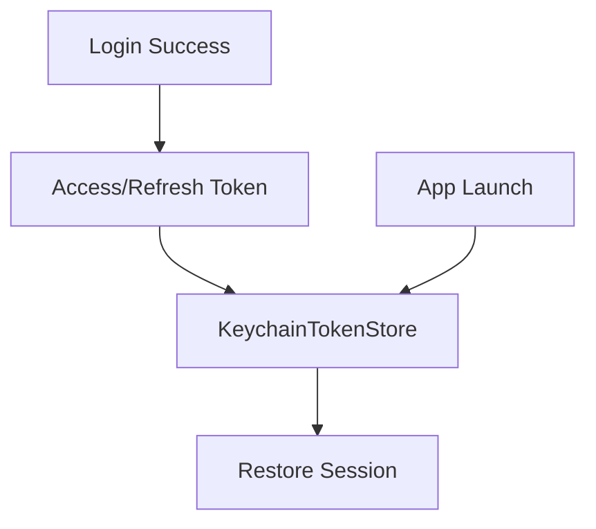

Keychain is correct because auth tokens are secrets.

---

## `Core/Configuration/`

This is where base URLs and environment settings belong.

Prior context said you had `.xcconfig` files for API base URLs. That is good.

Likely files:

```text
Config/
├── Debug.xcconfig
├── Release.xcconfig
├── Debug.local.xcconfig
└── Staging.xcconfig
```

### What `.xcconfig` does

It separates build settings from code.

Example idea:

```text
API_BASE_URL = http://localhost:8080
```

Then Swift code reads that from the app bundle/config.

This keeps your code clean:

```swift
let baseURL = AppConfig.apiBaseURL
```

Instead of scattering:

```swift
"http://localhost:8080"
```

everywhere.

Important issue from the prior audit: your `Debug.local.xcconfig` had machine-specific local data, and `Staging.xcconfig` existed but was not fully wired as an Xcode build configuration. That should be cleaned up later.

---

# `Packages/ScubaPalAPI/`

This is your **generated OpenAPI Swift client package**.

This is the layer created from your Spring Boot OpenAPI spec.

Likely structure:

```text
Packages/
└── ScubaPalAPI/
    ├── Package.swift
    ├── Sources/
    │   └── ScubaPalAPI/
    │       ├── Client.swift
    │       ├── Types.swift
    │       └── Generated/
    └── Tests/
```

## What it does

This package gives Swift type-safe access to your backend.

Instead of manually writing:

```swift
URLSession.shared.dataTask(...)
```

you get generated Swift types and endpoints based on your backend contract.

Backend:

```text
Spring Boot
/v3/api-docs
```

becomes:

```text
Swift OpenAPI client
Packages/ScubaPalAPI
```

Flow:

```mermaid
flowchart LR
    Backend[Spring Boot Controllers] --> OpenAPI[/v3/api-docs]
    OpenAPI --> Generator[swift-openapi-generator]
    Generator --> Package[Packages/ScubaPalAPI]
    Package --> CoreAPI[Core/APIClient]
    CoreAPI --> Features[SwiftUI Features]
```

## Important rule

Treat generated code as **replaceable**.

Do not hand-edit generated files.

Better rule:

```text
Generated API types       → disposable
APIClient wrapper         → yours
Mappers                   → yours
Domain models             → yours
SwiftUI views             → yours
```

That way, when the backend OpenAPI spec changes, you regenerate the package without destroying your app logic.

---

# `Shared/`

This is your **cross-feature app model layer**.

Prior context said your `Shared` folder had:

```text
Shared/
├── DTO/
├── Domain/
└── Mappers/
```

This is mostly correct, but I would eventually rename/reorganize it slightly for clarity.

---

## `Shared/Domain/`

These are clean app models.

Example:

```swift
struct Post: Identifiable {
    let id: UUID
    let authorName: String
    let text: String
    let imageURL: URL?
    let likeCount: Int
}
```

Domain models should feel like your app, not your backend database.

They answer:

```text
What does Scuba Pal care about?
```

Not:

```text
What exact JSON did the server return?
```

---

## `Shared/DTO/`

DTO means **Data Transfer Object**.

These mirror backend payloads.

Example:

```swift
struct PostResponseDTO: Decodable {
    let id: String
    let content: String
    let createdAt: String
}
```

DTOs are transport shapes.

They answer:

```text
What did the API send?
```

They should not leak deep into your SwiftUI views.

---

## `Shared/Mappers/`

Mappers convert DTOs into domain models.

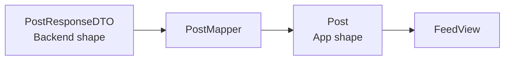

This is one of the most important maintainability patterns in your app.

Why?

Because your backend may return ugly or inconvenient data, but your views should receive clean, stable models.

---

# `DesignSystem/`

This is your **visual language**.

Likely contents:

```text
DesignSystem/
├── Colors.swift
├── Typography.swift
├── Spacing.swift
├── Components/
│   ├── PrimaryButton.swift
│   ├── CardView.swift
│   ├── AvatarView.swift
│   └── LoadingView.swift
└── Theme.swift
```

## What it does

It prevents copy-pasted styling.

Instead of every screen inventing its own color, padding, shadow, and button style, you define reusable primitives.

Bad:

```swift
.padding(17)
.background(Color.cyan.opacity(0.18))
.cornerRadius(23)
```

repeated everywhere.

Better:

```swift
ScubaCard {
    ...
}
```

or:

```swift
.themeSpacing(.md)
```

The design system is how your app becomes visually consistent and easier to change.

---

# `Features/`

This is where most of your actual app lives.

Prior audit mentioned these larger files:

```text
FeedView.swift        433 lines
ProfileView.swift     331 lines
DiscoverView.swift    272 lines
MessagingView.swift   240 lines
```

That tells me the feature views are currently doing too much.

A good feature should usually be structured like this:

```text
Features/
└── Feed/
    ├── FeedView.swift
    ├── FeedStore.swift
    ├── FeedService.swift
    ├── Components/
    │   ├── PostCard.swift
    │   └── FeedHeader.swift
    └── Models/
        └── FeedState.swift
```

---

## `Features/Feed/`

This is the social feed.

It likely shows posts, likes, author info, images, and post details.

Flow:

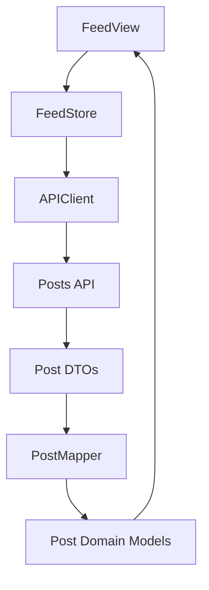

### What `FeedView.swift` should do

Only:

1. Render feed state.
2. Show loading/error/empty states.
3. Display post cards.
4. Send user actions to the store.

It should not know how to call the API directly.

Because your `FeedView.swift` was previously around 433 lines, I would split it.

Better:

```text
FeedView.swift
PostCard.swift
FeedToolbar.swift
FeedEmptyStateView.swift
FeedLoadingView.swift
CreatePostButton.swift
```

---

## `Features/Profile/`

This handles the user profile screen.

From your screenshots and prior context, this likely includes:

```text
username
handle
bio
dive count
followers/following
edit profile
settings
profile image
```

Good structure:

```text
Features/Profile/
├── ProfileView.swift
├── ProfileStore.swift
├── EditProfileView.swift
├── Components/
│   ├── ProfileHeader.swift
│   ├── ProfileStatsRow.swift
│   ├── BioEditor.swift
│   └── ProfileActionButton.swift
└── Models/
```

### What it does

The profile feature answers:

```text
Who is this diver?
What are their stats?
Can I edit my profile?
Can I see their posts/social identity?
```

Your `ProfileView.swift` was previously around 331 lines. That is not terrible, but it is big enough to split.

---

## `Features/Discover/`

This is likely your exploration/search feature.

It may include:

```text
dive locations
people discovery
buddy finder
search
recommended divers
nearby spots
```

Good structure:

```text
Features/Discover/
├── DiscoverView.swift
├── DiscoverStore.swift
├── Components/
│   ├── SearchBar.swift
│   ├── DiveLocationCard.swift
│   ├── DiverSuggestionCard.swift
│   └── CategoryChip.swift
└── Models/
```

### What it does

Discover should be your app’s “find things” layer:

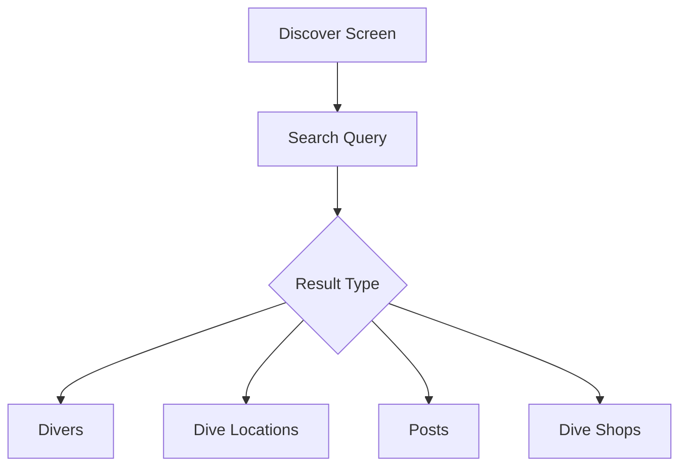

Your `DiscoverView.swift` was around 272 lines, so this is another candidate for component extraction.

---

## `Features/Messaging/`

This handles conversations and messages.

Likely pieces:

```text
Features/Messaging/
├── MessagingView.swift
├── ConversationView.swift
├── MessagingStore.swift
├── Components/
│   ├── ConversationRow.swift
│   ├── MessageBubble.swift
│   └── MessageInputBar.swift
└── Models/
```

### What it does

Messaging has two main levels:

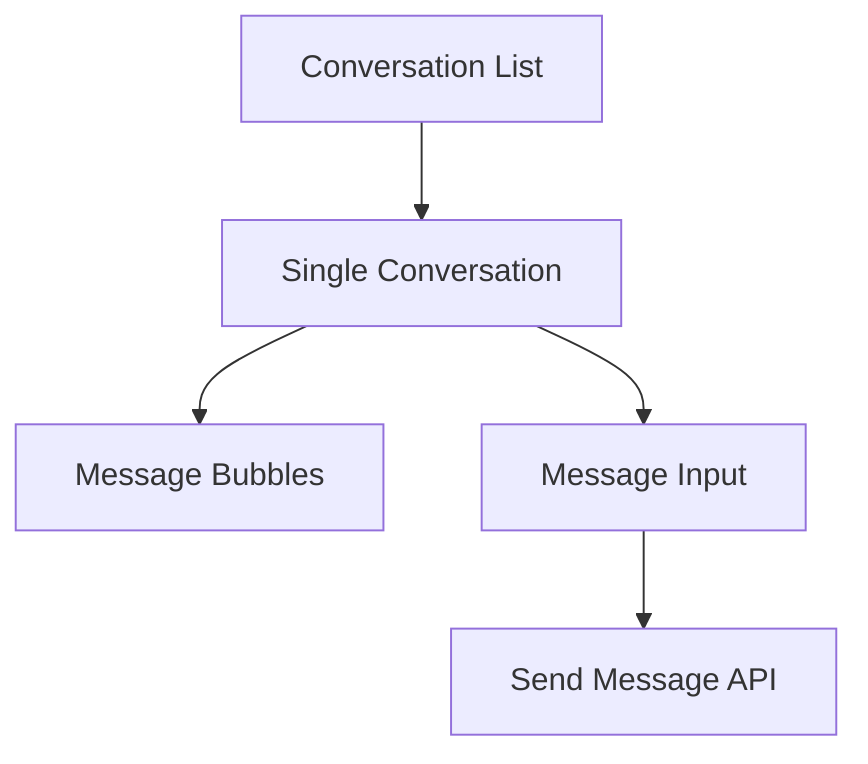

This should eventually be isolated well, because messaging can get complex quickly:

1. Pagination.
2. Read receipts.
3. Realtime updates.
4. Push notifications.
5. Local caching.
6. Failed sends/retries.

Your `MessagingView.swift` was previously around 240 lines. That is manageable, but should still split UI components early.

---

## `Features/Auth/`

This handles login/register/forgot password.

Likely contents:

```text
Features/Auth/
├── LoginView.swift
├── RegisterView.swift
├── AuthStore.swift
├── Components/
│   ├── AuthTextField.swift
│   └── PasswordField.swift
└── Models/
```

### What it does

Auth connects UI to session state.

Flow:

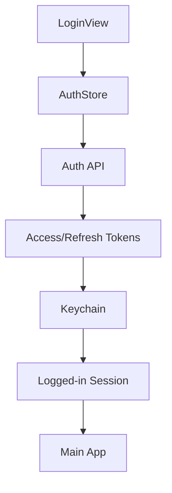

The important part: auth should be centralized. Do not let every feature check tokens manually.

---

# `Resources` / `Assets.xcassets`

This contains visual assets.

Likely:

```text
Assets.xcassets/
├── AppIcon.appiconset
├── AccentColor.colorset
├── Logo.imageset
└── Other images
```

## What it does

This is where Xcode stores app icons, image assets, and colors.

Prior audit found a duplicate asset set named something like:

```text
AppIcon 1
```

That should be cleaned up.

You generally want one canonical app icon set:

```text
AppIcon.appiconset
```

Not duplicates. Duplicates make Xcode configuration messy and can cause confusion when shipping.

---

# `Config/`

This is build/environment configuration.

Good setup:

```text
Config/
├── Debug.xcconfig
├── Release.xcconfig
├── Staging.xcconfig
└── Debug.local.xcconfig
```

## What each should do

| File                   | Purpose                              |
| ---------------------- | ------------------------------------ |
| `Debug.xcconfig`       | Normal local development defaults    |
| `Debug.local.xcconfig` | Your personal machine-only overrides |
| `Staging.xcconfig`     | Staging backend/test server          |
| `Release.xcconfig`     | Production App Store config          |

Important rule:

```text
Debug.local.xcconfig should usually be gitignored.
```

Because it may contain machine names, local IPs, or personal paths.

---

# `Tests/`

This is your safety net.

Likely:

```text
ScubaPalTests/
ScubaPalUITests/
Packages/ScubaPalAPI/Tests/
```

## What should be tested

For your app, the best ROI tests are not UI snapshot tests first. Start with logic tests.

High-value tests:

```text
Auth token saving/loading
DTO → Domain mappers
API error mapping
FeedStore loading success/error
ProfileStore update flow
Message sending state transitions
```

The most important test area is probably **mappers**.

Why?

Because generated API types will change as your backend evolves. Mapper tests catch broken assumptions early.

---

# The most important architecture principle

Your app has five kinds of code:

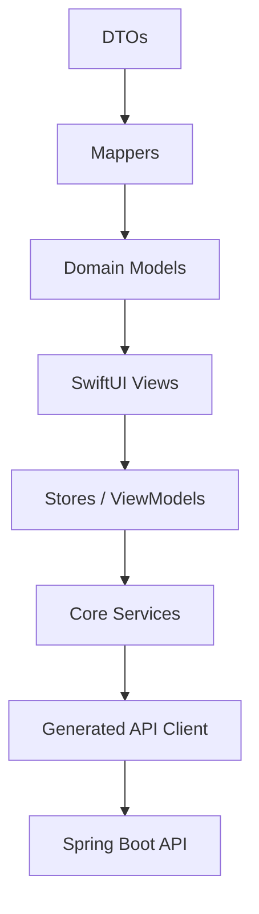

Each layer should have a clean responsibility:

| Layer                  | Responsibility                              |
| ---------------------- | ------------------------------------------- |
| `App`                  | Start app, route user, inject dependencies  |
| `Features`             | User-facing screens and feature state       |
| `Core`                 | API, auth, config, storage, system services |
| `Shared/Domain`        | Clean app models                            |
| `Shared/DTO`           | Backend/API shapes                          |
| `Shared/Mappers`       | Convert backend shapes to app shapes        |
| `DesignSystem`         | Reusable visual language                    |
| `Packages/ScubaPalAPI` | Generated OpenAPI client                    |

---

# What is good in your current structure

Your direction is mostly right.

Strong choices:

1. **Native SwiftUI app** instead of overloading the backend/web project.
2. **Separate generated API package** under `Packages/ScubaPalAPI`.
3. **Core layer** for networking/auth.
4. **DesignSystem layer** for visual consistency.
5. **Feature-based screens** instead of random global views.
6. **DTO / Domain / Mapper separation**, which is very production-minded.

This is the correct long-term direction.

---

# What I would improve next

## 1. Split large SwiftUI views

Your larger files should be reduced.

Current concern:

```text
FeedView.swift        433 lines
ProfileView.swift     331 lines
DiscoverView.swift    272 lines
MessagingView.swift   240 lines
```

Target:

```text
Main feature view:     80–180 lines
Reusable components:   20–120 lines each
Store/ViewModel:       80–200 lines
Mapper:                small and testable
```

Do not split just to split. Split when a section has a name.

Example:

```text
ProfileView
├── ProfileHeader
├── ProfileStatsRow
├── ProfileBioSection
├── ProfileActions
└── ProfilePostGrid
```

---

## 2. Keep generated API away from views

This is critical.

Bad:

```swift
FeedView → generated OpenAPI client
```

Good:

```swift
FeedView → FeedStore → APIClient → generated OpenAPI client
```

This protects your UI from backend churn.

---

## 3. Turn `Shared` into clearer modules later

`Shared` can become a dumping ground.

Better long-term:

```text
Shared/
├── Domain/
├── Mapping/
├── Presentation/
└── Foundation/
```

Or even better later:

```text
Core/
DesignSystem/
Features/
Domain/
API/
```

But do not over-modularize too early. Your current structure is fine until things hurt.

---

## 4. Clean asset duplicates

Delete duplicate asset sets like:

```text
AppIcon 1
```

Keep one real app icon path.

---

## 5. Fix build configuration naming

You already chose:

```text
repo/folder: scubapal-ios
Xcode project/product/module: ScubaPal
bundle id: com.scubapal.app
```

That is the right convention.

For environments:

```text
com.scubapal.app.dev
com.scubapal.app.staging
com.scubapal.app
```

---

# Best final structure I would aim for

```text
scubapal-ios/
├── ScubaPal.xcodeproj
├── ScubaPal/
│   ├── App/
│   │   ├── ScubaPalApp.swift
│   │   ├── AppRootView.swift
│   │   ├── AppEnvironment.swift
│   │   ├── AppRoute.swift
│   │   └── MainTabView.swift
│   │
│   ├── Core/
│   │   ├── Auth/
│   │   ├── Networking/
│   │   ├── Configuration/
│   │   ├── Storage/
│   │   └── Errors/
│   │
│   ├── DesignSystem/
│   │   ├── Theme/
│   │   ├── Components/
│   │   └── Modifiers/
│   │
│   ├── Features/
│   │   ├── Auth/
│   │   ├── Feed/
│   │   ├── Discover/
│   │   ├── Messaging/
│   │   ├── Profile/
│   │   └── DiveLocations/
│   │
│   ├── Shared/
│   │   ├── Domain/
│   │   ├── DTO/
│   │   └── Mappers/
│   │
│   └── Resources/
│       └── Assets.xcassets
│
├── Packages/
│   └── ScubaPalAPI/
│       ├── Package.swift
│       └── Sources/
│
├── Config/
│   ├── Debug.xcconfig
│   ├── Debug.local.xcconfig
│   ├── Staging.xcconfig
│   └── Release.xcconfig
│
├── ScubaPalTests/
├── ScubaPalUITests/
└── README.md
```

---

# The simplest way to think about the whole app

```text
App
= starts and wires the app

Features
= what the user sees and does

Core
= how the app talks to systems

DesignSystem
= how the app looks consistently

Shared
= common models and conversions

ScubaPalAPI
= generated backend contract client

Config
= environment/build settings

Tests
= proof the important behavior still works
```

---

# Current score

I would rate the current architecture direction:

```text
Structure:        8/10
Scalability:      8/10
Maintainability:  7/10
Production path:  7.5/10
```

Main reason it is not higher yet: the large feature views need decomposition, and generated API types need to stay strictly behind `APIClient` + mappers.

---

# Next goal

Get me the exact latest tree and I can do the real **file-by-file** breakdown.

Run this from the parent of `scubapal-ios`:

```bash
find scubapal-ios \
  -path '*/.git' -prune -o \
  -path '*/DerivedData' -prune -o \
  -path '*/.build' -prune -o \
  -path '*/xcuserdata' -prune -o \
  -print
```

Command breakdown:

```text
find scubapal-ios
```

Walks through your iOS project directory.

```text
-path '*/.git' -prune -o
```

Skips Git internals.

```text
-path '*/DerivedData' -prune -o
```

Skips Xcode build cache.

```text
-path '*/.build' -prune -o
```

Skips Swift Package build artifacts.

```text
-path '*/xcuserdata' -prune -o
```

Skips personal Xcode user state.

```text
-print
```

Prints the remaining useful project files.

Paste that output, and the next pass can be **100% exact** instead of architecture-based.
