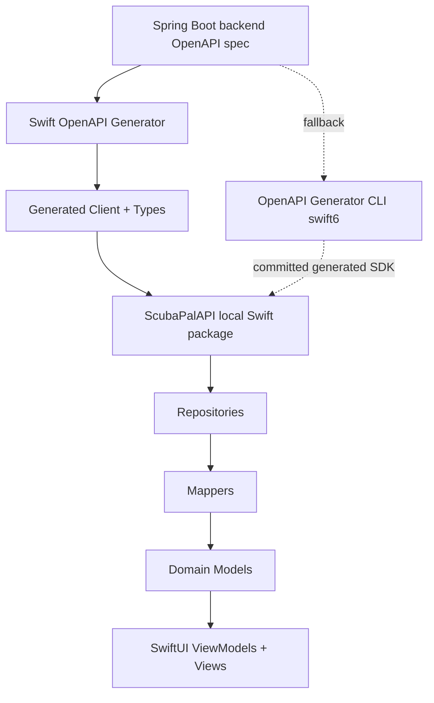

Use **Apple `swift-openapi-generator`** for the actual app.

Use your installed **OpenAPI Generator CLI** only as a fallback or temporary DTO generator. For ScubaPal iOS, Apple’s generator is the cleaner long-term choice because it generates Swift client code at build time, keeps generated code out of git, supports OpenAPI 3.0/3.1, and works with a `URLSession` transport package. ([GitHub][1]) ([GitHub][2])

Also: **do not use OpenAPI Generator `swift5`** unless forced. Its own docs mark `swift5` as deprecated; `swift6` is the stable OpenAPI Generator Swift client target now. ([OpenAPI Generator][3]) ([OpenAPI Generator][4])

---

## The decision



For you:

```text
Recommended:
Swift OpenAPI Generator

Fallback:
openapi-generator-cli -g swift6
```

---

# Do this exactly

## 0. Start from repo root

```bash
cd ~/Developer/active/scubapal-ios
```

Command breakdown:

* `cd` changes your current directory.
* `~/Developer/active/scubapal-ios` should be replaced only if your repo lives somewhere else.

---

## 1. Make sure backend is running

From your Spring Boot repo:

```bash
cd ~/Developer/active/scuba-pal/app
SPRING_PROFILES_ACTIVE=dev ./mvnw spring-boot:run
```

Command breakdown:

* `cd` moves into your backend app folder.
* `SPRING_PROFILES_ACTIVE=dev` starts the app with your dev profile.
* `./mvnw` uses the Maven wrapper committed to your project.
* `spring-boot:run` starts the Spring Boot app.

Springdoc exposes the OpenAPI JSON at `/v3/api-docs` by default, and Swagger UI at `/swagger-ui.html`. ([OpenAPI 3 Library for spring-boot][5])

---

## 2. Export the OpenAPI spec into the iOS repo

From your **iOS repo root**:

```bash
mkdir -p OpenAPI
curl -fSL http://localhost:8080/v3/api-docs -o OpenAPI/scubapal-openapi.json
```

Command breakdown:

* `mkdir -p OpenAPI`

  * `mkdir` creates a folder.
  * `-p` avoids an error if the folder already exists.
* `curl` downloads the OpenAPI document.
* `-f` fails the command on HTTP errors.
* `-S` shows useful error output when `-f` fails.
* `-L` follows redirects if needed.
* `-o OpenAPI/scubapal-openapi.json` writes the response to that file.

Check that the file is valid JSON:

```bash
python3 -m json.tool OpenAPI/scubapal-openapi.json > /tmp/scubapal-openapi.pretty.json
```

Command breakdown:

* `python3 -m json.tool` validates and pretty-prints JSON.
* `>` redirects formatted output into a temporary file.
* If the command fails, your OpenAPI export is not valid JSON.

---

## 3. Create a local Swift package for the generated client

Do **not** generate directly into your app target yet. Keep it isolated.

```bash
mkdir -p Packages/ScubaPalAPI/Sources/ScubaPalAPI
cp OpenAPI/scubapal-openapi.json Packages/ScubaPalAPI/Sources/ScubaPalAPI/openapi.json
```

Command breakdown:

* `mkdir -p` creates the local Swift package source folder.
* `cp` copies your backend OpenAPI spec into the package.
* The file name `openapi.json` matters because Swift OpenAPI Generator expects an OpenAPI document in the target source directory.

Now create the generator config:

```bash
cat > Packages/ScubaPalAPI/Sources/ScubaPalAPI/openapi-generator-config.yaml <<'EOF'
generate:
  - types
  - client
accessModifier: public
namingStrategy: idiomatic
EOF
```

Command breakdown:

* `cat > file <<'EOF'` writes a multi-line file.
* `generate: types/client` tells the plugin to generate models and client methods.
* `accessModifier: public` matters because this is a separate Swift package consumed by your app.
* `namingStrategy: idiomatic` makes generated Swift names more Swift-like.

Apple’s own examples use this config shape with `types`, `client`, `accessModifier`, and `namingStrategy`. ([GitHub][6])

---

## 4. Create `Package.swift`

```bash
cat > Packages/ScubaPalAPI/Package.swift <<'EOF'
// swift-tools-version: 6.0

import PackageDescription

let package = Package(
    name: "ScubaPalAPI",
    platforms: [
        .iOS(.v17)
    ],
    products: [
        .library(
            name: "ScubaPalAPI",
            targets: ["ScubaPalAPI"]
        )
    ],
    dependencies: [
        .package(url: "https://github.com/apple/swift-openapi-generator", from: "1.12.0"),
        .package(url: "https://github.com/apple/swift-openapi-runtime", from: "1.8.0"),
        .package(url: "https://github.com/apple/swift-openapi-urlsession", from: "1.0.0")
    ],
    targets: [
        .target(
            name: "ScubaPalAPI",
            dependencies: [
                .product(name: "OpenAPIRuntime", package: "swift-openapi-runtime"),
                .product(name: "OpenAPIURLSession", package: "swift-openapi-urlsession")
            ],
            plugins: [
                .plugin(name: "OpenAPIGenerator", package: "swift-openapi-generator")
            ]
        )
    ]
)
EOF
```

Command breakdown:

* `swift-tools-version: 6.0` declares the Swift package tools version.
* `.iOS(.v17)` matches your current iOS deployment target.
* `ScubaPalAPI` becomes the importable library name.
* `swift-openapi-generator` is the build plugin.
* `swift-openapi-runtime` is required by generated code.
* `swift-openapi-urlsession` gives the generated client a `URLSession` transport.
* The `plugins` section attaches the generator to the package target.

Apple’s package ecosystem separates the generator, runtime, and URLSession transport into separate packages. ([GitHub][1])

---

## 5. Test the package generation

```bash
swift build --package-path Packages/ScubaPalAPI
```

Command breakdown:

* `swift build` builds a Swift package.
* `--package-path Packages/ScubaPalAPI` tells Swift which package to build.
* This triggers the OpenAPI generator plugin.

If this fails, the problem is usually one of these:

* Your OpenAPI spec has invalid schemas.
* Your endpoints do not have stable `operationId`s.
* Springdoc generated ambiguous names.
* Some request/response body is not represented cleanly.

---

## 6. Add the local package to Xcode

In Xcode:

```text
File → Add Package Dependencies…
```

Then choose:

```text
Add Local…
```

Select:

```text
Packages/ScubaPalAPI
```

Add the product:

```text
ScubaPalAPI
```

To your app target:

```text
scubapal-ios
```

After that, you should be able to write:

```swift
import ScubaPalAPI
import OpenAPIURLSession
```

---

## 7. Create a thin wrapper in your app

Create:

```text
scubapal-ios/API/Generated/ScubaPalGeneratedClient.swift
```

Put this in it:

```swift
import Foundation
import ScubaPalAPI
import OpenAPIURLSession

struct ScubaPalGeneratedClient {
    let client: Client

    init(baseURL: URL) {
        self.client = Client(
            serverURL: baseURL,
            transport: URLSessionTransport()
        )
    }
}
```

Now wire it later into repositories.

Do **not** directly use generated types in SwiftUI views.

Correct direction:


---

## 8. Figure out your correct `baseURL`

Check whether your OpenAPI paths include `/api`.

```bash
python3 - <<'PY'
import json
spec = json.load(open("OpenAPI/scubapal-openapi.json"))
for path in list(spec.get("paths", {}).keys())[:20]:
    print(path)
PY
```

Command breakdown:

* `python3 - <<'PY'` runs an inline Python script.
* `json.load(...)` reads your OpenAPI JSON.
* `spec.get("paths", {})` gets the OpenAPI paths.
* `[:20]` prints only the first 20.

If paths look like this:

```text
/api/posts
/api/me
/api/messages/conversations
```

Use:

```swift
URL(string: "http://localhost:8080")!
```

If paths look like this:

```text
/posts
/me
/messages/conversations
```

Use:

```swift
URL(string: "http://localhost:8080/api")!
```

For iOS Simulator, `localhost` usually points to your Mac. For a real iPhone, use your Mac’s LAN IP address instead.

---

# Fallback: using your installed `openapi-generator-cli`

Only do this if Apple’s generator fails or blocks you.

First validate available generators:

```bash
openapi-generator-cli list | grep swift
```

Command breakdown:

* `openapi-generator-cli list` lists supported generators.
* `|` pipes output into the next command.
* `grep swift` filters lines containing `swift`.

Generate using **swift6**, not swift5:

```bash
rm -rf Packages/ScubaPalGeneratedSDK

openapi-generator-cli generate \
  -i OpenAPI/scubapal-openapi.json \
  -g swift6 \
  -o Packages/ScubaPalGeneratedSDK \
  --additional-properties=projectName=ScubaPalGeneratedSDK,responseAs=AsyncAwait,library=urlsession,hideGenerationTimestamp=true
```

Command breakdown:

* `rm -rf Packages/ScubaPalGeneratedSDK`

  * Deletes the previous generated SDK.
  * `-r` removes recursively.
  * `-f` forces removal.
* `openapi-generator-cli generate` runs generation.
* `-i OpenAPI/scubapal-openapi.json` sets the input OpenAPI spec.
* `-g swift6` selects the Swift 6 generator.
* `-o Packages/ScubaPalGeneratedSDK` sets the output folder.
* `--additional-properties=...` passes Swift generator options.
* `projectName=ScubaPalGeneratedSDK` names the generated project.
* `responseAs=AsyncAwait` prefers async/await-style responses.
* `library=urlsession` uses URLSession.
* `hideGenerationTimestamp=true` reduces noisy diffs.

OpenAPI Generator CLI is Java-based and uses `openapi-generator-cli generate -g ... -i ... -o ...`; the CLI docs also note Java must be available and that the CLI downloads/invokes the generator JAR. ([GitHub][7])

---

# My recommendation for your next move

Do **Apple Swift OpenAPI Generator first**.

Your exact next command sequence:

```bash
cd ~/Developer/active/scubapal-ios

mkdir -p OpenAPI
curl -fSL http://localhost:8080/v3/api-docs -o OpenAPI/scubapal-openapi.json

python3 -m json.tool OpenAPI/scubapal-openapi.json > /tmp/scubapal-openapi.pretty.json

mkdir -p Packages/ScubaPalAPI/Sources/ScubaPalAPI
cp OpenAPI/scubapal-openapi.json Packages/ScubaPalAPI/Sources/ScubaPalAPI/openapi.json
```

Then create the two files:

```text
Packages/ScubaPalAPI/Package.swift
Packages/ScubaPalAPI/Sources/ScubaPalAPI/openapi-generator-config.yaml
```

Then run:

```bash
swift build --package-path Packages/ScubaPalAPI
```

**Progress: 45% → next goal 50%.**
The goal is not to replace your whole networking layer today. The goal is to get a generated client compiling in isolation. After that, wire **one endpoint only** through a repository, probably `/api/me` or `/api/posts`.

[1]: https://github.com/apple/swift-openapi-generator "GitHub - apple/swift-openapi-generator: Generate Swift client and server code from an OpenAPI document. · GitHub"
[2]: https://github.com/apple/swift-openapi-urlsession "GitHub - apple/swift-openapi-urlsession: URLSession transport for Swift OpenAPI Generator. · GitHub"
[3]: https://openapi-generator.tech/docs/generators/swift5/ "Documentation for the swift5 Generator | OpenAPI Generator"
[4]: https://openapi-generator.tech/docs/generators/swift6/ "Documentation for the swift6 Generator | OpenAPI Generator"
[5]: https://springdoc.org/?utm_source=chatgpt.com "OpenAPI 3 Library for spring-boot"
[6]: https://raw.githubusercontent.com/apple/swift-openapi-generator/main/Examples/curated-client-library-example/Sources/CuratedLibraryClient/openapi-generator-config.yaml "raw.githubusercontent.com"
[7]: https://github.com/OpenAPITools/openapi-generator-cli "GitHub - OpenAPITools/openapi-generator-cli: A node package wrapper for https://github.com/OpenAPITools/openapi-generator · GitHub"
