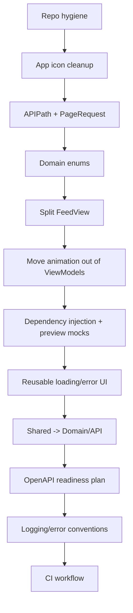

Use this as a **safe, phased Codex workflow**. Do **not** ask Codex to do all of this in one prompt. Make one branch/PR per phase.

Codex is designed to help write, review, and ship code; for repo-connected work, GitHub connection is supported through ChatGPT/Codex workflows. Keep secrets out of the repo; OpenAI’s API key safety guidance says not to commit keys and recommends environment variables. ([OpenAI Help Center][1])

---

# 1. Root `AGENTS.md`

Create this at the root of `scubapal-ios`.

```md
# ScubaPal iOS — Codex Instructions

## Project Goal

ScubaPal iOS is a native SwiftUI client for the ScubaPal backend. The app should be production-quality, modular, maintainable, testable, and friendly to future OpenAPI client generation.

Prioritize long-term architecture over quick patches.

## Core Principles

1. Prefer small, safe, reviewable changes.
2. Do not do large rewrites unless explicitly requested.
3. Preserve current behavior unless the task says otherwise.
4. Avoid duplicate API contracts, magic strings, and repeated loading/error UI.
5. Keep dependency direction clean:
   - SwiftUI Views depend on ViewModels and DesignSystem.
   - ViewModels depend on repositories/protocols and domain models.
   - Repositories depend on APIClient, DTOs, and mappers.
   - Domain models do not depend on networking, SwiftUI, or DTOs.
6. Do not put live networking dependencies directly in previews.
7. Do not commit local config, machine-specific files, user state, secrets, or generated trash.

## Architecture Boundaries

Preferred top-level structure:

ScubaPal/
  App/
  Core/
  DesignSystem/
  Domain/
  API/
  Features/
  Resources/

Use:

- `App/` for app entry point, dependency composition, app state, routing.
- `Core/` for infrastructure: networking, auth/session, keychain, logging, utilities.
- `DesignSystem/` for theme, components, modifiers, reusable visual language.
- `Domain/` for app-level models and value types.
- `API/` for DTOs, endpoint definitions, mappers, generated API client code.
- `Features/` for vertical product areas: Auth, Feed, Discover, Messaging, Notifications, Profile, Shell.
- `Resources/` for assets, strings, localization, config resources.

Avoid using `Shared` as a junk drawer. If something is truly shared, place it in the correct architectural layer instead.

## Swift Conventions

- Prefer clear names over clever names.
- Use `URL` suffix only for real `URL` values.
- Use `Path`, `Key`, `Identifier`, or `String` suffixes for string-backed values.
- Avoid magic strings for API paths, enum values, notification types, visibility statuses, difficulty levels, and roles.
- Prefer domain enums over raw strings.
- Prefer `private(set)` for view model state.
- Avoid putting `withAnimation` in view models.
- View models should not import SwiftUI unless unavoidable.
- Put animation in views.
- Keep screen files mostly compositional.
- Extract reusable components when a view file exceeds roughly 200 lines or mixes unrelated concerns.
- Do not create protocols for every type. Create protocols mainly at dependency boundaries.

## Networking Rules

- Centralize endpoint paths.
- Centralize pagination query parameters.
- Keep DTOs separate from domain models.
- Use mappers between DTOs and domain models.
- Mapper behavior should be covered by tests.
- Do not leak DTOs into SwiftUI views.
- Do not leak APIClient directly into SwiftUI views.
- Prepare the app for future OpenAPI generation.
- If an OpenAPI spec exists, prefer generated DTO/client types over hand-maintained duplicate contracts.

## Dependency Injection

- App-level dependencies should be composed once in `AppDependencies`.
- Screens should receive repositories/view models through explicit injection or SwiftUI environment.
- Tests and previews must use mock/stub dependencies.
- Production dependencies should not be the default inside previews.

## Config and Repo Hygiene

Never commit:

- `.DS_Store`
- `__MACOSX/`
- `xcuserdata/`
- `*.xcuserstate`
- `Config/Debug.local.xcconfig`
- machine-specific hostnames
- secrets
- tokens
- API keys
- local-only build files

Keep:

- `Config/Debug.local.xcconfig.example`
- non-secret `.xcconfig` files
- documented setup steps

## Testing Expectations

When changing architecture, add or update tests where possible.

Prioritize tests for:

- mappers
- API path helpers
- pagination helpers
- repositories with mocked API clients
- view model state transitions
- auth/session behavior

## Build Safety

After changes, attempt the strongest available validation:

1. `swift test` if this is a Swift package.
2. `xcodebuild test` if Xcode project/scheme is available.
3. Static inspection if build tooling is unavailable.

Report what was run and what could not be run.

## Output Expectations

For every task:

1. Summarize the architectural intent.
2. List changed files.
3. Explain important tradeoffs.
4. Mention follow-up tasks.
5. Do not hide build/test failures.
```

---

# 2. Codex prompt sequence

Use these **one at a time**.

## Prompt 1 — Repo hygiene cleanup

```text
You are working in the ScubaPal iOS SwiftUI repo.

Goal:
Clean repository hygiene without changing app behavior.

Tasks:
1. Remove committed/generated trash if present:
   - .DS_Store
   - __MACOSX/
   - xcuserdata/
   - *.xcuserstate
2. Ensure .gitignore excludes those files.
3. Ensure Config/Debug.local.xcconfig is not tracked.
4. Keep or create Config/Debug.local.xcconfig.example with non-secret placeholder values.
5. Do not delete useful project files.
6. Do not modify app architecture yet.

Acceptance criteria:
- No machine-specific Xcode user state remains tracked.
- No local-only xcconfig remains tracked.
- The repo contains a safe example config file.
- App source behavior is unchanged.

After completing:
- Show changed files.
- Explain any files removed from tracking.
- Tell me the exact validation you ran.
```

---

## Prompt 2 — App icon and asset cleanup

```text
You are working in the ScubaPal iOS SwiftUI repo.

Goal:
Clean app icon naming and asset catalog conventions.

Context:
The repo appears to have duplicate app icon sets such as AppIcon and "AppIcon 1". Production convention should avoid numbered/space-based asset names.

Tasks:
1. Inspect the Xcode project and Assets.xcassets.
2. Determine which app icon set is actually used.
3. Rename the active app icon set to AppIcon if needed.
4. Remove duplicate/unused app icon sets only if safe.
5. Update project build settings to use AppIcon.
6. Do not change the actual icon artwork unless necessary.
7. Do not touch unrelated assets.

Acceptance criteria:
- The build setting references AppIcon.
- There is no duplicate "AppIcon 1" app icon set unless it is intentionally kept and documented.
- Asset naming is clean and production-friendly.

After completing:
- Show changed files.
- Explain exactly what was renamed/removed.
- Tell me the validation you ran.
```

---

## Prompt 3 — Introduce API path and pagination helpers

```text
You are working in the ScubaPal iOS SwiftUI repo.

Goal:
Reduce API magic strings and duplicated pagination query construction.

Tasks:
1. Add an APIPath helper in the API or Core/Networking layer.
2. Move repeated endpoint path strings into APIPath.
3. Add a PageRequest value type for page/size query parameters.
4. Replace hardcoded page/size dictionaries where straightforward.
5. Keep behavior identical.
6. Do not introduce OpenAPI generation yet.
7. Do not rewrite the APIClient unless needed.

Preferred shape:
- APIPath should contain static constants/functions for known API routes.
- PageRequest should produce query parameters like ["page": "...", "size": "..."].
- Keep names clear and boring.

Acceptance criteria:
- Repeated API path strings are centralized.
- Repeated pagination query dictionaries are centralized.
- Existing repository behavior remains equivalent.
- Add tests for APIPath/PageRequest if a test target exists.

After completing:
- Show changed files.
- Explain what duplication was removed.
- Tell me the validation you ran.
```

---

## Prompt 4 — Replace magic strings with domain enums

```text
You are working in the ScubaPal iOS SwiftUI repo.

Goal:
Replace obvious raw string domain values with typed enums.

Look for fields such as:
- visibilityStatus
- notification type
- difficulty level
- role
- post/media/status strings
- any backend string enum currently passed around as plain String

Tasks:
1. Identify obvious raw string enums.
2. Add Swift enums with raw String values matching backend values.
3. Update DTOs/domain models/mappers carefully.
4. Preserve Codable behavior.
5. Do not over-engineer.
6. If a value is uncertain, leave it as String and add a TODO comment rather than guessing.

Acceptance criteria:
- At least the clearest repeated string-backed values are typed.
- Codable mapping still matches backend raw values.
- Mappers/tests are updated.
- No UI behavior changes.

After completing:
- Show changed files.
- Explain which strings became enums.
- Mention any values intentionally left as String.
- Tell me the validation you ran.
```

---

## Prompt 5 — Split `FeedView` safely

```text
You are working in the ScubaPal iOS SwiftUI repo.

Goal:
Refactor FeedView into smaller composable SwiftUI files without changing behavior.

Context:
FeedView is currently too large and mixes screen composition, components, state rendering, and sheet/detail UI.

Tasks:
1. Keep FeedView or FeedScreen as the main screen entry.
2. Extract obvious subviews into Features/Feed/Components.
3. Candidate components:
   - feed header
   - filter rail/chips
   - compose prompt
   - post card/list/grid area
   - loading/error/empty feed sections
   - create post sheet if currently embedded
   - post detail screen if currently embedded
4. Do not change visual design intentionally.
5. Do not change networking/repository behavior.
6. Keep access control tight: use private where possible, internal where needed.
7. Avoid creating too many tiny files for one-line views.

Acceptance criteria:
- Main Feed screen file is significantly smaller.
- Extracted components have clear names.
- Behavior and layout remain equivalent.
- Preview support is preserved or improved.

After completing:
- Show changed files.
- Explain the new Feed structure.
- Tell me the validation you ran.
```

---

## Prompt 6 — Move animation out of view models

```text
You are working in the ScubaPal iOS SwiftUI repo.

Goal:
Separate presentation animation from view model state transitions.

Tasks:
1. Search for withAnimation usage inside view models.
2. Remove SwiftUI animation from view models.
3. Make view models set state directly.
4. Move equivalent animation to the SwiftUI view using `.animation(..., value:)` or local view-level `withAnimation` only where appropriate.
5. Remove unnecessary SwiftUI imports from view models if possible.
6. Preserve user-visible behavior.

Acceptance criteria:
- View models no longer contain withAnimation.
- View models import SwiftUI only if still truly necessary.
- UI still animates where it did before.
- Tests/previews still work.

After completing:
- Show changed files.
- Explain each animation move.
- Tell me the validation you ran.
```

---

## Prompt 7 — Add proper dependency injection and preview dependencies

```text
You are working in the ScubaPal iOS SwiftUI repo.

Goal:
Improve dependency injection so previews/tests do not accidentally use live networking.

Tasks:
1. Inspect AppEnvironment/AppDependencies/current dependency composition.
2. Introduce or improve AppDependencies as the central dependency container.
3. Add repository protocols only at useful boundaries:
   - AuthRepositoryProtocol
   - FeedRepositoryProtocol
   - ProfileRepositoryProtocol
   - MessagingRepositoryProtocol if needed
   - NotificationsRepositoryProtocol if needed
4. Do not create protocols for mappers or tiny helpers.
5. Add preview/mock dependencies.
6. Ensure SwiftUI previews use mock/stub data, not live API.
7. Keep production app wiring clear and centralized.

Acceptance criteria:
- Production dependencies are composed once.
- Screens/view models can receive mock repositories.
- Previews do not default to live API.
- Existing behavior remains unchanged.

After completing:
- Show changed files.
- Explain dependency direction before/after.
- Tell me the validation you ran.
```

---

## Prompt 8 — Introduce reusable loading/error/empty state rendering

```text
You are working in the ScubaPal iOS SwiftUI repo.

Goal:
Reduce duplicated loading, failed, empty, and loaded-state UI patterns.

Tasks:
1. Inspect Feed, Discover, Messaging, Notifications, Profile for repeated Loadable state rendering.
2. Add a reusable view/helper only if it simplifies code.
3. Prefer a small, flexible abstraction over a giant generic framework.
4. Preserve each screen’s visual identity.
5. Do not force all screens into the same UI if they genuinely differ.
6. Keep DesignSystem components reusable and boring.

Acceptance criteria:
- Repeated loading/error/empty boilerplate is reduced.
- Code remains easier to read, not more abstract for its own sake.
- Existing screen behavior remains equivalent.

After completing:
- Show changed files.
- Explain what duplication was removed.
- Tell me the validation you ran.
```

---

## Prompt 9 — Reorganize `Shared` into `Domain` and `API`

```text
You are working in the ScubaPal iOS SwiftUI repo.

Goal:
Replace vague Shared organization with clearer production-style layers.

Current issue:
Shared/DTO, Shared/Domain, and Shared/Mappers are directionally okay, but "Shared" can become a junk drawer.

Tasks:
1. Inspect current Shared folder.
2. Move domain models to Domain/Models.
3. Move DTOs, request/response types, endpoint helpers, and mappers to API/.
4. Update imports/project references.
5. Keep file names stable unless a rename clearly improves clarity.
6. Do not change runtime behavior.
7. Do not move DesignSystem or Feature-specific views into Domain/API.
8. Avoid a giant rearchitecture.

Target:
ScubaPal/
  Domain/
    Models/
  API/
    DTO/
    Mappers/
    Requests/
    Endpoints/

Acceptance criteria:
- No vague Shared bucket remains unless there is a strong reason.
- Domain models are separated from API DTOs.
- Features compile against the new locations.
- Tests are updated.

After completing:
- Show changed files.
- Explain the dependency direction.
- Tell me the validation you ran.
```

---

## Prompt 10 — OpenAPI generation readiness plan

```text
You are working in the ScubaPal iOS SwiftUI repo.

Goal:
Prepare the iOS app for future OpenAPI-generated client/types without doing a risky migration yet.

Tasks:
1. Inspect current API DTOs, Endpoint usage, and repositories.
2. Check whether an OpenAPI spec file exists in the repo.
3. If a spec exists, document the safest path to generated Swift client integration.
4. If no spec exists, create Docs/OpenAPIClientPlan.md explaining:
   - expected backend OpenAPI source
   - generated output folder
   - what should remain hand-written
   - what should become generated
   - how repositories should wrap generated client calls
   - how mappers should remain between API models and domain models
5. Do not add a generator dependency unless explicitly safe and obvious.
6. Do not delete current hand-written DTOs.

Acceptance criteria:
- There is a clear migration plan.
- The plan avoids leaking generated API models into SwiftUI.
- The plan explains how to preserve Domain models and mappers.
- No app behavior changes.

After completing:
- Show changed files.
- Explain whether an OpenAPI spec was found.
- Tell me the validation you ran.
```

---

## Prompt 11 — Add logging and error conventions

```text
You are working in the ScubaPal iOS SwiftUI repo.

Goal:
Create production-friendly logging and error handling conventions.

Tasks:
1. Inspect APIError, repository errors, and view model error strings.
2. Add or improve AppLogger using Apple OSLog if appropriate.
3. Ensure user-facing errors are clean and non-sensitive.
4. Ensure debug logs can contain useful diagnostic context without leaking tokens/secrets.
5. Do not log auth tokens, passwords, raw secrets, or sensitive headers.
6. Avoid overbuilding a logging framework.

Acceptance criteria:
- Networking/auth failures can be logged safely.
- User-facing error messages remain understandable.
- Sensitive values are not logged.
- The convention is documented in code or Docs/.

After completing:
- Show changed files.
- Explain logging categories.
- Tell me the validation you ran.
```

---

## Prompt 12 — Add CI build/test workflow

```text
You are working in the ScubaPal iOS SwiftUI repo.

Goal:
Add a minimal GitHub Actions CI workflow for build/test validation.

Tasks:
1. Inspect the Xcode project name and scheme.
2. Add a GitHub Actions workflow under .github/workflows/ios-ci.yml.
3. Use macOS runner.
4. Run xcodebuild build or test against the correct scheme/destination.
5. Do not add fragile hardcoded local paths.
6. If tests are not currently reliable, make the workflow build-only and document why.
7. Do not add secrets.

Acceptance criteria:
- CI workflow exists.
- It uses the actual project/scheme names.
- It validates the app in a reasonable simulator destination.
- It avoids local machine assumptions.

After completing:
- Show changed files.
- Explain the CI command.
- Tell me any limitations.
```

---

# 3. Review prompt after each Codex change

Paste this after Codex finishes each phase.

```text
Review your own changes critically.

Check:
1. Did you change behavior unintentionally?
2. Did you introduce extra abstraction that is not justified?
3. Did you preserve dependency direction?
4. Did you create any new duplication?
5. Did you leave any live networking in previews?
6. Did you accidentally commit local files, machine paths, user state, or secrets?
7. Did tests/build actually run? If not, why?

Give me:
- Risk level: low / medium / high
- Files most worth reviewing manually
- Any rollback concerns
- Next safest follow-up task
```

---

# 4. Best overall order



**Progress target:** this gets the app from roughly **45% production-ready** to about **65–70% production-ready**.

Your next concrete goal: run **Prompt 1** only. After that, review the diff before moving to Prompt 2.

[1]: https://help.openai.com/en/articles/11369540-using-codex-with-your-chatgpt-plan?utm_source=chatgpt.com "Using Codex with your ChatGPT plan"
