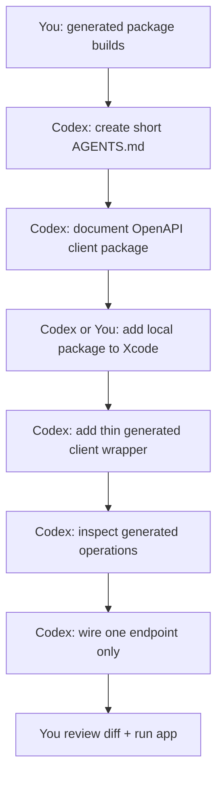

Perfect. Since `swift build --package-path Packages/ScubaPalAPI` says **Build complete**, you crossed the important line:

```text
✅ Backend OpenAPI exported
✅ Local ScubaPalAPI Swift package created
✅ Swift OpenAPI Generator downloaded
✅ Generated client/types compile in isolation
```

Now **pause**. Do not ask Codex to refactor everything. The next Codex task should be narrow:

> Add the generated API package into the app architecture safely, without replacing the current networking layer yet.

Your previous prompt list had “OpenAPI generation readiness plan” later, but now you are past planning; you have a compiling generated package. So move OpenAPI integration earlier. 

Codex supports repo-level `AGENTS.md` instructions, and OpenAI’s Codex docs specifically describe using `AGENTS.md` for persistent project guidance. ([OpenAI Developers][1])

---

# Do this first: checkpoint your current work

From:

```text
~/Developer/active/scuba-pal/scubapal-ios
```

Run:

```bash
git status
```

Breakdown:

* `git status` shows modified, untracked, staged, and deleted files.

Then create a branch:

```bash
git switch -c integrate-swift-openapi-client
```

Breakdown:

* `git switch` changes branches.
* `-c` creates a new branch.
* `integrate-swift-openapi-client` is the branch name.

Then add only the OpenAPI package work:

```bash
git add OpenAPI/scubapal-openapi.json Packages/ScubaPalAPI
```

Breakdown:

* `git add` stages files for commit.
* `OpenAPI/scubapal-openapi.json` stages the exported backend spec.
* `Packages/ScubaPalAPI` stages your local generated API package.

Commit:

```bash
git commit -m "Add generated Swift OpenAPI client package"
```

Breakdown:

* `git commit` creates a commit.
* `-m` sets the commit message.

Now you have a safe checkpoint.

---

# Codex Task 1: add project instructions

Paste this into Codex first.

```text
Create or update AGENTS.md at the repository root.

Use concise project guidance for this SwiftUI app.

Include:
- ScubaPal iOS is a native SwiftUI client for the ScubaPal backend.
- Prioritize small, reviewable, production-safe changes.
- Do not do large rewrites unless explicitly requested.
- Preserve behavior unless the task says otherwise.
- Keep generated OpenAPI client/types isolated in Packages/ScubaPalAPI.
- Do not expose generated API models directly to SwiftUI views.
- Repositories may call generated clients.
- Repositories should map API models into domain models.
- ViewModels should depend on repositories/domain models, not generated DTOs.
- SwiftUI Views should depend on ViewModels/domain/design system, not API client types.
- Do not commit secrets, local config, xcuserdata, .DS_Store, __MACOSX, or machine-specific files.
- Previews/tests must not use live networking by default.
- After code changes, run the strongest available validation and report what was run.

Keep AGENTS.md practical and short. Do not paste a giant architecture essay.
After editing, show changed files and the final AGENTS.md contents.
```

Why first? Because every later Codex prompt gets better if Codex has stable project rules.

---

# Codex Task 2: verify generated package and document it

Paste this next.

```text
You are working in the ScubaPal iOS SwiftUI repo.

Goal:
Verify the existing local Swift OpenAPI package and document how it works. Do not integrate it into the app target yet.

Current state:
- OpenAPI/scubapal-openapi.json exists.
- Packages/ScubaPalAPI exists.
- Packages/ScubaPalAPI builds successfully with:
  swift build --package-path Packages/ScubaPalAPI

Tasks:
1. Inspect Packages/ScubaPalAPI.
2. Confirm Package.swift uses:
   - swift-openapi-generator
   - swift-openapi-runtime
   - swift-openapi-urlsession
3. Confirm Sources/ScubaPalAPI contains:
   - openapi.json
   - openapi-generator-config.yaml
   - at least one Swift source file so the target is non-empty
4. Add a short document at Docs/OpenAPIClient.md explaining:
   - how to refresh the OpenAPI spec from the backend
   - how to copy it into Packages/ScubaPalAPI/Sources/ScubaPalAPI/openapi.json
   - how to build the package
   - that generated API types should not be used directly in SwiftUI views
   - that repositories should wrap generated client calls
   - that mappers should convert API models to domain models
5. Do not modify app networking yet.
6. Do not modify Xcode project settings yet.
7. Do not delete current hand-written APIClient, Endpoint, DTOs, or repositories.

Acceptance criteria:
- Docs/OpenAPIClient.md exists and is accurate.
- Packages/ScubaPalAPI still builds.
- No app runtime behavior changes.
- Existing networking layer is untouched.

Validation:
Run:
swift build --package-path Packages/ScubaPalAPI

After completing:
- List changed files.
- Show the validation result.
- Explain the next safest integration step.
```

This is a low-risk Codex task. It confirms the foundation before touching Xcode.

---

# Codex Task 3: add local package to Xcode project

Only after Task 2 is clean, use this.

```text
You are working in the ScubaPal iOS SwiftUI repo.

Goal:
Add the local Packages/ScubaPalAPI Swift package to the Xcode project safely.

Context:
Packages/ScubaPalAPI builds successfully by itself. It contains a Swift OpenAPI generated client package. The app should import it later, but this task should only connect the local package to the app target if safe.

Tasks:
1. Inspect scubapal-ios.xcodeproj/project.pbxproj.
2. Add local package dependency:
   Packages/ScubaPalAPI
3. Link the ScubaPalAPI product to the main iOS app target.
4. Do not rewrite repositories.
5. Do not replace the existing APIClient.
6. Do not change app behavior.
7. Avoid touching unrelated Xcode project settings.
8. If editing project.pbxproj manually is risky, explain the exact Xcode UI steps instead of guessing.

Acceptance criteria:
- Xcode project references the local ScubaPalAPI package.
- Main app target links the ScubaPalAPI product.
- No unrelated project settings are changed.
- Package still builds.
- App target should build if xcodebuild is available.

Validation:
Run the strongest available commands:
1. swift build --package-path Packages/ScubaPalAPI
2. xcodebuild -project scubapal-ios.xcodeproj -scheme scubapal-ios -destination 'platform=iOS Simulator,name=iPhone 16' build

If xcodebuild destination/scheme fails due to environment, report the exact failure and do not hide it.

After completing:
- List changed files.
- Explain whether the package was added automatically or whether manual Xcode steps are required.
- Show validation results.
```

Important: if Codex says it is not confident editing `project.pbxproj`, that is okay. Then you do it manually in Xcode:

```text
File → Add Package Dependencies… → Add Local… → Packages/ScubaPalAPI
```

---

# Codex Task 4: add a wrapper, but do not use it yet

After the package is linked, paste this.

```text
You are working in the ScubaPal iOS SwiftUI repo.

Goal:
Add a thin app-level wrapper around the generated Swift OpenAPI client without replacing existing networking yet.

Tasks:
1. Create an appropriate file, preferably:
   scubapal-ios/API/Generated/ScubaPalGeneratedClient.swift
   or the nearest existing equivalent folder if API/Generated does not exist.
2. Import:
   - Foundation
   - ScubaPalAPI
   - OpenAPIURLSession
3. Add a small wrapper type that creates the generated Client from a baseURL.
4. Keep it simple.
5. Do not call the wrapper from production code yet.
6. Do not delete or modify the current APIClient.
7. Do not leak generated API models into SwiftUI views.
8. If the generated Client initializer signature differs, inspect the generated package/build output and adapt correctly.

Expected shape:

import Foundation
import ScubaPalAPI
import OpenAPIURLSession

struct ScubaPalGeneratedClient {
    let client: Client

    init(baseURL: URL) {
        self.client = Client(
            serverURL: baseURL,
            transport: URLSessionTransport()
        )
    }
}

Acceptance criteria:
- The wrapper compiles.
- Existing app behavior is unchanged.
- The current hand-written networking layer still exists.
- The wrapper is ready for one endpoint migration later.

Validation:
Run:
swift build --package-path Packages/ScubaPalAPI

Also run xcodebuild build if available.

After completing:
- List changed files.
- Explain the wrapper.
- Tell me whether the generated Client initializer matched the expected shape.
```

---

# Codex Task 5: inspect generated operations before wiring anything

This is important. You need to know the generated method names.

```text
You are working in the ScubaPal iOS SwiftUI repo.

Goal:
Inspect the generated OpenAPI client operations and identify the safest first endpoint to wire.

Tasks:
1. Build Packages/ScubaPalAPI if needed.
2. Inspect generated symbols/build plugin output if accessible.
3. Identify generated operation names for likely simple endpoints:
   - current user / me endpoint
   - feed/posts list endpoint
   - health/status endpoint if present
4. Prefer a GET endpoint with no auth complexity if available.
5. Do not modify production repository code yet.
6. Create Docs/OpenAPIFirstEndpoint.md documenting:
   - candidate endpoint path
   - generated Swift operation name if discoverable
   - request type
   - response type
   - why it is safe or risky
   - what mapper would be needed
7. If generated sources are hidden in build artifacts and hard to inspect, explain how to find them locally.

Acceptance criteria:
- We know the first endpoint to migrate.
- No runtime behavior changes.
- No repository replacement yet.

Validation:
Run:
swift build --package-path Packages/ScubaPalAPI

After completing:
- List changed files.
- Recommend exactly one first endpoint to migrate.
```

---

# Codex Task 6: wire one endpoint only

Use this only when Task 5 identifies the exact generated operation.

```text
You are working in the ScubaPal iOS SwiftUI repo.

Goal:
Migrate exactly one low-risk endpoint from the hand-written APIClient path to the generated OpenAPI client path.

Constraints:
- Migrate only one endpoint.
- Do not rewrite the whole networking layer.
- Do not delete current DTOs/repositories unless truly unused by this one change.
- Do not leak generated API models into SwiftUI views.
- Preserve domain models and mapper boundaries.
- Preserve existing UI behavior.

Preferred endpoint:
Use the endpoint documented in Docs/OpenAPIFirstEndpoint.md.

Tasks:
1. Inspect the existing repository method for that endpoint.
2. Create or update a repository implementation that calls the generated client.
3. Map generated API response models into existing domain models.
4. Keep the public repository method signature stable if possible.
5. Add/update tests for the mapper or repository if feasible.
6. Keep fallback/current APIClient path untouched unless this task explicitly replaces one method.
7. Do not change unrelated screens.

Acceptance criteria:
- Exactly one endpoint uses the generated client.
- SwiftUI views do not import ScubaPalAPI.
- Domain models remain separate from generated API models.
- App behavior remains equivalent.
- Build/test validation is run.

Validation:
Run:
swift build --package-path Packages/ScubaPalAPI

Then run xcodebuild build/test if available.

After completing:
- List changed files.
- Explain the old path and new path.
- Explain the mapper boundary.
- Report validation.
- Recommend the next endpoint only after this one is stable.
```

---

# The actual sequence now



---

# What not to ask Codex yet

Do **not** ask for this yet:

```text
Refactor all repositories to use the generated OpenAPI client.
```

Bad. Too large.

Do **not** ask for this yet:

```text
Delete my old APIClient and DTOs.
```

Bad. You need a migration bridge.

Do **not** ask for this yet:

```text
Reorganize the whole app into Domain/API/Features while integrating OpenAPI.
```

Bad. Mixes two risky refactors.

---

# Best next prompt to paste right now

Paste **this one** now:

```text
You are working in the ScubaPal iOS SwiftUI repo.

Goal:
Create concise root AGENTS.md instructions and document the new generated Swift OpenAPI client package.

Current state:
- OpenAPI/scubapal-openapi.json exists.
- Packages/ScubaPalAPI exists.
- Packages/ScubaPalAPI builds successfully with:
  swift build --package-path Packages/ScubaPalAPI

Tasks:
1. Create or update AGENTS.md at the repository root with concise project rules:
   - ScubaPal iOS is a native SwiftUI client for the ScubaPal backend.
   - Prefer small, reviewable, production-safe changes.
   - Preserve behavior unless explicitly told otherwise.
   - Keep generated OpenAPI client/types isolated in Packages/ScubaPalAPI.
   - Do not expose generated API models directly to SwiftUI views.
   - Repositories may call generated clients.
   - Repositories should map API models into domain models.
   - ViewModels should depend on repositories/domain models, not generated DTOs.
   - SwiftUI Views should depend on ViewModels/domain/design system, not API client types.
   - Do not commit secrets, local config, xcuserdata, .DS_Store, __MACOSX, or machine-specific files.
   - Previews/tests must not use live networking by default.
   - After code changes, run the strongest available validation and report what was run.
2. Add Docs/OpenAPIClient.md explaining:
   - how to refresh the OpenAPI spec from the backend
   - how to copy it into Packages/ScubaPalAPI/Sources/ScubaPalAPI/openapi.json
   - how to build the package
   - that generated API types should not be used directly in SwiftUI views
   - that repositories should wrap generated client calls
   - that mappers should convert API models to domain models
3. Do not modify app networking yet.
4. Do not modify the Xcode project yet.
5. Do not delete current hand-written APIClient, Endpoint, DTOs, or repositories.

Acceptance criteria:
- AGENTS.md exists and is concise.
- Docs/OpenAPIClient.md exists and is accurate.
- Packages/ScubaPalAPI still builds.
- No app runtime behavior changes.

Validation:
Run:
swift build --package-path Packages/ScubaPalAPI

After completing:
- List changed files.
- Show validation result.
- Explain the next safest integration step.
```

**Progress: 52%.**
Next goal: get Codex to add durable repo instructions + documentation, then integrate the local package into Xcode as a separate safe step.

[1]: https://developers.openai.com/codex/guides/agents-md?utm_source=chatgpt.com "Custom instructions with AGENTS.md – Codex"
