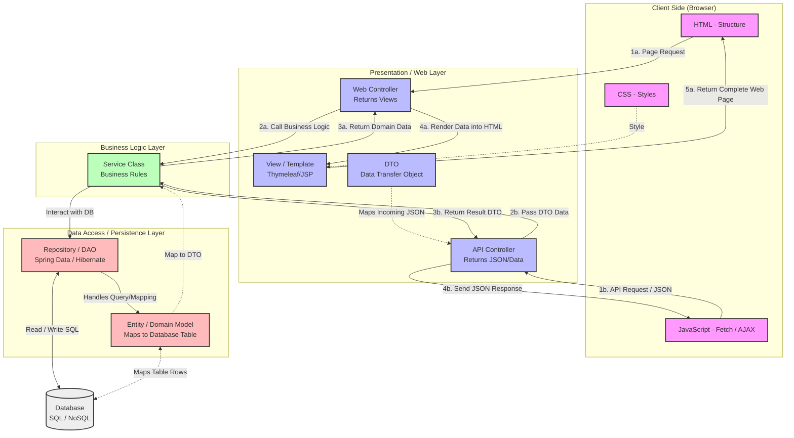

Diagramming is powerful. Never understimate good diagrams.

Anything else:
Where applicable, always provide mermaid diagrams because diagrams help me understand and learn stuff better. Flow, connections, use case, system, any other diagrams relevant to understand the material decide etc. 

