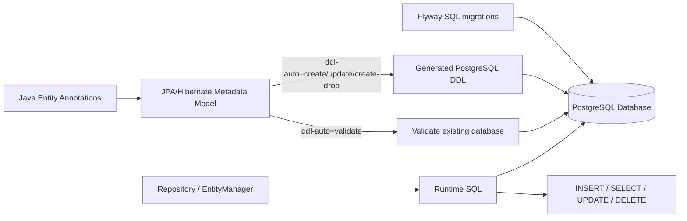
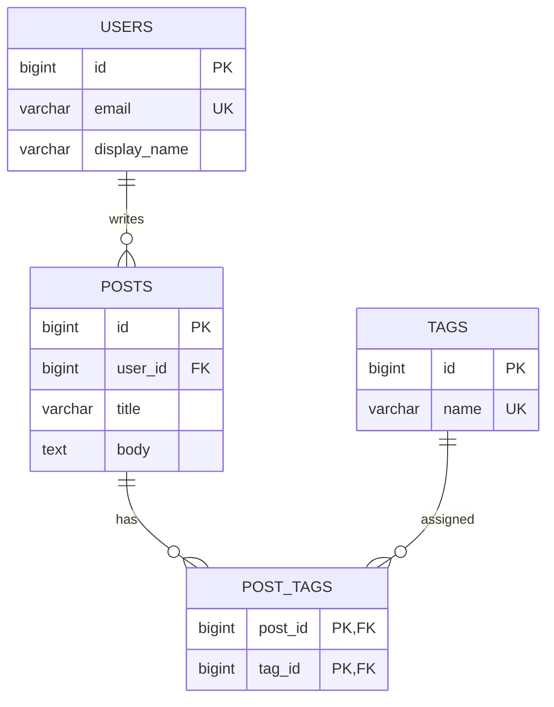
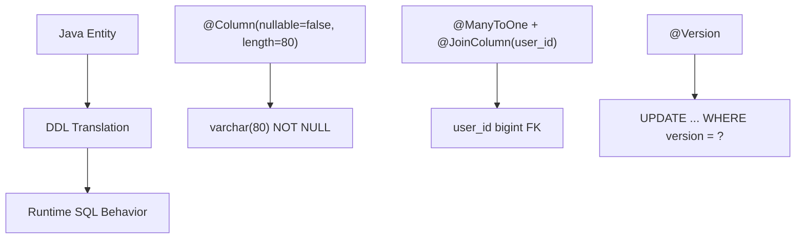

1. [2. Core annotation → PostgreSQL SQL map](#2-core-annotation--postgresql-sql-map)
   1. [Table-level mappings](#table-level-mappings)
   2. [Column-level mappings](#column-level-mappings)
   3. [Primary key and generated ID mappings](#primary-key-and-generated-id-mappings)
2. [3. Relationship annotation → SQL map](#3-relationship-annotation--sql-map)
   1. [`@ManyToOne`](#manytoone)
   2. [`@OneToMany`](#onetomany)
      1. [Case A: Bidirectional, recommended](#case-a-bidirectional-recommended)
      2. [Case B: Unidirectional one-to-many](#case-b-unidirectional-one-to-many)
   3. [`@OneToOne`](#onetoone)
   4. [`@ManyToMany`](#manytomany)
   5. [Relationship visual](#relationship-visual)
3. [4. Enum, date, JSON, text, UUID mappings](#4-enum-date-json-text-uuid-mappings)
4. [5. Validation annotation → SQL mapping](#5-validation-annotation--sql-mapping)
5. [6. Hibernate-specific annotations → SQL / runtime behavior](#6-hibernate-specific-annotations--sql--runtime-behavior)
6. [7. Inheritance annotations → SQL shape](#7-inheritance-annotations--sql-shape)
   1. [`@MappedSuperclass`](#mappedsuperclass)
   2. [`@Inheritance(strategy = SINGLE_TABLE)`](#inheritancestrategy--single_table)
   3. [`@Inheritance(strategy = JOINED)`](#inheritancestrategy--joined)
   4. [`@Inheritance(strategy = TABLE_PER_CLASS)`](#inheritancestrategy--table_per_class)
7. [8. Secondary table mappings](#8-secondary-table-mappings)
8. [9. Runtime SQL annotations/attributes that do not directly create DDL](#9-runtime-sql-annotationsattributes-that-do-not-directly-create-ddl)
9. [10. Best visual method: annotation-to-DDL cards](#10-best-visual-method-annotation-to-ddl-cards)
10. [11. Full example: entity → PostgreSQL](#11-full-example-entity--postgresql)
    1. [Java](#java)
    2. [PostgreSQL Flyway version](#postgresql-flyway-version)
11. [12. The map you should memorize](#12-the-map-you-should-memorize)
    1. [Practical rule for your apps](#practical-rule-for-your-apps)


You do **not** want “Spring Boot annotations → SQL.” You want:

**Jakarta Persistence/JPA annotations + Hibernate annotations + validation annotations → PostgreSQL DDL/DML behavior.**

Spring Boot mostly auto-configures Hibernate. The SQL-relevant part is JPA/Hibernate. Also: with `spring.jpa.hibernate.ddl-auto=validate`, annotations **do not create tables**. Hibernate checks your DB against the entity model. With `create`, `update`, or `create-drop`, Hibernate can generate/alter schema. Spring Boot lists `none`, `validate`, `update`, `create`, and `create-drop`, and recommends using one schema mechanism; with Flyway/Liquibase, use migrations as the source of truth. ([Home][1])

## 1. Mental model



Think in **4 layers**:

| Layer              | What you write                                  | What it becomes                                           |
| ------------------ | ----------------------------------------------- | --------------------------------------------------------- |
| Entity shape       | `@Entity`, `@Table`, fields                     | `CREATE TABLE`                                            |
| Column rules       | `@Column`, `@Id`, `@JoinColumn`                 | `NOT NULL`, `UNIQUE`, `FK`, `varchar`, `numeric`          |
| Relationship rules | `@ManyToOne`, `@OneToMany`, `@JoinTable`        | Foreign keys / join tables                                |
| Runtime behavior   | `cascade`, `fetch`, `orphanRemoval`, `@Version` | Generated `SELECT`, `INSERT`, `UPDATE`, `DELETE` behavior |

---

# 2. Core annotation → PostgreSQL SQL map

## Table-level mappings

| Java annotation |           Attribute | PostgreSQL SQL equivalent                     | Example                                                  |
| --------------- | ------------------: | --------------------------------------------- | -------------------------------------------------------- |
| `@Entity`       |                   — | Marks class as persistent table-backed entity | `CREATE TABLE ...`                                       |
| `@Table`        |              `name` | Table name                                    | `CREATE TABLE users (...)`                               |
| `@Table`        |            `schema` | Schema-qualified table                        | `CREATE TABLE identity.users (...)`                      |
| `@Table`        | `uniqueConstraints` | Table-level unique constraint                 | `CONSTRAINT uk_users_email UNIQUE (email)`               |
| `@Table`        |           `indexes` | Index creation                                | `CREATE INDEX idx_users_email ON identity.users(email);` |
| `@Index`        |              `name` | Index name                                    | `idx_users_email`                                        |
| `@Index`        |        `columnList` | Indexed columns                               | `(email)` or `(last_name, first_name)`                   |
| `@Index`        |     `unique = true` | Unique index                                  | `CREATE UNIQUE INDEX ...`                                |

`@Table.uniqueConstraints` are specifically used for generated DDL constraints, and `@Column` contains column-level options such as `nullable`, `unique`, `length`, `precision`, and `scale`. ([Jakarta EE][2])

Example:

```java
@Entity
@Table(
    schema = "identity",
    name = "users",
    uniqueConstraints = {
        @UniqueConstraint(name = "uk_users_email", columnNames = "email")
    },
    indexes = {
        @Index(name = "idx_users_display_name", columnList = "display_name")
    }
)
public class User {
}
```

Equivalent SQL idea:

```sql
CREATE TABLE identity.users (
    ...
    CONSTRAINT uk_users_email UNIQUE (email)
);

CREATE INDEX idx_users_display_name
    ON identity.users(display_name);
```

---

## Column-level mappings

| Java annotation |                    Attribute | PostgreSQL SQL equivalent       | Example                            |
| --------------- | ---------------------------: | ------------------------------- | ---------------------------------- |
| `@Column`       |                       `name` | Column name                     | `display_name`                     |
| `@Column`       |           `nullable = false` | `NOT NULL`                      | `email varchar(320) NOT NULL`      |
| `@Column`       |              `unique = true` | Single-column unique constraint | `email varchar(320) UNIQUE`        |
| `@Column`       |               `length = 320` | String length                   | `varchar(320)`                     |
| `@Column`       |  `precision = 10, scale = 2` | Decimal precision               | `numeric(10,2)`                    |
| `@Column`       |  `columnDefinition = "text"` | Exact SQL column type           | `bio text`                         |
| `@Column`       | `columnDefinition = "jsonb"` | Exact SQL column type           | `metadata jsonb`                   |
| `@Column`       |         `insertable = false` | Exclude from `INSERT` SQL       | field not included in insert       |
| `@Column`       |          `updatable = false` | Exclude from `UPDATE` SQL       | field not included in update       |
| `@Column`       |              `table = "..."` | Column in secondary table       | used with `@SecondaryTable`        |
| `@Basic`        |           `optional = false` | May imply non-null in model     | prefer `@Column(nullable = false)` |
| `@Transient`    |                            — | No DB column                    | field ignored by ORM               |

Important distinction:

```java
@Column(nullable = false)
private String email;
```

Means schema-level rule:

```sql
email varchar(255) NOT NULL
```

But:

```java
@NotNull
private String email;
```

Means application validation first. Hibernate Validator can integrate constraints into DDL generation in some setups, but for production migrations, do **not** rely on validation annotations as your database schema. Put actual `NOT NULL` in Flyway. ([Red Hat Documentation][3])

---

## Primary key and generated ID mappings

| Java annotation                        |        Attribute | PostgreSQL SQL equivalent     | Example                                    |
| -------------------------------------- | ---------------: | ----------------------------- | ------------------------------------------ |
| `@Id`                                  |                — | Primary key column            | `PRIMARY KEY`                              |
| `@GeneratedValue(strategy = IDENTITY)` |                — | Identity column               | `GENERATED BY DEFAULT AS IDENTITY`         |
| `@GeneratedValue(strategy = SEQUENCE)` |                — | Uses sequence                 | `nextval('users_id_seq')`                  |
| `@SequenceGenerator`                   |           `name` | Java generator name           | internal reference                         |
| `@SequenceGenerator`                   |   `sequenceName` | DB sequence name              | `identity.users_id_seq`                    |
| `@SequenceGenerator`                   | `allocationSize` | Hibernate ID allocation block | affects sequence fetching                  |
| `@GeneratedValue(strategy = AUTO)`     |                — | Provider chooses strategy     | usually sequence/UUID depending type       |
| `@UuidGenerator` Hibernate             |                — | UUID generation               | `uuid` column, generated in Java/Hibernate |

Hibernate’s behavior for `AUTO` depends on type and database support; for UUID identifiers, Hibernate uses UUID generation. ([Hibernate Documentation][4])

Example:

```java
@Id
@GeneratedValue(strategy = GenerationType.SEQUENCE, generator = "users_id_seq")
@SequenceGenerator(
    name = "users_id_seq",
    sequenceName = "identity.users_id_seq",
    allocationSize = 50
)
private Long id;
```

Equivalent SQL idea:

```sql
CREATE SEQUENCE identity.users_id_seq START WITH 1 INCREMENT BY 50;

CREATE TABLE identity.users (
    id bigint NOT NULL DEFAULT nextval('identity.users_id_seq'),
    CONSTRAINT pk_users PRIMARY KEY (id)
);
```

For PostgreSQL apps, I would usually use either:

```java
@Id
@GeneratedValue(strategy = GenerationType.IDENTITY)
private Long id;
```

or:

```java
@Id
@GeneratedValue
private UUID id;
```

For distributed systems, UUIDs avoid sequence coordination.

---

# 3. Relationship annotation → SQL map

## `@ManyToOne`

Most important relationship annotation.

```java
@ManyToOne(fetch = FetchType.LAZY, optional = false)
@JoinColumn(
    name = "user_id",
    nullable = false,
    foreignKey = @ForeignKey(name = "fk_posts_user")
)
private User user;
```

Equivalent SQL:

```sql
user_id bigint NOT NULL,
CONSTRAINT fk_posts_user
    FOREIGN KEY (user_id)
    REFERENCES identity.users(id)
```

`@JoinColumn` defines the join column, including `name`, `referencedColumnName`, `nullable`, `unique`, and `foreignKey`-related DDL behavior. ([Jakarta EE][5])

| Java annotation |              Attribute | SQL effect                                 |
| --------------- | ---------------------: | ------------------------------------------ |
| `@ManyToOne`    |                      — | Usually creates FK column on current table |
| `@ManyToOne`    |   `fetch = LAZY/EAGER` | Runtime `SELECT` behavior, not DDL         |
| `@ManyToOne`    |     `optional = false` | Object model says required                 |
| `@JoinColumn`   |                 `name` | FK column name                             |
| `@JoinColumn`   | `referencedColumnName` | Referenced target column                   |
| `@JoinColumn`   |     `nullable = false` | `NOT NULL` on FK column                    |
| `@JoinColumn`   |        `unique = true` | Unique FK, often one-to-one                |
| `@ForeignKey`   |                 `name` | FK constraint name                         |

---

## `@OneToMany`

Two cases.

### Case A: Bidirectional, recommended

```java
@OneToMany(mappedBy = "user")
private List<Post> posts;
```

No column is created on `users`.

The FK lives on the `posts` table because `Post` has:

```java
@ManyToOne
@JoinColumn(name = "user_id")
private User user;
```

SQL:

```sql
ALTER TABLE social.posts
ADD CONSTRAINT fk_posts_user
FOREIGN KEY (user_id)
REFERENCES identity.users(id);
```

### Case B: Unidirectional one-to-many

```java
@OneToMany
@JoinColumn(name = "user_id")
private List<Post> posts;
```

Hibernate may create/update FK from parent side. Usually avoid this for normal app design. Prefer the child owning the FK with `@ManyToOne`.

---

## `@OneToOne`

```java
@OneToOne(fetch = FetchType.LAZY, optional = false)
@JoinColumn(name = "profile_id", unique = true, nullable = false)
private Profile profile;
```

Equivalent SQL:

```sql
profile_id bigint NOT NULL UNIQUE,
CONSTRAINT fk_users_profile
    FOREIGN KEY (profile_id)
    REFERENCES identity.profiles(id)
```

| Annotation                                 | SQL meaning                       |
| ------------------------------------------ | --------------------------------- |
| `@OneToOne` + `@JoinColumn(unique = true)` | FK column with unique constraint  |
| `@OneToOne(mappedBy = "...")`              | Inverse side; no new column there |

---

## `@ManyToMany`

```java
@ManyToMany
@JoinTable(
    schema = "social",
    name = "post_tags",
    joinColumns = @JoinColumn(name = "post_id"),
    inverseJoinColumns = @JoinColumn(name = "tag_id")
)
private Set<Tag> tags;
```

Equivalent SQL:

```sql
CREATE TABLE social.post_tags (
    post_id bigint NOT NULL,
    tag_id bigint NOT NULL,
    CONSTRAINT pk_post_tags PRIMARY KEY (post_id, tag_id),
    CONSTRAINT fk_post_tags_post FOREIGN KEY (post_id) REFERENCES social.posts(id),
    CONSTRAINT fk_post_tags_tag FOREIGN KEY (tag_id) REFERENCES social.tags(id)
);
```

For real apps, I usually avoid raw `@ManyToMany` once the relationship needs metadata like `created_at`, `role`, `status`, `sort_order`, etc. Make a real join entity instead.

---

## Relationship visual



---

# 4. Enum, date, JSON, text, UUID mappings

| Java annotation/type                  | SQL equivalent       | Notes                                       |
| ------------------------------------- | -------------------- | ------------------------------------------- |
| `@Enumerated(EnumType.STRING)`        | `varchar(...)`       | Best default; readable and stable           |
| `@Enumerated(EnumType.ORDINAL)`       | `smallint`/`integer` | Avoid; enum reorder breaks data             |
| `@Column(columnDefinition = "text")`  | `text`               | Good for long descriptions                  |
| `@Lob` on `String`                    | large text type      | Provider-specific; I prefer explicit `text` |
| `@Lob` on `byte[]`                    | binary/blob type     | For files, prefer S3 + URL/key in DB        |
| `UUID` field                          | `uuid`               | PostgreSQL supports native UUID             |
| `@JdbcTypeCode(SqlTypes.JSON)`        | JSON mapping         | Hibernate-level JSON mapping                |
| `@Column(columnDefinition = "jsonb")` | `jsonb`              | PostgreSQL-specific JSONB                   |
| `Instant` / `OffsetDateTime`          | timestamp type       | Use UTC consistently                        |
| `LocalDate`                           | `date`               | Date only                                   |
| `LocalTime`                           | `time`               | Time only                                   |

For PostgreSQL, `json` and `jsonb` both accept JSON values; `jsonb` stores a decomposed binary form that is usually faster to process because it avoids reparsing on every execution. ([PostgreSQL][6])

Example:

```java
@Enumerated(EnumType.STRING)
@Column(nullable = false, length = 30)
private AccountStatus status;
```

SQL:

```sql
status varchar(30) NOT NULL
```

Better production SQL with explicit check:

```sql
status varchar(30) NOT NULL,
CONSTRAINT ck_users_status
    CHECK (status IN ('ACTIVE', 'DISABLED', 'DELETED'))
```

Hibernate/JPA will not magically know your ideal PostgreSQL enum/check strategy. Put the `CHECK` in Flyway.

---

# 5. Validation annotation → SQL mapping

These are **not primarily database annotations**. They validate Java objects before persistence or request handling.

| Validation annotation                | App-level meaning             | Possible SQL equivalent you should write manually |
| ------------------------------------ | ----------------------------- | ------------------------------------------------- |
| `@NotNull`                           | value cannot be `null`        | `NOT NULL`                                        |
| `@NotBlank`                          | string not null and not blank | `CHECK (length(trim(name)) > 0)`                  |
| `@NotEmpty`                          | collection/string not empty   | usually app-level only                            |
| `@Size(max = 80)`                    | max length                    | `varchar(80)` or `CHECK (length(x) <= 80)`        |
| `@Size(min = 2, max = 80)`           | min/max length                | `varchar(80)` + `CHECK (length(x) >= 2)`          |
| `@Min(0)`                            | numeric minimum               | `CHECK (value >= 0)`                              |
| `@Max(100)`                          | numeric maximum               | `CHECK (value <= 100)`                            |
| `@Positive`                          | greater than 0                | `CHECK (value > 0)`                               |
| `@PositiveOrZero`                    | greater/equal 0               | `CHECK (value >= 0)`                              |
| `@Negative`                          | less than 0                   | `CHECK (value < 0)`                               |
| `@DecimalMin("0.00")`                | decimal minimum               | `CHECK (price >= 0.00)`                           |
| `@DecimalMax("9999.99")`             | decimal maximum               | `CHECK (price <= 9999.99)`                        |
| `@Digits(integer = 6, fraction = 2)` | decimal shape                 | `numeric(8,2)` usually                            |
| `@Email`                             | email format                  | app-level; DB regex check optional                |
| `@Pattern`                           | regex format                  | PostgreSQL `CHECK (value ~ 'regex')`              |
| `@Past`, `@Future`                   | temporal validation           | usually app-level                                 |
| `@AssertTrue`                        | boolean must be true          | `CHECK (accepted_terms = true)`                   |

Jakarta Bean Validation defines constraints like `@Min`, `@Max`, `@DecimalMin`, `@Digits`, `@Email`, `@Future`, and others as validation rules on Java fields/properties. ([Jakarta EE][7])

Best rule:

```java
@NotBlank
@Size(max = 80)
@Column(nullable = false, length = 80)
private String displayName;
```

Flyway SQL:

```sql
display_name varchar(80) NOT NULL,
CONSTRAINT ck_users_display_name_not_blank
    CHECK (length(trim(display_name)) > 0)
```

---

# 6. Hibernate-specific annotations → SQL / runtime behavior

| Hibernate annotation           | SQL effect                                  | Notes                                           |
| ------------------------------ | ------------------------------------------- | ----------------------------------------------- |
| `@CreationTimestamp`           | sets value on insert                        | Usually app/Hibernate-generated, not DB default |
| `@UpdateTimestamp`             | sets value on update                        | Runtime behavior                                |
| `@ColumnDefault("now()")`      | `DEFAULT now()`                             | DDL default if Hibernate generates schema       |
| `@Check(constraints = "...")`  | `CHECK (...)`                               | Hibernate-specific DDL                          |
| `@Comment`                     | `COMMENT ON ...`                            | DB comments, if supported                       |
| `@NaturalId`                   | Natural key lookup metadata                 | Pair with actual unique constraint              |
| `@DynamicInsert`               | Generates insert with non-null columns only | Runtime SQL shape                               |
| `@DynamicUpdate`               | Updates changed columns only                | Runtime SQL shape                               |
| `@Immutable`                   | Prevents updates                            | Runtime behavior                                |
| `@SoftDelete`                  | update flag instead of hard delete          | Hibernate soft delete support                   |
| `@SQLDelete`                   | Custom delete SQL                           | Runtime `DELETE` override                       |
| `@JdbcTypeCode(SqlTypes.JSON)` | JSON JDBC mapping                           | Combine with PostgreSQL `jsonb` column          |
| `@UuidGenerator`               | UUID value generation                       | Hibernate ID generation                         |

Hibernate ORM sits between the Java application data-access layer and the relational database, mapping domain objects to relational persistence behavior. ([Hibernate Documentation][8])

Example DB default:

```java
@ColumnDefault("now()")
@Column(nullable = false)
private Instant createdAt;
```

SQL idea:

```sql
created_at timestamp with time zone NOT NULL DEFAULT now()
```

But in production I prefer explicit Flyway:

```sql
created_at timestamptz NOT NULL DEFAULT now()
```

---

# 7. Inheritance annotations → SQL shape

## `@MappedSuperclass`

```java
@MappedSuperclass
public abstract class BaseEntity {
    @Id
    private Long id;

    @Column(nullable = false)
    private Instant createdAt;
}
```

SQL effect:

```sql
-- No base_entity table.
-- Columns are copied into child tables.
```

## `@Inheritance(strategy = SINGLE_TABLE)`

One table for all subclasses.

```java
@Entity
@Inheritance(strategy = InheritanceType.SINGLE_TABLE)
@DiscriminatorColumn(name = "account_type")
public abstract class Account {
}
```

SQL:

```sql
CREATE TABLE accounts (
    id bigint PRIMARY KEY,
    account_type varchar(31) NOT NULL,
    ...
);
```

## `@Inheritance(strategy = JOINED)`

Base table + subclass tables.

```sql
CREATE TABLE accounts (
    id bigint PRIMARY KEY
);

CREATE TABLE diver_accounts (
    id bigint PRIMARY KEY REFERENCES accounts(id),
    certification_level varchar(50)
);
```

## `@Inheritance(strategy = TABLE_PER_CLASS)`

Each concrete class gets its own table. Usually avoid unless you really need it.

---

# 8. Secondary table mappings

```java
@Entity
@Table(name = "users", schema = "identity")
@SecondaryTable(name = "user_profiles", schema = "identity")
public class User {
    @Column(table = "user_profiles", name = "bio", columnDefinition = "text")
    private String bio;
}
```

SQL idea:

```sql
CREATE TABLE identity.users (
    id bigint PRIMARY KEY,
    email varchar(320) NOT NULL
);

CREATE TABLE identity.user_profiles (
    user_id bigint PRIMARY KEY REFERENCES identity.users(id),
    bio text
);
```

---

# 9. Runtime SQL annotations/attributes that do not directly create DDL

These affect **how Hibernate queries**, not table structure.

| Annotation/attribute      | Runtime SQL effect                                  |
| ------------------------- | --------------------------------------------------- |
| `fetch = FetchType.LAZY`  | delays `SELECT` until accessed                      |
| `fetch = FetchType.EAGER` | loads immediately, can cause joins/extra selects    |
| `cascade = PERSIST`       | saving parent can insert child                      |
| `cascade = REMOVE`        | deleting parent can delete child                    |
| `orphanRemoval = true`    | removing child from collection can delete child row |
| `mappedBy`                | says “other side owns FK”                           |
| `@OrderBy`                | adds `ORDER BY` to select                           |
| `@OrderColumn`            | creates physical order column                       |
| `@Version`                | optimistic locking with version check               |
| `insertable = false`      | omit column from `INSERT`                           |
| `updatable = false`       | omit column from `UPDATE`                           |
| `@NamedQuery`             | predefined JPQL query                               |
| `@Query` Spring Data      | explicit JPQL/native SQL query                      |

Example `@Version`:

```java
@Version
@Column(nullable = false)
private long version;
```

SQL table:

```sql
version bigint NOT NULL
```

Runtime update:

```sql
UPDATE posts
SET title = ?, version = version + 1
WHERE id = ?
  AND version = ?;
```

That last `AND version = ?` prevents lost updates.

---

# 10. Best visual method: annotation-to-DDL cards

For each entity, make a 3-panel card:



Use this template:

```md
## Entity: User

### 1. Java annotation
@Column(nullable = false, length = 320)
private String email;

### 2. PostgreSQL DDL
email varchar(320) NOT NULL

### 3. Runtime behavior
Included in INSERT and UPDATE unless insertable/updatable is false.

### 4. Flyway source of truth
email varchar(320) NOT NULL
```

---

# 11. Full example: entity → PostgreSQL

## Java

```java
@Entity
@Table(
    schema = "identity",
    name = "users",
    uniqueConstraints = {
        @UniqueConstraint(name = "uk_users_email", columnNames = "email")
    },
    indexes = {
        @Index(name = "idx_users_display_name", columnList = "display_name")
    }
)
public class User {

    @Id
    @GeneratedValue(strategy = GenerationType.SEQUENCE, generator = "users_id_seq")
    @SequenceGenerator(
        name = "users_id_seq",
        sequenceName = "identity.users_id_seq",
        allocationSize = 50
    )
    private Long id;

    @NotBlank
    @Size(max = 320)
    @Column(nullable = false, length = 320)
    private String email;

    @NotBlank
    @Size(max = 80)
    @Column(name = "display_name", nullable = false, length = 80)
    private String displayName;

    @Enumerated(EnumType.STRING)
    @Column(nullable = false, length = 30)
    private UserStatus status;

    @Version
    @Column(nullable = false)
    private long version;
}
```

## PostgreSQL Flyway version

```sql
CREATE SCHEMA IF NOT EXISTS identity;

CREATE SEQUENCE identity.users_id_seq
    START WITH 1
    INCREMENT BY 50;

CREATE TABLE identity.users (
    id bigint NOT NULL DEFAULT nextval('identity.users_id_seq'),
    email varchar(320) NOT NULL,
    display_name varchar(80) NOT NULL,
    status varchar(30) NOT NULL,
    version bigint NOT NULL DEFAULT 0,

    CONSTRAINT pk_users PRIMARY KEY (id),
    CONSTRAINT uk_users_email UNIQUE (email),
    CONSTRAINT ck_users_email_not_blank CHECK (length(trim(email)) > 0),
    CONSTRAINT ck_users_display_name_not_blank CHECK (length(trim(display_name)) > 0),
    CONSTRAINT ck_users_status CHECK (status IN ('ACTIVE', 'DISABLED', 'DELETED'))
);

CREATE INDEX idx_users_display_name
    ON identity.users(display_name);
```

---

# 12. The map you should memorize

```mermaid
mindmap
  root((JPA/Hibernate to SQL))
    Table
      @Entity --> CREATE TABLE
      @Table(name) --> table name
      @Table(schema) --> schema.table
      @Table(uniqueConstraints) --> UNIQUE
      @Table(indexes) --> CREATE INDEX
    Column
      @Column(name) --> column name
      nullable=false --> NOT NULL
      unique=true --> UNIQUE
      length --> varchar(n)
      precision/scale --> numeric(p,s)
      columnDefinition --> exact SQL
    Identity
      @Id --> PRIMARY KEY
      @GeneratedValue --> generated id
      @SequenceGenerator --> CREATE SEQUENCE
      @UuidGenerator --> uuid id
    Relationships
      @ManyToOne --> FK column
      @JoinColumn --> FK details
      @OneToMany(mappedBy) --> inverse side
      @ManyToMany --> join table
      @JoinTable --> CREATE join table
    Validation
      @NotNull --> app validation / NOT NULL manually
      @Size --> app validation / varchar or CHECK
      @Min/@Max --> app validation / CHECK
      @Email --> app validation
    Runtime
      fetch --> SELECT behavior
      cascade --> child persistence behavior
      orphanRemoval --> DELETE behavior
      @Version --> optimistic locking
```

---

## Practical rule for your apps

Use annotations for **Java/Hibernate truth**:

```java
@Column(nullable = false, length = 80)
@NotBlank
private String displayName;
```

Use Flyway for **database truth**:

```sql
display_name varchar(80) NOT NULL,
CONSTRAINT ck_display_name_not_blank CHECK (length(trim(display_name)) > 0)
```

Progress: **35%** toward a complete annotation-to-SQL mental model.
Next goal: take one real entity from your app, like `User`, `Post`, or `DiveLocation`, and write the 3-panel card: **Java annotation → PostgreSQL DDL → runtime SQL behavior**.

[1]: https://docs.spring.io/spring-boot/how-to/data-initialization.html?utm_source=chatgpt.com "Database Initialization :: Spring Boot"
[2]: https://jakarta.ee/specifications/persistence/4.0/apidocs/jakarta.persistence/jakarta/persistence/table?utm_source=chatgpt.com "Table (Jakarta Persistence API documentation)"
[3]: https://docs.redhat.com/en/documentation/red_hat_jboss_enterprise_application_platform/5/html-single/hibernate_validator_reference_guide/index?utm_source=chatgpt.com "Hibernate Validator Reference Guide"
[4]: https://docs.hibernate.org/stable/orm/userguide/html_single/?utm_source=chatgpt.com "Hibernate ORM User Guide"
[5]: https://jakarta.ee/specifications/persistence/3.2/apidocs/jakarta.persistence/jakarta/persistence/joincolumn?utm_source=chatgpt.com "JoinColumn (Jakarta Persistence API documentation)"
[6]: https://www.postgresql.org/docs/current/datatype-json.html?utm_source=chatgpt.com "Documentation: 18: 8.14. JSON Types"
[7]: https://jakarta.ee/learn/docs/jakartaee-tutorial/current/beanvalidation/bean-validation/bean-validation.html?utm_source=chatgpt.com "Introduction to Jakarta Bean Validation"
[8]: https://docs.hibernate.org/orm/7.1/userguide/html_single/?utm_source=chatgpt.com "Hibernate ORM User Guide"
