Exactly. The better mental model is:

> **UML/OOP model = meaning + ownership**
> **JPA annotations = persistence mapping**
> **SQL schema = actual durable structure**

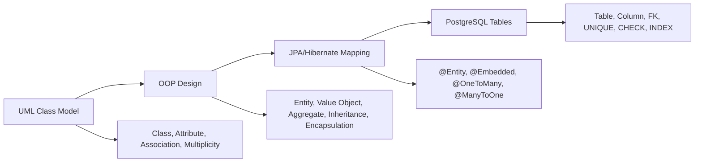

---

# 1. Core mapping: UML/OOP → JPA → SQL

| UML / OOP idea      | Java/JPA mapping                                   | PostgreSQL mapping              | Example                                    |
| ------------------- | -------------------------------------------------- | ------------------------------- | ------------------------------------------ |
| Class with identity | `@Entity`                                          | Table                           | `User` → `identity.users`                  |
| Attribute           | Field + `@Column`                                  | Column                          | `displayName` → `display_name varchar(80)` |
| Object identity     | `@Id`                                              | Primary key                     | `id uuid PRIMARY KEY`                      |
| Value object        | `@Embeddable` + `@Embedded`                        | Columns inside owner table      | `Credentials.email` → `users.email`        |
| Composition         | `@Embedded` or `@OneToOne(cascade, orphanRemoval)` | Same table or owned child table | `UserInfo` belongs to `User`               |
| Association         | `@ManyToOne`, `@OneToMany`, etc.                   | Foreign key                     | `Post.user_id → users.id`                  |
| Multiplicity `1`    | `optional = false`, `nullable = false`             | `NOT NULL` FK                   | each post must have user                   |
| Multiplicity `0..1` | nullable relationship                              | nullable FK                     | optional profile image                     |
| Multiplicity `*`    | collection                                         | child table or join table       | user has many posts                        |
| Constraint          | validation + DB constraint                         | `NOT NULL`, `UNIQUE`, `CHECK`   | email unique                               |
| Enum                | `@Enumerated(STRING)`                              | `varchar` + `CHECK`             | `ACTIVE`, `LOCKED`                         |
| Inheritance         | `@Inheritance`                                     | single table / joined tables    | `UserAccount`, `AdminAccount`              |
| Interface           | Java abstraction                                   | usually no SQL                  | `PasswordEncoder`                          |
| Method              | domain behavior                                    | usually no column               | `user.changeEmail()`                       |
| Package/module      | Java package                                       | DB schema/module                | `identity`, `social`, `dive`               |

---

# 2. User example as UML/OOP model

Use this as your visual starting point.

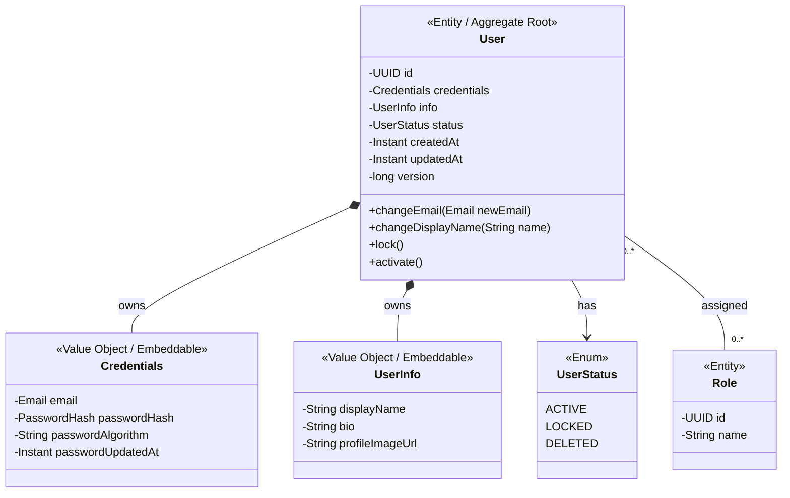

Important design point:

* `User` is an **Entity** because it has identity.
* `Credentials` is usually a **Value Object** because it belongs to one user and has no independent lifecycle.
* `UserInfo` can be `@Embedded` if it is just simple profile fields.
* `Role` should usually be a separate `@Entity`, because many users can share the same role.
* Never store `password`. Store `passwordHash`.

---

# 3. Same model as SQL/ER diagram

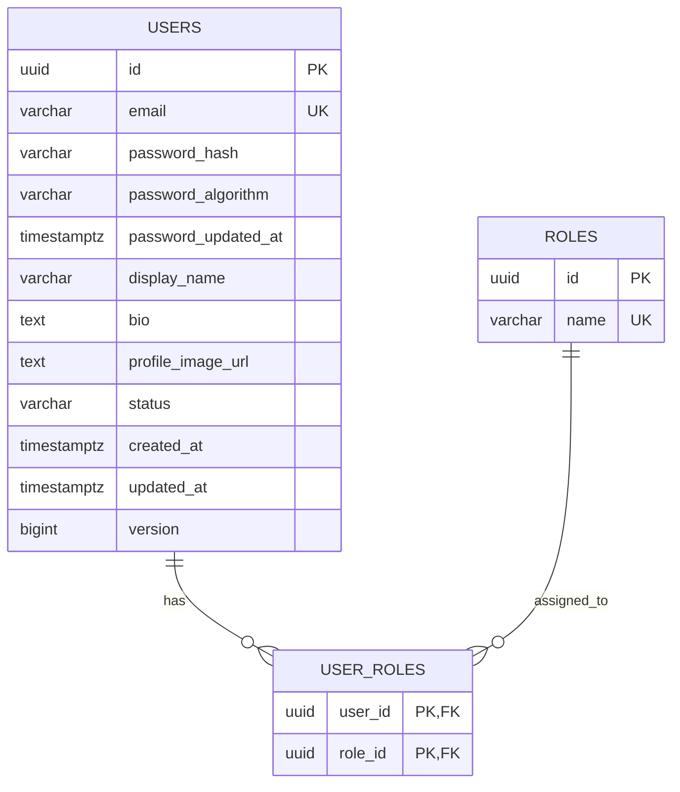

Notice the key translation:

```mermaid
flowchart TB
    A[User owns Credentials] --> B[@Embedded Credentials]
    B --> C[email, password_hash, password_algorithm columns inside users table]

    D[User has many Roles] --> E[@ManyToMany or join entity]
    E --> F[user_roles join table]
```

---

# 4. Java entity mapping

```java
@Entity
@Table(
    schema = "identity",
    name = "users",
    uniqueConstraints = {
        @UniqueConstraint(name = "uk_users_email", columnNames = "email")
    },
    indexes = {
        @Index(name = "idx_users_status", columnList = "status"),
        @Index(name = "idx_users_display_name", columnList = "display_name")
    }
)
public class User {

    @Id
    @GeneratedValue
    private UUID id;

    @Embedded
    private Credentials credentials;

    @Embedded
    private UserInfo info;

    @Enumerated(EnumType.STRING)
    @Column(nullable = false, length = 30)
    private UserStatus status = UserStatus.ACTIVE;

    @Column(name = "created_at", nullable = false, updatable = false)
    private Instant createdAt;

    @Column(name = "updated_at", nullable = false)
    private Instant updatedAt;

    @Version
    @Column(nullable = false)
    private long version;

    protected User() {
    }

    public User(Credentials credentials, UserInfo info) {
        this.credentials = credentials;
        this.info = info;
        this.status = UserStatus.ACTIVE;
        this.createdAt = Instant.now();
        this.updatedAt = Instant.now();
    }

    public void changeEmail(Email newEmail) {
        this.credentials = this.credentials.withEmail(newEmail);
        this.updatedAt = Instant.now();
    }

    public void lock() {
        this.status = UserStatus.LOCKED;
        this.updatedAt = Instant.now();
    }
}
```

---

# 5. Embeddable value object mapping

```java
@Embeddable
public class Credentials {

    @Embedded
    @AttributeOverride(
        name = "value",
        column = @Column(name = "email", nullable = false, length = 320)
    )
    private Email email;

    @Embedded
    @AttributeOverride(
        name = "value",
        column = @Column(name = "password_hash", nullable = false, length = 255)
    )
    private PasswordHash passwordHash;

    @Column(name = "password_algorithm", nullable = false, length = 40)
    private String passwordAlgorithm;

    @Column(name = "password_updated_at", nullable = false)
    private Instant passwordUpdatedAt;

    protected Credentials() {
    }

    public Credentials(Email email, PasswordHash passwordHash, String passwordAlgorithm) {
        this.email = email;
        this.passwordHash = passwordHash;
        this.passwordAlgorithm = passwordAlgorithm;
        this.passwordUpdatedAt = Instant.now();
    }

    public Credentials withEmail(Email newEmail) {
        return new Credentials(newEmail, this.passwordHash, this.passwordAlgorithm);
    }
}
```

Value object example:

```java
@Embeddable
public class Email {

    @Column(name = "email", nullable = false, length = 320)
    private String value;

    protected Email() {
    }

    public Email(String value) {
        if (value == null || value.isBlank()) {
            throw new IllegalArgumentException("Email is required.");
        }

        this.value = value.toLowerCase().trim();
    }

    public String value() {
        return value;
    }
}
```

The OOP point:

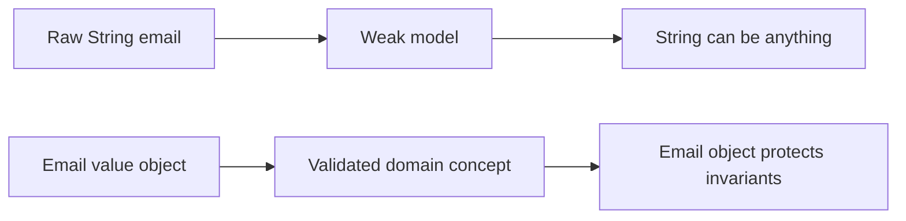

---

# 6. SQL produced conceptually

```sql
CREATE SCHEMA IF NOT EXISTS identity;

CREATE TABLE identity.users (
    id uuid NOT NULL,
    email varchar(320) NOT NULL,
    password_hash varchar(255) NOT NULL,
    password_algorithm varchar(40) NOT NULL,
    password_updated_at timestamptz NOT NULL,
    display_name varchar(80) NOT NULL,
    bio text,
    profile_image_url text,
    status varchar(30) NOT NULL,
    created_at timestamptz NOT NULL,
    updated_at timestamptz NOT NULL,
    version bigint NOT NULL DEFAULT 0,

    CONSTRAINT pk_users PRIMARY KEY (id),
    CONSTRAINT uk_users_email UNIQUE (email),
    CONSTRAINT ck_users_email_not_blank CHECK (length(trim(email)) > 0),
    CONSTRAINT ck_users_display_name_not_blank CHECK (length(trim(display_name)) > 0),
    CONSTRAINT ck_users_status CHECK (status IN ('ACTIVE', 'LOCKED', 'DELETED'))
);

CREATE INDEX idx_users_status ON identity.users(status);
CREATE INDEX idx_users_display_name ON identity.users(display_name);
```

Roles:

```sql
CREATE TABLE identity.roles (
    id uuid NOT NULL,
    name varchar(80) NOT NULL,

    CONSTRAINT pk_roles PRIMARY KEY (id),
    CONSTRAINT uk_roles_name UNIQUE (name),
    CONSTRAINT ck_roles_name_not_blank CHECK (length(trim(name)) > 0)
);

CREATE TABLE identity.user_roles (
    user_id uuid NOT NULL,
    role_id uuid NOT NULL,

    CONSTRAINT pk_user_roles PRIMARY KEY (user_id, role_id),
    CONSTRAINT fk_user_roles_user FOREIGN KEY (user_id) REFERENCES identity.users(id),
    CONSTRAINT fk_user_roles_role FOREIGN KEY (role_id) REFERENCES identity.roles(id)
);
```

---

# 7. The big visual map

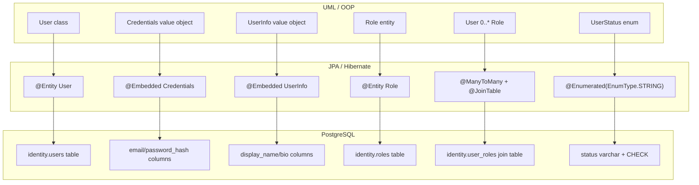

---

# 8. UML multiplicity → SQL best practices

| UML multiplicity               | Meaning                   | JPA                             | SQL                            |
| ------------------------------ | ------------------------- | ------------------------------- | ------------------------------ |
| `User 1 --> 1 Credentials`     | User owns credentials     | `@Embedded`                     | same `users` table             |
| `User 1 --> 0..1 ProfileImage` | optional relation         | nullable `@JoinColumn`          | nullable FK                    |
| `User 1 --> 1 UserInfo`        | required owned data       | `@Embedded`                     | columns `NOT NULL` if required |
| `User 1 --> * Post`            | user has many posts       | `@OneToMany(mappedBy = "user")` | FK on `posts.user_id`          |
| `Post * --> 1 User`            | many posts belong to user | `@ManyToOne(optional = false)`  | `user_id NOT NULL FK`          |
| `User * --> * Role`            | many-to-many              | `@ManyToMany` or join entity    | join table                     |
| `User 1 --> * LoginEvent`      | audit/history             | `@OneToMany`                    | child table with FK            |

Visual:

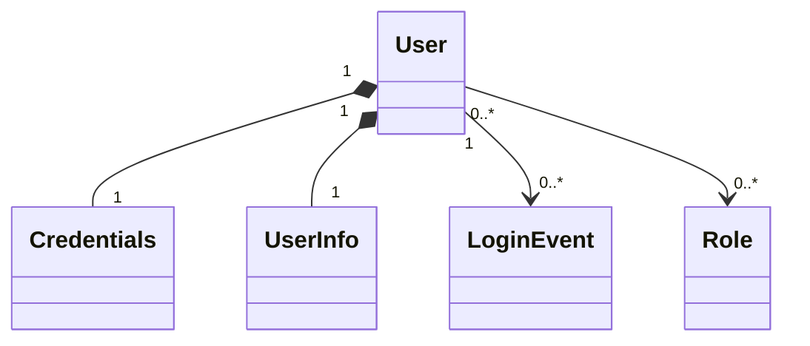

SQL equivalent:

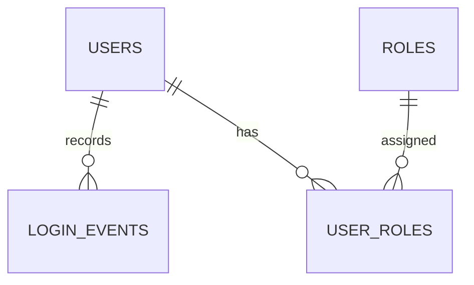

---

# 9. OOP principles → persistence design

## Encapsulation

Bad:

```java
user.setStatus(UserStatus.DELETED);
user.setEmail("bad value");
```

Better:

```java
user.changeEmail(new Email("a@example.com"));
user.delete();
```

Database equivalent:

```sql
email varchar(320) NOT NULL,
status varchar(30) NOT NULL,
CONSTRAINT ck_users_status CHECK (status IN ('ACTIVE', 'LOCKED', 'DELETED'))
```

Meaning:

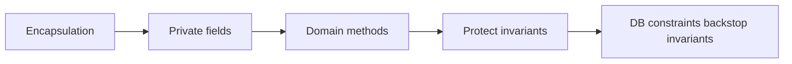

---

## Abstraction

Java has clean domain concepts:

```java
Email
PasswordHash
Credentials
UserInfo
```

SQL stores primitive durable facts:

```sql
email varchar(320)
password_hash varchar(255)
display_name varchar(80)
```

Abstraction means your app thinks in **domain objects**, not random strings.

---

## Composition

`User` owns `Credentials`.

```java
@Embedded
private Credentials credentials;
```

SQL:

```sql
email varchar(320) NOT NULL,
password_hash varchar(255) NOT NULL
```

Composition rule:

> If the child has no independent identity and dies with the parent, use `@Embedded` or owned child table.

---

## Inheritance

Use carefully.

Bad default:

```java
class Admin extends User
class Diver extends User
class Instructor extends User
```

This often becomes messy in SQL.

Usually better:

```java
User has Roles
User has Profile
InstructorProfile belongs to User
```

Better SQL:

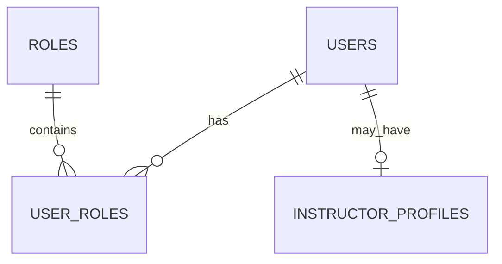

Rule:

> Prefer composition and roles over inheritance for users.

---

## Polymorphism

Good place for polymorphism:

```java
interface PasswordEncoder {
    PasswordHash encode(String rawPassword);
}
```

No SQL table needed.

Bad place for polymorphism:

```java
User superclass with 10 subclasses just because users behave slightly differently.
```

Use polymorphism for **behavior**, not every data variation.

---

# 10. Data type map: Java/OOP → PostgreSQL

| Domain concept | Java type            | JPA mapping                          | PostgreSQL type      |
| -------------- | -------------------- | ------------------------------------ | -------------------- |
| Entity ID      | `UUID`               | `@Id @GeneratedValue`                | `uuid`               |
| Name/title     | `String`             | `@Column(length = 80)`               | `varchar(80)`        |
| Long text      | `String`             | `@Column(columnDefinition = "text")` | `text`               |
| Email          | `Email` value object | `@Embeddable`                        | `varchar(320)`       |
| Password hash  | `PasswordHash`       | `@Embeddable`                        | `varchar(255)`       |
| Money          | `BigDecimal`         | `precision`, `scale`                 | `numeric(12,2)`      |
| Count          | `int` / `long`       | normal column                        | `integer` / `bigint` |
| Boolean        | `boolean`            | normal column                        | `boolean`            |
| Timestamp      | `Instant`            | normal column                        | `timestamptz`        |
| Date only      | `LocalDate`          | normal column                        | `date`               |
| Enum           | `enum`               | `@Enumerated(STRING)`                | `varchar` + `CHECK`  |
| JSON metadata  | POJO / `Map`         | Hibernate JSON mapping               | `jsonb`              |
| File/image     | `String` URL/key     | normal column                        | `text`               |

Best defaults for your apps:

| Use case    | Prefer                                       |
| ----------- | -------------------------------------------- |
| IDs         | `UUID`                                       |
| Timestamps  | `Instant` in Java, `timestamptz` in Postgres |
| Enums       | `EnumType.STRING` + SQL `CHECK`              |
| Money       | `BigDecimal` + `numeric(p,s)`                |
| Large media | S3 key in DB, not `bytea`                    |
| Passwords   | hash only, never raw password                |

---

# 11. Entity vs value object decision tree

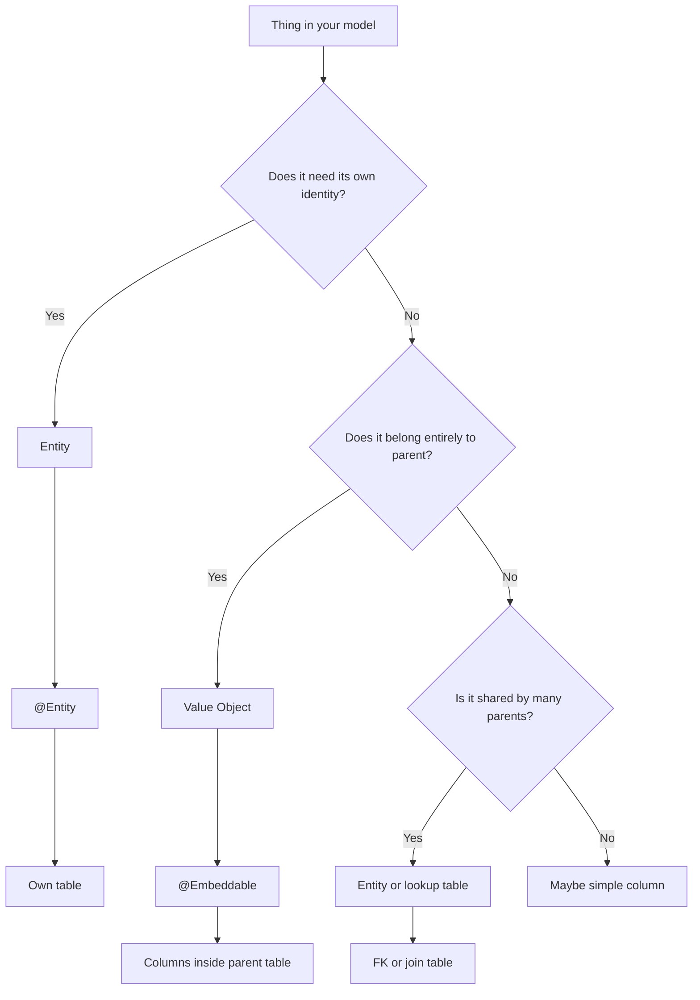

Apply to `User`:

| Concept        | Entity or value object? | Why                                     |
| -------------- | ----------------------- | --------------------------------------- |
| `User`         | Entity                  | Has identity and lifecycle              |
| `Credentials`  | Value object            | Owned by user                           |
| `Email`        | Value object            | Validated domain value                  |
| `PasswordHash` | Value object            | Validated secure value                  |
| `UserInfo`     | Value object            | Usually owned by user                   |
| `Role`         | Entity / lookup         | Shared across users                     |
| `LoginEvent`   | Entity                  | Own historical record                   |
| `Address`      | Depends                 | Embedded if one owner, entity if reused |

---

# 12. Best-practice final shape for `User`

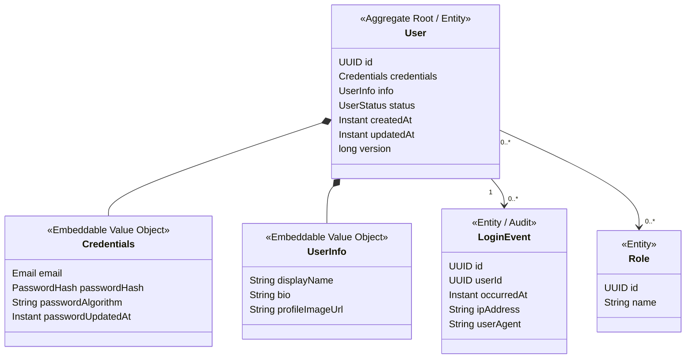

Database shape:

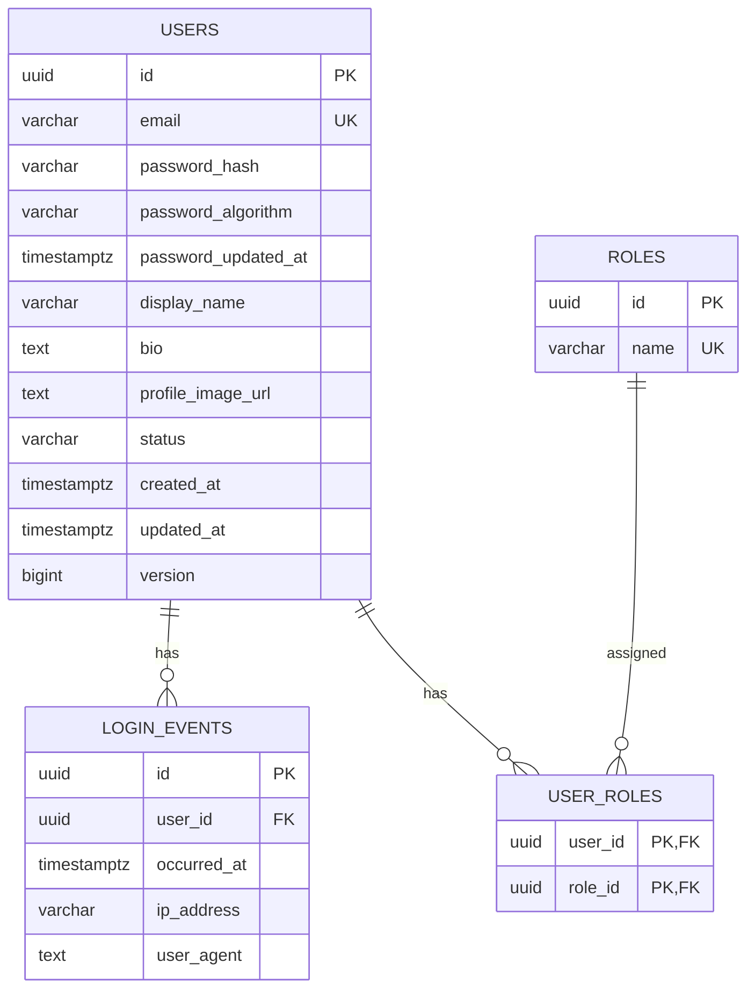

---

# 13. The visual learning method

For every domain object, draw this card:

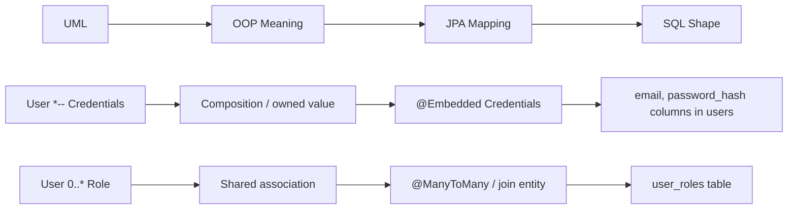

Use this template:

```md
## Concept: Credentials

UML:
User *-- Credentials

OOP:
Credentials is a value object owned by User.

JPA:
@Embeddable Credentials
@Embedded private Credentials credentials;

SQL:
email varchar(320) NOT NULL
password_hash varchar(255) NOT NULL
password_algorithm varchar(40) NOT NULL

Best practice:
No raw password. Store only password hash.
```

---

# 14. High-level rule set

Use this as your cheat sheet:

| Question                                     | Best answer                              |
| -------------------------------------------- | ---------------------------------------- |
| Does it have identity?                       | `@Entity` + table                        |
| Is it just descriptive data owned by parent? | `@Embeddable`                            |
| Is it shared by many things?                 | Separate table                           |
| Is it optional?                              | nullable FK/column                       |
| Is it required?                              | `nullable = false` + `NOT NULL`          |
| Is it unique?                                | unique constraint                        |
| Is it a list of children?                    | child table with FK                      |
| Is it many-to-many?                          | join table, or better, join entity       |
| Is it behavior only?                         | method/service/interface, no SQL         |
| Is it security-sensitive?                    | separate auth boundary, hash/token table |
| Is it historical/audit data?                 | separate event/history table             |

Progress: **55%** toward the full OOP → JPA → SQL mental model.

Next goal: model one real domain from your app, probably `User`, `Post`, or `DiveLocation`, using this exact flow:

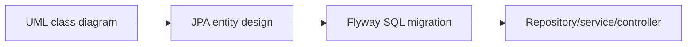

That gets you from idea to implementation without drowning in docs.
