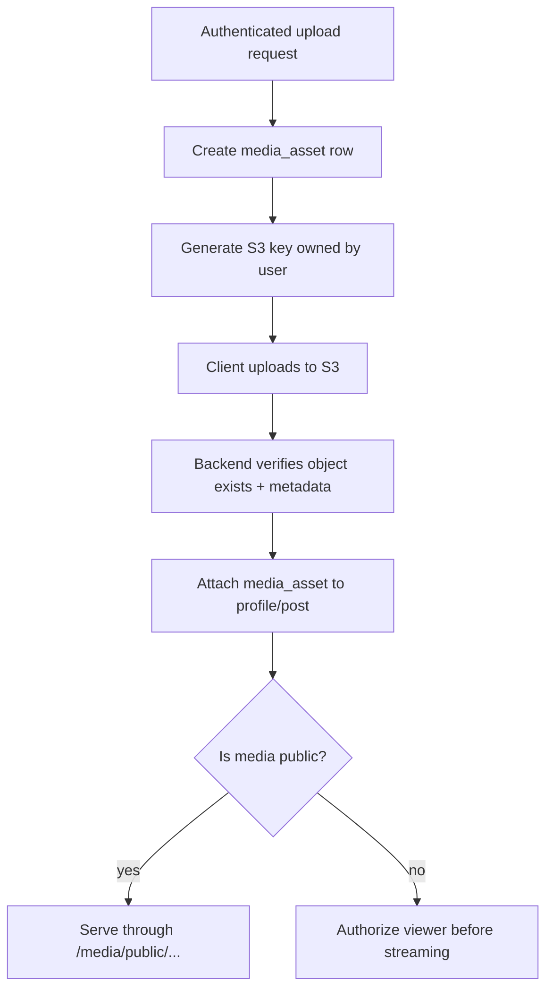
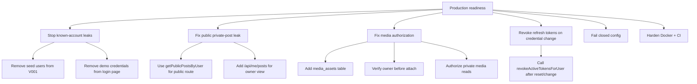

I reviewed the `ground-breaking-changes` backend under `/app`, which matches your repo layout for the Spring Boot + Thymeleaf backend. 

**Progress: 70% production-readiness review complete.** I focused on the highest-risk backend areas: config, auth/JWT, password reset, security filters, migrations, media/S3, public APIs, admin APIs, Docker, and tests.

## Highest priority fixes before production

### 1. Remove seeded production users and demo credentials immediately

This is the biggest production leak.

Your first Flyway migration creates real users, including admin/demo/personal-looking accounts, with pre-baked password hashes.  Your public login page also displays demo credentials directly: `admin / admin123` and `maya_dives / password`. 

This means a production database bootstrapped from migrations would contain known accounts unless you surgically remove or override them.

**Fix:**

Move seed data out of normal Flyway migrations.

Recommended structure:

```text
src/main/resources/db/migration/        # schema only, production-safe
src/main/resources/db/dev-migration/    # demo/dev seed data only
```

Then in `application-dev.properties`:

```properties
spring.flyway.locations=classpath:db/migration,classpath:db/dev-migration
```

And in prod keep:

```properties
spring.flyway.locations=classpath:db/migration
```

Also remove demo credentials from `login.html`. Production UI should never teach attackers your sample passwords.

---

### 2. Private post media is effectively public if the URL is known

`/media/**` is explicitly public in the web security chain.  The public media controller streams any object key under `/media/**` with public caching for 30 days.  Meanwhile `MediaStorageService.publicUrlForKey()` always returns a public `/media/...` URL. 

This is okay for public avatars, but not okay for **private post images**. If a private post’s image URL is copied, leaked, logged, or guessed from a client response, the media endpoint does not check whether the current viewer can see the post.

**Fix:**

Treat media as owned assets, not just S3 keys.



Add a `media_assets` table with `owner_user_id`, `object_key`, `purpose`, `visibility`, `scan_status`, `attached_entity_type`, `attached_entity_id`, `created_at`.

---

### 3. Users can attach someone else’s uploaded media if they know the key

The upload flow writes uploader metadata into S3: `uploader-user-id` and `upload-purpose`.  But post creation only normalizes URLs and stores them; it does not verify the media belongs to the current user. 

So ownership is implied by obscurity, not enforced.

**Fix:**

Before attaching a media URL to a post/profile, verify ownership against a DB record or S3 object metadata. Better: never let the client submit arbitrary media URLs. Let the client submit `mediaAssetId`.

---

### 4. Password reset/change does not revoke existing refresh tokens

You have a good refresh-token rotation model, and refresh tokens are hashed in the DB.  You also already wrote `revokeAllRefreshTokens(...)`. 

But password reset only changes the password hash and marks the reset token used.  Current-user password change does the same. 

That means if a refresh token was stolen before a password reset, it may remain usable after the password reset.

**Fix:**

After successful password reset or password change, revoke all active refresh tokens for that user. Ideally also add a `token_version` or `credentials_changed_at` claim to JWTs if you want immediate access-token invalidation.

---

### 5. Public endpoint leaks private posts by user

`GET /api/posts/users/{userId}` is public because GET `/api/posts/**` is permitted.  The controller calls `postService.getPostsByUser(...)`.  That service method fetches **all posts by user**, not only public posts. 

You already have a safer method, `getPublicPostsByUser(...)`, but the controller is not using it. 

**Fix now:**

```java
@GetMapping("/users/{userId}")
public PageResponse<FeedPostView> getByUser(@PathVariable Long userId,
                                             @RequestParam(defaultValue = "0") int page,
                                             @RequestParam(defaultValue = "12") int size) {
    return PageResponse.from(postService.getPublicPostsByUser(userId, pageable(page, size)));
}
```

For authenticated owners, add a separate `/api/me/posts` endpoint that returns their own private posts.

---

## Important production concerns

### 6. JWT secret has a dev default in base config

Base `application.properties` includes:

```properties
app.security.jwt.secret=${JWT_SECRET:dev-only-scuba-pal-jwt-secret-change-me-please-32b}
```


Prod overrides this with `${JWT_SECRET}`, which is good.  But the base default means a wrong deployment profile could boot with a known signing secret.

**Fix:**

Make the base config fail closed:

```properties
app.security.jwt.secret=${JWT_SECRET}
```

Put the dev secret only in `application-dev.properties` or `src/test/resources/application.properties`.

---

### 7. Hardcoded S3 bucket fallback leaks environment/account naming

`MediaStorageProperties` has a real-looking hardcoded bucket fallback:

```java
scuba-pal-media-user-uploads-test-817455142561-us-west-2-an
```

 It repeats again if bucket is blank. 

That is a production smell. Config should fail if missing, not silently point to a test bucket.

**Fix:**

Remove S3 defaults from the properties record. Let Spring fail on missing config. Keep examples in `.env.example`, not code.

---

### 8. Password reset link can leak through logs/history/referrers

Reset links are built as query params: `/reset-password?token=...`.  Query tokens are common, but they can appear in browser history, reverse-proxy logs, analytics, and referrer headers.

Also, the console fallback email service logs the entire reset email body including the reset link. 

**Fix:**

Make the fallback email service dev-only:

```java
@Profile("dev")
@Service
public class ConsoleFallbackEmailService implements EmailService { ... }
```

Also add security headers:

```java
.referrerPolicy(referrer -> referrer.policy(ReferrerPolicyHeaderWriter.ReferrerPolicy.NO_REFERRER))
```

And do not log reset URLs.

---

### 9. Rate limiting is useful but not production-grade

The new auth rate limiter is a good start. It limits auth endpoints to 20 attempts per minute.  But it stores counters in memory, so it does not work correctly across multiple app instances. It also trusts `X-Forwarded-For` directly. 

**Fix:**

For production, put rate limiting at the edge first: CloudFront/WAF/API Gateway/ALB rules. In-app, use Redis-backed buckets if you need application-aware limits.

Also only trust forwarded headers if your app is behind a trusted proxy and configure:

```properties
server.forward-headers-strategy=framework
```

---

### 10. Hibernate schema validation may fail due entity/migration mismatch

`User.email` is mapped as length `320`.  But the migration creates `email VARCHAR(255)`.  Since prod uses `ddl-auto=validate`, this can break startup. 

Also your base timestamp entities use `LocalDateTime`.  But migrations use `TIMESTAMPTZ`.  For production, prefer `Instant` for audit fields if the DB column is `TIMESTAMPTZ`.

**Fix:**

Either:

```sql
email VARCHAR(320)
```

or:

```java
@Column(nullable = false, unique = true, length = 255)
private String email;
```

I’d use `VARCHAR(320)` because that matches the email validation.

---

### 11. Dockerfile is not production-hardened yet

The Dockerfile builds with tests skipped.  The runtime image does not create a non-root user, so the app likely runs as root by default.  Spring Boot 4.0.6 is officially current/stable and compatible with Java 25, so the version itself is valid, but the ecosystem is still newer than the conservative Spring Boot 3.5 line. ([Home][1])

**Fix:**

Use tests in CI/build, run as non-root, and prefer a pinned digest for production images.

Example direction:

```dockerfile
RUN addgroup -S app && adduser -S app -G app
USER app
ENTRYPOINT ["java", "-XX:MaxRAMPercentage=75", "-jar", "app.jar"]
```

---

## Medium priority cleanup

### 12. OpenAPI contact exposes personal email

OpenAPI config includes your name and personal email.  Since Swagger is disabled in prod, this is less urgent.  But generated mobile docs or staging docs may still expose it.

Use `support@scubapal.com` or remove contact until you have a domain mailbox.

---

### 13. CORS defaults are dev-oriented

Security config defaults allowed origins to localhost values.  Prod config does not override `app.cors.allowed-origins`. 

CORS is not primary security, but production should be explicit.

```properties
app.cors.allowed-origins=https://scubapal.com,https://app.scubapal.com
```

---

### 14. Tests are not yet catching production security regressions

The current auth controller test mostly verifies delegation and happy paths.  Post controller tests cover pagination/feed/like behavior, but not the private-post leak. 

Add integration tests for:

```text
anonymous cannot see private post by user
anonymous cannot fetch private media
password reset revokes refresh tokens
password change revokes refresh tokens
admin seed user is not present in prod profile
swagger disabled in prod
JWT default secret cannot boot prod
```

---

## What I’d fix first



## Next goal

**Get to 85% production readiness by fixing the four security blockers first:**

1. remove seed users/demo credentials from production path
2. change `/api/posts/users/{userId}` to public-only posts
3. revoke refresh tokens on password reset/change
4. remove default JWT/S3 production fallbacks

After that, the next major goal is **media ownership + private media authorization**, which is the biggest architectural gap.

[1]: https://docs.spring.io/spring-boot/system-requirements.html "System Requirements :: Spring Boot"
