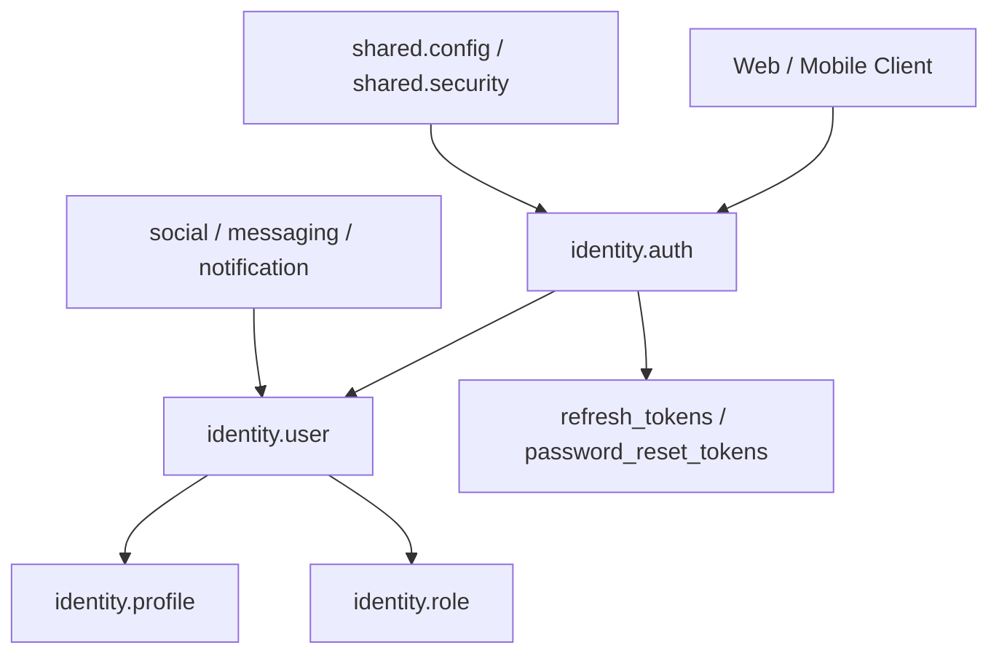

I reviewed the `ground-breaking-changes` branch directly. The branch exists; branch search missed it, but direct branch fetch worked.

## Verdict

**Progress: ~70% toward a production-clean identity module.**
Your branch is much better than the older shape. You already split identity into clearer pieces: `AuthService`, `PasswordResetService`, `JwtTokenService`, `CurrentUserService`, `UserAdminService`, `IdentityQueryService`, and `ProfileService`. That is the right direction.

Do **not** move auth directly under `com.scubapal`. Keep root `com.scubapal` clean. `auth`, `user`, `profile`, and `role` belong under the **identity bounded context**.

## Should `users` become `accounts`?

**Keep the database table as `identity.users`.** Your app uses plural table names, and the current entity explicitly maps to `identity.users` with `user_id` as the primary key override. 

Conceptually:

```text
users      = login-capable identity principal
profiles   = public diver/persona data
roles      = authorization category
```

That split is already visible in your schema: `identity.users` contains email, username, password hash, role, active flag, verification/login timestamps, while `identity.profiles` contains public/person fields like name, city, country, DOB, dive count, bio, and profile image. 

I would **not rename the table to `accounts` right now**. Rename only if you decide the core domain language is:

```text
Account = login/security object
User/Profile/Diver = social/public object
```

For Scuba Pal, `User` + `Profile` is clear enough. In UI copy, say “account settings.” In database/code, `users` is fine.

## Should auth move out of `identity`?

**No. Keep this:**

```text
com.scubapal.identity.auth
com.scubapal.identity.user
com.scubapal.identity.profile
com.scubapal.identity.role
```

Auth is not generic infrastructure in your app. It creates users, checks usernames, records logins, issues refresh tokens, resets passwords, and depends directly on identity tables. Your branch’s `AuthController` depends on `AuthService`, `PasswordResetService`, `JwtTokenService`, and `AuthenticationManager`, which confirms auth is part of identity, not a root-level module. 

Keep **cross-cutting Spring Security config** under `shared.config` or `shared.security`. Your `SecurityConfig` is currently under `com.scubapal.shared.config`, which is fine because it wires app-wide API/web filter chains, JWT encoder/decoder, CORS, and password encoder. 

## Recommended directory structure

I would shape identity like this:

```text
app/src/main/java/com/scubapal
├── ScubaPalApplication.java
├── identity
│   ├── auth
│   │   ├── AuthController.java
│   │   ├── AuthService.java
│   │   ├── JwtTokenService.java
│   │   ├── PasswordResetService.java
│   │   ├── RefreshToken.java
│   │   ├── RefreshTokenRepository.java
│   │   ├── PasswordResetToken.java
│   │   ├── PasswordResetTokenRepository.java
│   │   ├── TokenHashing.java
│   │   ├── AuthResponse.java
│   │   ├── LoginRequest.java
│   │   ├── RegisterRequest.java
│   │   ├── RefreshTokenRequest.java
│   │   ├── ForgotPasswordRequest.java
│   │   └── ResetPasswordRequest.java
│   ├── user
│   │   ├── User.java
│   │   ├── UserRepository.java
│   │   ├── CurrentUserController.java
│   │   ├── CurrentUserService.java
│   │   ├── UserAdminController.java
│   │   ├── UserAdminService.java
│   │   ├── IdentityQueryService.java
│   │   ├── IdentityMapper.java
│   │   ├── CurrentUserView.java
│   │   ├── PublicUserView.java
│   │   ├── AdminUserView.java
│   │   └── request/view records
│   ├── profile
│   │   ├── Profile.java
│   │   ├── ProfileRepository.java
│   │   ├── ProfileController.java
│   │   ├── ProfileService.java
│   │   ├── ProfileResponse.java
│   │   ├── PublicProfileResponse.java
│   │   └── UpsertProfileRequest.java
│   └── role
│       ├── Role.java
│       ├── RoleRepository.java
│       └── RoleNames.java
├── shared
│   ├── api
│   ├── config
│   ├── domain
│   ├── exception
│   ├── mail
│   └── security
├── social
├── dive
├── messaging
├── notification
├── media
└── learn
```

This follows **package by feature**, not package by layer. For your app, that is more maintainable than global folders like `controller`, `service`, `repository`, `dto`.



## What is already good on the branch

Your branch already made the most important architectural improvement: **current-user behavior and admin-user behavior are separated**. `CurrentUserController` exposes `/api/me`, `/api/me/settings`, and `/api/me/password` for the authenticated user.  `UserAdminController` exposes `/api/admin/users` and is guarded with `@PreAuthorize("hasRole('ADMIN')")`. 

Password reset is also much better now. It generates a random raw token, stores only a hash, invalidates older unused reset tokens for the user, and marks a token used after reset. 

Refresh tokens are also moving in the right production direction: raw refresh tokens are hashed, rotation uses a pessimistic write lock, revoked tokens are tracked, and replacements are linked by hash.  

JWT resource-server wiring is also cleaner than Basic Auth. The API chain is stateless, uses JWT resource server support, and maps `roles` claims into `ROLE_` authorities.  

## Things I would fix before calling identity production-ready

### 1. Fix the email column length mismatch

Your entity says email is length `320`. 
Your migration creates `email VARCHAR(255)`. 

That is a real schema drift issue.

Best fix:

```sql
ALTER TABLE identity.users
ALTER COLUMN email TYPE VARCHAR(320);
```

If this branch has not been shared/deployed yet, update `V001`. If it has already run anywhere persistent, add a new Flyway migration instead.

### 2. Remove duplicate email/username indexes from the entity

Your entity adds `idx_users_email` and `idx_users_username`. 
But both columns are already `UNIQUE` in the migration, and unique constraints already create indexes in PostgreSQL. 

I would remove these from `@Table(indexes = ...)` unless you intentionally want custom-named unique indexes.

### 3. Add `SHOP_OWNER` to `RoleNames`

Your seed data has `SHOP_OWNER`. 
Your security config checks `SHOP_OWNER`. 
But `RoleNames` only defines `USER`, `ADMIN`, and `MODERATOR`. 

Add:

```java
public static final String SHOP_OWNER = "SHOP_OWNER";
```

### 4. Move the default JWT secret out of base `application.properties`

Right now base config has a dev fallback secret:

```properties
app.security.jwt.secret=${JWT_SECRET:dev-only-scuba-pal-jwt-secret-change-me-please-32b}
```

That means production could accidentally boot with a known default secret if `JWT_SECRET` is missing. 

Use this in base:

```properties
app.security.jwt.secret=${JWT_SECRET}
```

Then put the dev fallback only in `application-dev.properties`.

### 5. Rename password reset `token` to `tokenHash`

The service stores a hash in the reset token entity. 
But the entity field and column are still named `token`. 

That is misleading. Prefer:

```java
@Column(name = "token_hash", nullable = false, unique = true, length = 64)
private String tokenHash;
```

Then update the repository methods to `findByTokenHash...`.

### 6. Reuse `TokenHashing` in `PasswordResetService`

You already have a `TokenHashing.sha256(...)` helper for refresh tokens. 
`PasswordResetService` currently duplicates SHA-256 hashing logic. 

Use the helper in both places.

### 7. Clarify login identifier semantics

`LoginRequest` calls the field `username`, but allows up to 320 chars. 
`AuthService.recordSuccessfulLogin` only looks up by username, not email. 

Pick one:

```java
// username-only login
@NotBlank @Size(max = 60) String username
```

or:

```java
// email-or-username login
@NotBlank @Size(max = 320) String identifier
```

For product polish, I would use `identifier` and allow either email or username.

### 8. Use `Instant` for security timestamps

`User` currently uses `LocalDateTime` for `emailVerifiedAt` and `lastLoginAt`.  
Your database uses `TIMESTAMPTZ`. 

For auth/security timestamps, prefer `Instant`. You are already using `Instant` for refresh tokens and reset tokens, so identity becomes more consistent. 

## Best-practice target

Your identity module should have these boundaries:

```text
AuthService
- register
- login bookkeeping
- username/email availability
- does not own profile editing
- does not own admin user management

JwtTokenService
- access token creation
- refresh token creation/rotation/revocation
- no registration business logic

PasswordResetService
- reset token issuing
- reset token validation
- password update through reset flow only

CurrentUserService
- /api/me
- settings
- change password with current password

UserAdminService
- admin create/update/deactivate users
- admin list/search users

ProfileService
- public profile reads
- current user profile update
- admin profile update
```

You are very close to this already.

## Final recommendation

Keep:

```text
identity.users
com.scubapal.identity.user.User
com.scubapal.identity.auth
com.scubapal.identity.profile
com.scubapal.identity.role
```

Do **not** rename everything to `accounts` yet. Do **not** move auth into root `com.scubapal`.

Next goal: **finish the identity hardening pass** by fixing schema drift, JWT default secret, role constants, token naming, and login identifier semantics. That gets identity from ~70% to ~85–90% production-ready.
