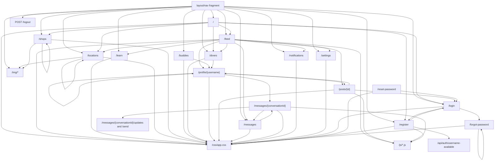

# Thymeleaf Web Route Map

This map covers the Thymeleaf web surface under `scubapal-app/src/main/resources/templates` and the Spring MVC routes that render or receive those pages.

## Page Routes

| Route | Template | Controller | Primary outbound targets |
| --- | --- | --- | --- |
| `GET /` | `index.html` | `HomePageController#home` | `/feed`, `/register`, `/login`, `/divers`, `/locations`, `/shops` |
| `GET /feed` | `social/feed.html` | `PostPageController#feed` | `/feed`, `#compose`, `/locations`, `/learn`, `/divers`, `/messages`, `/notifications`, `/settings`, `/posts/{postId}`, `/profile/{username}` |
| `POST /posts` | form target | `PostPageController#createPost` | redirects `/feed` |
| `GET /posts/{id}` | `social/post-detail.html` | `PostPageController#postDetail` | `/profile/{username}`, `/login` |
| `POST /posts/{id}/like` | form/AJAX target | `PostPageController#toggleLike` and `#toggleLikeFetch` | redirects `/posts/{id}` or returns JSON |
| `POST /posts/{id}/comments` | form target | `PostPageController#addComment` | redirects `/posts/{id}` |
| `GET /learn` | `learn/index.html` | `LearnPageController#learn` | browser history back only |
| `GET /locations` | `dive/locations.html` | `LocationPageController#locations` | `/locations?city=...&page=...&size=...`, `/img/dive-location-placeholder.svg` |
| `GET /shops` | `dive/shops.html` | `DiveShopPageController#shops` | `/shops?q=...&page=...&size=...`, external shop `websiteUrl`, `/img/dive-location-placeholder.svg` |
| `GET /buddies` | `social/buddies.html` | `ProfilePageController#buddies` | `/buddies`, `/profile/{username}` |
| `GET /divers` | `social/divers.html` | `ProfilePageController#divers` | `/profile/{username}` |
| `GET /profile/{username}` | `social/profile.html` | `ProfilePageController#profile` | `/profile/{username}/follow`, `/profile/{username}/unfollow`, `/messages/start/{userId}`, `/profile/{follower}`, `/profile/{following}`, `/posts/{postId}` |
| `POST /profile/{username}/follow` | form target | `ProfilePageController#follow` | redirects canonical `/profile/{username}` |
| `POST /profile/{username}/unfollow` | form target | `ProfilePageController#unfollow` | redirects canonical `/profile/{username}` |
| `POST /messages/start/{userId}` | form target | `MessagingPageController#start` | redirects `/messages/{conversationId}` |
| `GET /messages` | `messaging/messages.html` | `MessagingPageController#messages` | `/messages/{conversationId}`, `/messages?page=...&size=...` |
| `GET /messages/{conversationId}` | `messaging/conversation.html` | `MessagingPageController#conversation` | `/messages`, `/messages/{conversationId}/updates`, `/messages/{conversationId}/send` |
| `POST /messages/{conversationId}` | non-JS form fallback | `MessagingPageController#send` | redirects `/messages/{conversationId}` |
| `POST /messages/{conversationId}/send` | AJAX target | `MessagingPageController#sendJson` | returns JSON |
| `GET /messages/{conversationId}/updates` | AJAX target | `MessagingPageController#updates` | returns JSON |
| `GET /notifications` | `notification/notifications.html` | `NotificationPageController#notifications` | `/notifications?page=...&size=...` |
| `GET /settings` | `auth/settings.html` | `SettingsPageController#settings` | `/settings` |
| `POST /settings` | form target | `SettingsPageController#update` | redirects `/settings` |
| `GET /login` | `auth/login.html` | `AuthPageController#login` | `/login`, `/forgot-password`, `/register` |
| `POST /login` | Spring Security form target | `SecurityConfig#webSecurityFilterChain` | defaults `/feed` |
| `GET /register` | `auth/register.html` | `AuthPageController#register` | `/register`, `/login`, `/api/auth/username-available` |
| `POST /register` | form target | `AuthPageController#register` | redirects `/login` |
| `GET /forgot-password` | `auth/forgot-password.html` | `AuthPageController#forgotPassword` | `/forgot-password` |
| `POST /forgot-password` | form target | `AuthPageController#forgotPassword` | redirects `/forgot-password` |
| `GET /reset-password` | `auth/reset-password.html` | `AuthPageController#resetPassword` | `/reset-password` |
| `POST /reset-password` | form target | `AuthPageController#resetPassword` | redirects `/login` |
| `POST /logout` | nav/feed form target | `SecurityConfig#webSecurityFilterChain` | redirects `/?logout` |

## Shared Includes And Assets

| Source | Points to |
| --- | --- |
| `layout/nav.html` | `/`, `/feed`, `/learn`, `/locations`, `/shops`, `/buddies`, `/divers`, `/messages`, `/notifications`, `/settings`, `/logout`, `/login`, `/register`, `/img/logo/2026-05-23/scubapal-manta-logo-navbar-header.png` |
| All pages | `/css/app.css` |
| `auth/register.html` | `/js/register.js` |
| `social/feed.html`, `social/post-detail.html` | `/js/feed.js` |
| `messaging/conversation.html` | `/js/messages.js` |
| `dive/locations.html`, `dive/shops.html` | `/img/dive-location-placeholder.svg` fallback |

## Graph

## Broken Links Fixed

| Problem | Fix |
| --- | --- |
| Homepage Dive Shops card pointed to `/locations` even though shop discovery exists as its own product area. | Added `GET /shops`, `dive/shops.html`, public security access, nav entry, and changed the homepage card to `/shops`. |
| Feed sidebar `Learn` pointed to `/locations`. | Changed it to `/learn`; kept map discovery on `/locations` with clearer text. |
| Location cards referenced `/img/dive-location-placeholder.svg`, but the asset was missing. | Added the placeholder SVG and reused it for shop cards with missing images. |
